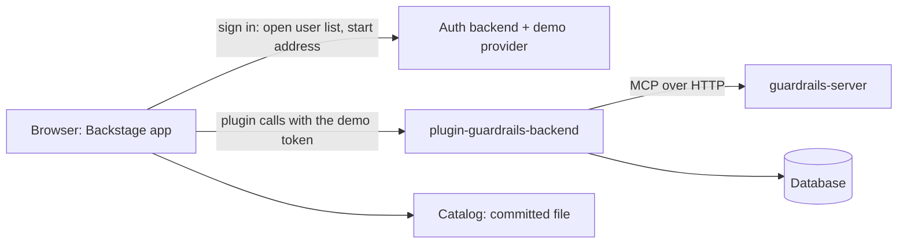

# Backstage guardrails sample

A sample project that puts a guardrails tool server inside a Backstage service catalog. It surfaces two kinds of work for a service, **dependency-upgrade planning** and **CI failure triage**, on the service's catalog page, and it lets a person propose and decide changes through an **approval-gated write flow** with an **audit log** that is visible in the UI.

Everything runs on invented data and locally (docker compose, with minikube as an option). Nothing here is deployed automatically, and nothing is meant to be hosted without the changes listed under [Known limits](#known-limits).

> **Read this first: the demo sign-in is passwordless.** When it is on, anyone who can open the page can sign in as any of the three demo users. It is off unless you turn it on, and it must be replaced with a real sign-in provider before any hosted use. See [The demo users and the sign-in risk](#the-demo-users-and-the-sign-in-risk).

## Contents

- [What is in the project](#what-is-in-the-project)
- [How the parts fit together](#how-the-parts-fit-together)
- [The demo users and the sign-in risk](#the-demo-users-and-the-sign-in-risk)
- [Quick start](#quick-start)
- [Settings and environment variables](#settings-and-environment-variables)
- [Run modes](#run-modes)
- [The catalog and the seed](#the-catalog-and-the-seed)
- [Testing](#testing)
- [Continuous integration](#continuous-integration)
- [Folder layout](#folder-layout)
- [Contracts between the units](#contracts-between-the-units)
- [Look and theme](#look-and-theme)
- [Known limits](#known-limits)
- [Troubleshooting](#troubleshooting)
- [Status of the project](#status-of-the-project)
- [Built with AI-DLC](#built-with-ai-dlc)

## What is in the project

The project is built from six units of work. Each unit has its own design record under `aidlc/` and its own tests.

| Unit | Package or folder                                  | What it is                                                                                                      |
| ---- | -------------------------------------------------- | --------------------------------------------------------------------------------------------------------------- |
| u1   | `packages/guardrails-server`                       | A synthetic MCP server with four tools, and the seeded generator that feeds it                                  |
| u2   | `packages/plugin-guardrails-backend`               | The Backstage backend plugin: change workflow, approvals, append-only audit log, demo sign-in provider          |
| u3   | `packages/plugin-guardrails`                       | The Backstage frontend plugin: overview card, Guardrails tab, change detail, demo-user switch                   |
| u4   | `packages/app`, `packages/backend`                 | The host Backstage app: loads both plugins, the demo sign-in page, the catalog of the seeded services, settings |
| u5   | `compose.yaml`, `packages/e2e` and the CI workflow | Runs the whole sample with docker compose, the real-browser checks and the shared CI workflow                   |
| u6   | `k8s/` and the minikube scripts                    | Runs the sample on a local minikube cluster, with the same end-to-end check as compose                          |

Work after the six units, each a short pull request into `main`:

| Change | What it did                                                                                                                                       |
| ------ | ------------------------------------------------------------------------------------------------------------------------------------------------- |
| u7     | Turned off the content policy's `upgrade-insecure-requests` so Safari loads the app over `http://localhost` (see [Known limits](#known-limits))   |
| u8     | The UI redesign: Backstage's stylesheet, dark by default, a visible light/dark switch, no clipped layouts (see [Look and theme](#look-and-theme)) |
| u9     | Workflow records for the redesign (no application code)                                                                                           |
| u10    | Shows the whole "Starred" label in the catalog filter list                                                                                        |

This README was started in u4, the first unit where the whole application runs. It is kept in step with the code: a change that alters how the project is run, looks or is checked updates it in the same pull request.

## How the parts fit together



Text fallback: the browser shows the Backstage app (u4) with the guardrails frontend plugin (u3). It signs in through the auth backend's demo provider (u2's sign-in module, loaded by u4). The frontend plugin calls the guardrails backend plugin (u2) with the demo user's token. The backend plugin keeps changes and the audit log in a database and reaches the guardrails server (u1) only through its four MCP tools. The catalog lists the seeded services from a committed file.

What the app decides and what it does not:

- **The backend plugin decides every rule**: who may propose or decide, which status allows which action, one decision per change, no self-approval, what is audited. The browser only shows what the backend says is allowed.
- **The app (u4) holds wiring and configuration only.** It contains no business rule.
- **The audit log is append-only.** There is no route that edits or deletes an entry.

## The demo users and the sign-in risk

There are three invented users. The sign-in page lists them with their roles and nothing else; you pick one and you are signed in with no password.

| User  | Role              | What the role means in the sample                                                    |
| ----- | ----------------- | ------------------------------------------------------------------------------------ |
| Sam   | Service owner     | May propose changes, and approve, reject or retry changes that someone else proposed |
| Priya | Platform engineer | The same as Sam: may propose, and decide changes that someone else proposed          |
| Alex  | Auditor           | Read only: can look at everything and change nothing                                 |

Nobody may decide their own change (no self-approval), so a change needs a second person. The exact rules (one decision per change, refusal reasons, what state allows what) are enforced by the backend plugin and described in its README (`packages/plugin-guardrails-backend/README.md`).

The risk, stated plainly:

- **Anyone who can reach the page can become any demo user** while the demo sign-in is on. That is acceptable for a laptop demo and for nothing else.
- It is **off by default**. The shipped setting is `GUARDRAILS_DEMO_SIGN_IN` with the default `false`. When it is off, the provider and the open user list do not exist, and the sign-in page says so.
- When it is on, the backend logs one warning line at start-up.
- The token is kept **in memory only**: never in browser storage, an address, a log line or the page text. Reloading the page signs you out, and an expired token shows the plugin's "session ended" text; the app does not renew it silently.
- **Replace the provider before any hosted use** (see [Known limits](#known-limits)).

## Quick start

You need Node.js 22 or later and Yarn classic (1.x). Docker is only needed for the compose run (unit u5).

```bash
# 1. install everything
yarn install

# 2. build the guardrails server (the catalog script and some tests use its generator)
yarn workspace guardrails-server build

# 3. start the guardrails server on port 7100 (leave it running in its own terminal)
PORT=7100 node packages/guardrails-server/dist/main.js

# 4. set up local settings
cp .env.example .env      # GUARDRAILS_SERVER_URL already points at port 7100

# 5. start the app (backend on 7007, frontend dev server on 3000), demo sign-in on for this run
yarn start:local --demo
```

Open `http://localhost:3000`. You see the sign-in page. Pick a user, then open a service in the catalog (for example `catalog-portal`): the overview shows the Guardrails card and the **Guardrails** tab shows the upgrade plan, failed CI runs, changes and the audit log.

Stop both processes with Ctrl+C. The database is in memory, so changes and audit entries are lost on restart.

## Settings and environment variables

The shipped settings are in `packages/backend/app-config.yaml`. Every value that differs between machines is filled from an environment variable, and **no secret and no guardrails server address is written in any committed file**. `.env.example` lists the names with safe local values; copy it to `.env` (git ignores `.env`). What is already set in your shell wins over `.env`.

| Variable                                                                              | Fills                                                | Required                               | Default / example                                                           |
| ------------------------------------------------------------------------------------- | ---------------------------------------------------- | -------------------------------------- | --------------------------------------------------------------------------- |
| `GUARDRAILS_SERVER_URL`                                                               | `guardrails.server.url`                              | **Yes**, no default                    | `http://localhost:7100` in `.env.example`                                   |
| `GUARDRAILS_DEMO_SIGN_IN`                                                             | `guardrails.demoSignIn.enabled`                      | No; **off unless set to `true`**       | `false`. `yarn start:local --demo` sets `true` for one run                  |
| `APP_BASE_URL`                                                                        | `app.baseUrl` and the one allowed browser origin     | No                                     | `http://localhost:3000`                                                     |
| `BACKEND_BASE_URL`                                                                    | `backend.baseUrl`                                    | No                                     | `http://localhost:7007`                                                     |
| `BACKEND_PORT`                                                                        | The backend's listen port                            | No                                     | `7007`                                                                      |
| `POSTGRES_HOST`, `POSTGRES_PORT`, `POSTGRES_DB`, `POSTGRES_USER`, `POSTGRES_PASSWORD` | `backend.database.connection` (PostgreSQL file only) | All five, only when PostgreSQL is used | Not set locally; the compose files supply them. **Never commit a password** |

A missing `GUARDRAILS_SERVER_URL` stops the backend at start-up with a message that names `guardrails.server.url` (never a value) and a non-zero exit code, so a compose run shows the failure.

### Databases

- **Plain local runs** use an in-memory SQLite database (`app-config.yaml`). Nothing to install; data is lost on restart.
- **PostgreSQL** is selected by adding the second settings file: `--config app-config.yaml --config app-config.postgres.yaml`. That file holds only the five `POSTGRES_*` substitutions. The compose run (u5) does this.

### Security headers and browser origin

- The backend accepts browser calls only from the app's own address (`APP_BASE_URL`): one origin, no wildcard.
- A content policy (`backend.csp`) allows scripts, styles and connections only from the app and the backend's own addresses, with no wildcard host. **`unsafe-eval` is allowed for scripts only**, because Backstage's own entity page fails with an `EvalError` without it (found in a real browser run). This is a known, recorded deviation from a stricter design; see [Known limits](#known-limits).
- **`upgrade-insecure-requests` is switched off** (`backend.csp.upgrade-insecure-requests: false`). Backstage's default policy includes it, and Safari then loads `http://localhost` assets over `https`, which gives a blank page. Nothing is hosted over TLS here, so the directive has no use; the shipped-settings check (`csp-no-upgrade`) fails if it comes back. Turn it on again when the app is served over HTTPS.

## Run modes

| Mode                                  | How                                                                                                         | Origins                                                                 |
| ------------------------------------- | ----------------------------------------------------------------------------------------------------------- | ----------------------------------------------------------------------- |
| **Development** (`yarn start:local`)  | Frontend dev server on port 3000 plus the backend on port 7007                                              | Two origins; `APP_BASE_URL=http://localhost:3000` is the allowed origin |
| **Backend serves the built frontend** | `yarn workspace app build`, then start only the backend (see below); the backend serves `packages/app/dist` | One origin; set `APP_BASE_URL` and `BACKEND_BASE_URL` to the same value |
| **Compose** (u5)                      | The compose files run the guardrails server, the app and PostgreSQL                                         | One origin; u5 sets both base URLs equal                                |

Run the backend alone (it serves the built frontend), from the repository root:

```bash
yarn workspace app build
cd packages/backend
GUARDRAILS_SERVER_URL=http://localhost:7100 GUARDRAILS_DEMO_SIGN_IN=true \
  APP_BASE_URL=http://localhost:7007 BACKEND_BASE_URL=http://localhost:7007 \
  node --require @backstage/cli/config/nodeTransform.cjs src/index.ts --config app-config.yaml
```

Run the backend **from `packages/backend`** (as `yarn workspace backend start` does): the catalog file location in the settings is relative to that folder.

## The catalog and the seed

The catalog holds ten entries, read from the committed file `packages/backend/catalog/guardrails-catalog.yaml` and read-only in the app:

- six service **Components**, named exactly as the seed names its services,
- three **User** entities for the demo users,
- one **Group**, `guardrails-demo`, which owns every service and has the three users as members.

A script writes the file from the guardrails server's generator, so the catalog cannot drift from the data:

```bash
yarn workspace guardrails-server build
yarn workspace backend catalog:write --out catalog/guardrails-catalog.yaml   # default seed 20261106
yarn workspace backend catalog:write --seed 12345 --out catalog/other.yaml   # another seed
```

A test fails when the committed file differs from the script's output for the default seed. **The committed catalog matches the default seed only.** If you run the guardrails server with another `GUARDRAILS_SEED`, write the catalog again for that seed and point `catalog.locations` at it; otherwise some service pages will say a service is not found.

## Testing

The team practice is **test first** (a failing test before the code that makes it pass), with **at least 85% line coverage** on the project's own code, and CI must be green before merge.

Run these from the repository root.

| What                                        | Command                                                                                     |
| ------------------------------------------- | ------------------------------------------------------------------------------------------- |
| App (frontend) tests                        | `yarn workspace app test`                                                                   |
| App frontend coverage (85% line floor)      | `yarn workspace app test --coverage`                                                        |
| Backend tests except the start-up test      | `yarn workspace backend test --testPathIgnorePatterns startup`                              |
| Backend coverage (85% line floor)           | `yarn workspace backend test --coverage --testPathIgnorePatterns startup`                   |
| Start-up test (real features, test backend) | `yarn workspace backend test startup`                                                       |
| Catalog drift check                         | `yarn workspace backend catalog:check`                                                      |
| Settings check on the committed files       | `yarn workspace backend check:settings`                                                     |
| Package allow-lists                         | `yarn workspace backend check:packages` and `yarn workspace app check:packages`             |
| A failed start exits non-zero               | `yarn workspace backend check:exit`                                                         |
| Lint, type check, format                    | `yarn workspace app lint`, `yarn workspace backend lint`, `yarn tsc`, `yarn prettier:check` |

What the tests cover for u4:

- The sign-in page in every state (loading, choosing, demo off, load failed, starting, sign-in failed): texts, accessibility scans, keyboard use, hostile names shown as text, no token in storage, console or page text.
- The sign-in client's 5 second limits, the stale-answer drop and the single request for a double press.
- The start-up test: the real backend features with a stand-in guardrails server and a recording logger. It checks the readiness route, the open user list with the switch on and off, 401 for a service principal, an unknown user and no one, the server-down case (readiness stays 200, server routes answer 503), the demo warning line, that no token, password or reason text reaches the log, and the real auth backend's demo start address.
- The catalog builder and the settings check (with bad fixtures), the package allow-list script and the lint rules (with failing fixtures).

Not covered by these tests (checked by unit u5 in a real browser and with compose): colour contrast and real focus behavior, a screen-reader pass, the Chrome and Firefox walkthroughs, the 20-load timing, verifying a token issued by the real auth backend against the plugin end to end, and the CORS and content-policy headers in a deployed run (Backstage's test backend does not apply them).

## Continuous integration

`.github/workflows/ci.yml` is one shared workflow. It runs on every pull request and every push to `main`; nothing is deployed or published, and no secret is used. It has 28 jobs, grouped by what they check:

| Group                   | Jobs                                                                                                                  |
| ----------------------- | --------------------------------------------------------------------------------------------------------------------- |
| Whole repository        | `format`, `lint`, `typecheck`, `test`                                                                                 |
| Guardrails server       | `repeatability`, `contract`, `image`                                                                                  |
| Backend plugin          | `plugin-unit`, `plugin-rules`, `plugin-coverage`, `plugin-contract`, `plugin-build`                                   |
| Frontend plugin         | `ui-unit`, `ui-coverage`, `ui-contract`, `ui-build`, `ui-checks`                                                      |
| App and backend         | `app-unit`, `app-coverage`, `app-startup`, `app-catalog`, `app-checks`, `app-build`, `app-image` (details below)      |
| Real browsers and stack | `e2e-unit`, `compose-e2e` (Chrome and Firefox against the compose stack), `minikube-e2e` (the same specs on minikube) |
| Gate                    | `ci-ok`: needs every other job and is the one required status                                                         |

Jobs added for the app (u4):

| Job            | What it does                                                                                                                  |
| -------------- | ----------------------------------------------------------------------------------------------------------------------------- |
| `app-unit`     | One run of the unit tests of both packages (not the start-up test) with coverage; 85% line threshold in each package settings |
| `app-coverage` | Reads the coverage reports and fails below 85% line coverage in either package                                                |
| `app-startup`  | The start-up test                                                                                                             |
| `app-catalog`  | The catalog drift test, and two catalog writes compared byte for byte with each other and with the committed file             |
| `app-checks`   | The committed-settings check and the package allow-lists                                                                      |
| `app-build`    | Builds both packages and then starts the real backend with `GUARDRAILS_SERVER_URL` unset, expecting a non-zero exit           |

The shared `format`, `lint` and `typecheck` jobs also cover `packages/app` and `packages/backend`. The lint rules for these packages forbid raw HTML insertion, `console` output in the frontend, browser storage, module-level mutable state, and addresses or ports written in source.

## Folder layout

```
packages/
  guardrails-server/            u1  the synthetic MCP server and data generator
  plugin-guardrails-backend/    u2  backend plugin (workflow, audit, demo sign-in module)
  plugin-guardrails/            u3  frontend plugin (card, tab, change detail)
  app/                          u4  frontend app
    src/signin/                     sign-in page, state, client, identity holder
    src/signInModule.tsx            puts the sign-in page and the root redirect into the app
    src/features.ts                 the list of frontend features (catalog, sign-in, guardrails, user settings)
    src/theme/                      dark default theme
    src/layout/                     catalog table width and filter list fit
    src/a11y/                       accessibility repair of the catalog table
    allowed-packages.txt            the packages the app may depend on
  backend/                      u4  backend
    app-config.yaml                 shipped settings (SQLite in memory)
    app-config.postgres.yaml        adds PostgreSQL (five required variables)
    catalog/                        the committed catalog file
    src/features.ts                 the one list of backend features
    src/catalog/                    catalog builder and script logic
    src/settings/                   the check of the committed settings
    src/startup.test.ts             the start-up test
    scripts/                        check-packages, check-exit, start-local
    allowed-packages.txt            the packages the backend may depend on
  e2e/                          u5  real-browser specs (Playwright), compose and minikube scripts
k8s/                            u6  Kustomize base of the minikube run (one file per concern)
.env.example                    names and safe local values for the settings
compose.yaml                    u5  the compose run
.github/workflows/ci.yml        the shared CI workflow
aidlc/                          the design record of every unit (requirements, designs, reviews)
```

## Contracts between the units

| Contract | Between       | What it fixes                                                                                              |
| -------- | ------------- | ---------------------------------------------------------------------------------------------------------- |
| C1       | u2 and u3     | The plugin backend's routes and error codes (`/api/guardrails/...`)                                        |
| C2       | u1 and u2     | The four MCP tools and their errors (`packages/guardrails-server/contract/c2-tools.json`)                  |
| C3       | u2, u3 and u4 | Plugin ids, the settings keys, the demo sign-in and its start address, the catalog names                   |
| C4       | u1, u4 and u5 | The guardrails server's port and seed, and the app's readiness route `GET /.backstage/health/v1/readiness` |

The full text is in `aidlc/spaces/default/intents/261106-backstage-guardrails-plu/inception/contract-design/contract-summary.md`.

## Look and theme

- **One stylesheet for Backstage's page shell.** The header, navigation and tabs of the host app are built from Backstage UI components. Their styles come from `@backstage/ui/css/styles.css`, which `packages/app/src/index.tsx` imports. `@backstage/ui` is a direct dependency of the app (and is in `packages/app/allowed-packages.txt`). The file is served from the app's own address, so the content policy needs no new allowance.
- **Dark by default, with a visible switch.** A first-time visitor sees the dark theme. After signing in, the **Settings** link in the sidebar opens Backstage's settings page (the `@backstage/plugin-user-settings` plugin, the app's fourth feature next to the catalog, the sign-in module and the Guardrails plugin). Its **Theme** control offers Auto, Light and Dark, and works with the mouse and the keyboard (Tab to a choice, then Enter or Space). Backstage stores the choice itself under the key `theme`, and a choice made earlier wins over the default. The default is set in `packages/app/src/theme/defaultTheme.ts`, which the sign-in module carries; that code reads and writes no browser storage itself.
- **Catalog list width.** The cells of Backstage's catalog table (the table the app names "Catalog entries") get 4 pixels of sideways padding instead of 16 to 20 (`packages/app/src/layout/CatalogTableLayout.tsx`), so the list fits at 1024 and 1308 pixels without its own scrollbar and names are never broken inside a word.
- **Catalog filter list.** The Owned, Starred and All list keeps 32 pixels free on the right of each item (Backstage reserves 48), so the whole word "Starred" shows (`CatalogTableLayout.tsx`; the layout spec checks that no label in the list is clipped).
- **The Guardrails plugin takes its colours from the theme.** `StatusLabel` and `ShieldMark` start from the theme's status and primary colours and move them only as far as needed to read at contrast (5:1 for status text, 3:1 for the shield). No fixed colour is left in the plugin. Every status still shows a word and an icon, never colour alone.
- **Layout.** The sign-in page shows the three users in one centred container of limited width. The Guardrails view's two-column grid shrinks to one column in a narrow window instead of pushing past the right edge.
- **Checks.** `yarn workspace e2e playwright test --project chrome --project firefox --no-deps layout a11y` (with the compose stack running) checks that none of the six views scrolls sideways or clips at 1024, 1308 and 1440 pixels, and runs the accessibility scan on all six views in both themes.
- **Safari is checked by hand.** From `yarn compose:up`, open http://localhost:7007 in Safari on macOS and look at the six views (sign-in choices, catalog list, service overview, changes list, change detail, audit log) and the settings page in the dark theme and then the light theme (choose Light on the settings page). Each should be styled, with nothing cut off at the right edge. No automated Safari check exists.

## Known limits

- **Passwordless demo sign-in.** Replace the provider before any hosted use. It is off by default and the README, settings and a log line all say so.
- **`unsafe-eval` for scripts.** Backstage's pages need script evaluation, so the content policy allows it for `script-src` only. A stricter policy would need Backstage to stop evaluating strings; revisit it before hosting.
- **A reload signs you out.** The sign-in is held in memory by design and never renewed.
- **Data is lost on restart** with the in-memory database (plain local runs). Compose uses PostgreSQL with a volume.
- **The look is Backstage's own.** The app uses Backstage's stock light and dark themes with its accent and status colours; there is no custom brand colour or logo, and nothing below 1024 pixels wide is laid out for phones or tablets. Safari is checked by hand only.
- **The catalog matches one seed.** See [The catalog and the seed](#the-catalog-and-the-seed).
- **Firefox accessibility coverage.** Five of the fourteen Firefox accessibility screens are skipped by an existing Firefox page-crash workaround (dark theme: service overview, changes list, audit log; light theme: service overview, audit log), on macOS and in CI. Chrome runs all fourteen.
- **Safari has no automated check.** It was checked by hand for the redesign.
- **`flows.spec.ts` needs a fresh database.** Run `yarn compose:reset` and `yarn compose:up` before the end-to-end specs; CI starts from a reset.
- **Local only.** No hosted environment, no TLS, no managed database. The settings are written so hosting later changes settings, not code.

## Troubleshooting

| Symptom                                                 | Likely cause and fix                                                                                                                                         |
| ------------------------------------------------------- | ------------------------------------------------------------------------------------------------------------------------------------------------------------ |
| The backend stops at start with `guardrails.server.url` | `GUARDRAILS_SERVER_URL` is not set. Copy `.env.example` to `.env` or export it                                                                               |
| The sign-in page says the demo sign-in is off           | `GUARDRAILS_DEMO_SIGN_IN` is not `true`. Use `yarn start:local --demo`, or set it in `.env`                                                                  |
| The sign-in page says the users could not be loaded     | The backend is not reachable from the browser, or did not answer in 5 seconds. Use Retry; check `BACKEND_BASE_URL`                                           |
| `There is no .env file`                                 | Run `cp .env.example .env` at the repository root                                                                                                            |
| Service pages say a service is not found                | The guardrails server uses another seed than the committed catalog. See the catalog section                                                                  |
| Browser calls fail with a CORS error                    | `APP_BASE_URL` does not match the address in the browser's address bar                                                                                       |
| The Guardrails tab shows the server as unreachable      | The guardrails server is not running or `GUARDRAILS_SERVER_URL` is wrong. The rest of the app keeps working                                                  |
| Safari shows a blank page at `http://localhost:7007`    | The content policy still has `upgrade-insecure-requests`. It is `false` in `packages/backend/app-config.yaml`; check that no other settings file turns it on |
| `catalog:write` fails to find the generator             | Build it first: `yarn workspace guardrails-server build`                                                                                                     |

## Status of the project

All six units (u1 to u6) are built and merged, and the follow-up changes u7 to u10 are merged too. The compose run (u5) and the minikube run (u6) are described below. Two AI-DLC workflows are complete, and their records are under `aidlc/`:

- `261106-backstage-guardrails-plu` (mvp): the six units, branch protection on `main`, and the screen-reader pass.
- `261112-ui-redesign-polish` (express): the UI redesign. Deployment steps were skipped on purpose because nothing is deployed.

Nothing is outstanding. The known limits above are accepted ones.

## Built with AI-DLC

This project was planned, designed, built and tested with **AI-DLC** (AI-Driven Development Life Cycle), a structured workflow for AI-assisted software development, run through Claude Code. AI-DLC takes a piece of work from idea to merged code in ordered stages (requirements, design, code generation, build and test), asks for a person's approval at each gate, and keeps a written record of what was decided and why.

- **Where the record is.** Everything AI-DLC produced is under `aidlc/`: the requirements, designs, code plans, test results and the decision log of each intent (`aidlc/spaces/default/intents/`), the team's practices (`aidlc/spaces/default/memory/`) and the code knowledge base (`aidlc/spaces/default/codekb/`).
- **Two intents so far.** `261106-backstage-guardrails-plu` (the six units) and `261112-ui-redesign-polish` (the redesign).
- **Practices it enforced.** Test first, at least 85% line coverage, a short-lived branch and pull request for each piece of work, and a green `ci-ok` before merge.
- **Reading it.** Start with each intent's `construction/build-and-test/build-and-test-summary.md`: it lists every requirement, how it was verified and what is still a known limit.

The framework itself is a separate project; this repository only holds its record of this sample's work and its `.claude/` workspace shell.

## Run everything with docker compose

Added by unit u5. You need Docker with Compose v2 and Yarn; nothing else.

```bash
yarn install
yarn compose:up      # builds the three images, starts the sample, waits until it is healthy
```

Then open <http://localhost:7007> and choose a demo user. `compose:up` does everything itself: it creates `.env.compose` on the first run (a random database password, mode 0600, never printed, never committed), builds the app image and the guardrails server image, starts PostgreSQL, the guardrails server and the app in that order, and waits up to 180 seconds for all three to report healthy. On a failure it prints the status and the log of every service. The first build takes several minutes; later starts take well under a minute.

What runs: the app (Backstage backend with the built frontend) on `127.0.0.1:7007` only, the guardrails server and PostgreSQL on a network that is closed to the host and the internet. Every container runs as a non-root user without capabilities and with a read-only root file system; the only writable places are listed in `compose.yaml`. The data is invented and the seed is fixed at `20261106`; `compose:up` refuses to start when `GUARDRAILS_SEED` is set to anything else.

### Stopping and resetting

| Command              | What it does                                                                        |
| -------------------- | ----------------------------------------------------------------------------------- |
| `yarn compose:down`  | Stops the containers and **keeps** the database volume (changes and audit log stay) |
| `yarn compose:reset` | Stops the containers and **removes** the volume: the sample data is gone            |

If `.env.compose` is deleted while the volume still exists, `compose:up` stops and tells you to run `yarn compose:reset`, because a new password could not open the old database. Always call compose through these commands (or add `--project-name guardrails-sample --env-file .env.compose` yourself) so a `.env` meant for `yarn start:local` is never read.

### The demo sign-in risk in the compose run

The compose run turns the passwordless demo sign-in on (`GUARDRAILS_DEMO_SIGN_IN=true`): anyone who can open the page can become any of the three demo users. That is acceptable only because the port is published on the loopback address and the data is invented. Replace the demo provider and supply the database login from a secret store before any hosted use. The shipped settings still default the sign-in to off.

### The end-to-end checks

With the sample up (start from `yarn compose:reset` and `yarn compose:up` so the tables are empty):

```bash
yarn workspace e2e playwright install chrome firefox   # once
yarn e2e            # flows, accessibility, keyboard, accessibility tree, headers, token, audit, repeatability, then ports, missing-address start and output scan
yarn e2e:timing     # 20 loads of each view in Chrome; exits non-zero above 5000 ms at the 95th percentile
yarn workspace e2e test --watchAll=false --coverage   # the unit tests of the helpers and file checks (no Docker)
```

Reports and timing numbers are written to `packages/e2e/dist/out/`. Trace, video and HAR capture are off so that tokens and headers are never recorded; after each run the logs and the report folder are searched for the database password and for token-shaped text.

### Making the CI result block a merge

The workflow ends with one job, `ci-ok`, that needs every other job and fails unless all of them succeeded. A repository setting cannot be committed as code, so it is set in GitHub: branch protection on `main` requires the `ci-ok` status, applies to administrators too, and refuses force pushes and deletion. This is already on for this repository (checked with `gh api repos/<owner>/<repo>/branches/main/protection`). To set it on a copy: **Settings > Branches > branch protection rule for `main` > Require status checks to pass before merging > add `ci-ok`**. Doing it per job would need a settings change for every new job.

### Screen-reader checklist (done by a person, once)

This was done for the first release (VoiceOver, all five steps passed, recorded in the Build and Test records under `aidlc/`). Repeat it after a change that alters the pages' structure. No pipeline can run a screen reader. With VoiceOver and Chrome (macOS), or NVDA and Firefox (Windows), do each of these and note the result in the pull request:

1. Open the sample, hear the three "Sign in as ..." choices, and sign in as Sam.
2. Open a service, then its Guardrails tab, and read the upgrade plan table (names, current and recommended versions).
3. Propose an upgrade and hear the confirmation.
4. Switch to Priya, open the change, try to approve without a reason (hear the error), then approve with one.
5. Read the audit log and use its filters and paging.

### Browser versions

Safari is checked by hand only. Chrome is the stable channel installed on the machine or runner and moves on its own; Firefox is the build shipped with the pinned Playwright version (`@playwright/test` 1.65.0, checked on 2026-11-09). Each run prints the versions it used. Raise the pin in a pull request to move Firefox.

### Troubleshooting the compose run

| Symptom                                                           | Cause and fix                                                                       |
| ----------------------------------------------------------------- | ----------------------------------------------------------------------------------- |
| `Docker is not installed` or `Docker Compose v2 is not available` | Install or update Docker; `docker compose version` must work                        |
| `.env.compose is missing but the database volume ... exists`      | Run `yarn compose:reset`, then `yarn compose:up`                                    |
| `GUARDRAILS_SEED is set to another value`                         | Unset it; the compose sample only runs with `20261106`                              |
| `did not become healthy within 180 seconds`                       | Read the printed service logs; a crash shows because nothing restarts by itself     |
| The page shows the sign-in again after a reload                   | By design: the sign-in is held in memory only                                       |
| Port 7007 is already in use                                       | Stop `yarn start:local` or whatever uses it; the compose run needs `127.0.0.1:7007` |

## Run on minikube

Added by unit u6. This is the optional second way to run the sample: the same three parts (the app, the guardrails server and PostgreSQL) as Kubernetes workloads on a local [minikube](https://minikube.sigs.k8s.io/) cluster. It adds no application behavior; it proves that the same end-to-end check as the compose run passes on a cluster. Nothing is pushed anywhere, no registry is used, and the only cluster the commands will ever touch is the local `minikube` one.

### What you need

| Tool                                               | Version it was tested with                       | Notes                                              |
| -------------------------------------------------- | ------------------------------------------------ | -------------------------------------------------- |
| Docker (running)                                   | any current release                              | minikube uses it as its driver (`--driver=docker`) |
| [minikube](https://minikube.sigs.k8s.io/)          | v1.39.0 in CI (an older v1.36.0 also works here) | `minikube version`                                 |
| [kubectl](https://kubernetes.io/docs/tasks/tools/) | v1.37.2 in CI (v1.33.1 also works here)          | within one minor version of the cluster            |
| Node 22 or later and Yarn                          | as for the rest of the project                   | `yarn install` once                                |

The cluster needs about 4 GB of memory and 2 CPUs. `yarn minikube:up` starts it for you with `minikube start --driver=docker --container-runtime=docker --cpus=2 --memory=4096`; if a `minikube` cluster already exists it is reused as it is (minikube cannot change the memory or CPUs of an existing cluster; run `minikube delete` first if it is too small).

### The two commands

```bash
yarn install
yarn minikube:up      # starts the cluster if needed, builds the images, applies k8s/, waits until ready, opens the port
yarn minikube:down    # closes the port and removes the sample (its namespace); the cluster stays
```

Then open <http://localhost:7007> and choose a demo user. `minikube:up` does everything itself, in this order, and prints the time of each phase:

1. Checks that Docker, minikube and kubectl are installed, and says which one is missing.
2. Starts the `minikube` cluster if it is not running, and **refuses to go on unless kubectl points at the `minikube` context** (see below).
3. Builds the two images inside the cluster with `minikube image build` from the same build files as compose (`packages/backend/Dockerfile`, `packages/guardrails-server/Dockerfile`), so nothing is pulled or pushed. If the build inside the cluster fails (the frontend build can run out of memory in a 4 GB node), it says so in one line and builds with your Docker instead, then loads the image into the cluster. It prints the app image size and stops above 550 MB.
4. Creates the namespace `guardrails-sample` and the database Secret `guardrails-db` (a random 32-character password, sent to `kubectl` on standard input, so it is in no file, no command line and no log), then applies `k8s/`.
5. Waits up to 300 seconds for PostgreSQL, the guardrails server and the app to be ready. On a failure it prints `kubectl get pods,svc,pvc`, the description of the pods and each pod's log, and exits with a non-zero code.
6. Starts `kubectl port-forward` bound to `127.0.0.1:7007`, remembers its process id in `.minikube-forward.pid` (untracked), waits for the app's readiness route to answer through it and prints the address.

Running `minikube:up` again is safe: the images are layer-cached, `apply` is repeatable, the Secret and the database claim are kept (so the login and the data stay), and the port-forward is restarted.

`minikube:down` stops the port-forward (only after checking that the process in the file really is a `kubectl port-forward` for this sample, so a recycled process id is never killed) and deletes the namespace. **Everything in the namespace is gone afterwards: the database data, the claim and the Secret.** The minikube cluster itself is left running; stop it with `minikube stop` or remove it with `minikube delete` when you no longer need it. If `minikube:up` finds the database claim but not the Secret (a new password could not open the old data), it stops and tells you to run `yarn minikube:down`.

### What is in `k8s/`

A plain Kustomize base, applied with `kubectl apply -k k8s/`. Each file starts with a comment that lists the rules it follows; every rule is a unit test (`packages/e2e/src/k8sCheck.test.ts`), so a change that breaks one fails the pull request.

| File                     | What it holds                                                                                                   |
| ------------------------ | --------------------------------------------------------------------------------------------------------------- |
| `kustomization.yaml`     | Sets the namespace and lists the files. It holds no Secret and no Namespace object                              |
| `configmap.yaml`         | The settings, with the same names as the environment of the compose `app` service                               |
| `serviceaccounts.yaml`   | One service account per workload, no role binding, no token mounted                                             |
| `postgres.yaml`          | StatefulSet with a 1 GiB claim, and a ClusterIP service                                                         |
| `guardrails-server.yaml` | Deployment and ClusterIP service; writes nothing to disk                                                        |
| `app.yaml`               | Deployment and ClusterIP service; two init containers make it start only after PostgreSQL and the server answer |

Every container runs as a non-root user, with all capabilities dropped, no privilege escalation, a read-only root file system and the default seccomp profile; the writable places are the same short list as in compose (`/tmp`, the frontend static directory and, for PostgreSQL, its data and socket directory). Probes use the same timings as compose's health checks. Nothing is exposed: all three services are `ClusterIP`, and there is no Ingress, NodePort or LoadBalancer. The only way in from your machine is the port-forward on `127.0.0.1:7007`.

### Safety: only the local cluster

Every `kubectl` call of the scripts and of the end-to-end checks carries `--context minikube`, and `minikube:up` and `minikube:down` first check that `kubectl config current-context` is exactly `minikube` and that the `minikube` cluster is running. A shell left on another cluster (a hosted one, for example) is refused with a message that names the context and says nothing was changed; it can never receive the manifests or the namespace delete.

### The demo sign-in risk in the minikube run

As in the compose run, the passwordless demo sign-in is switched on (`GUARDRAILS_DEMO_SIGN_IN: 'true'`, set only in `k8s/configmap.yaml`): anyone who can open the page can become any of the three demo users. That is acceptable only because the port is reachable on the loopback address only and the data is invented. The pods can open outbound connections (compose's closed `internal` network has no equal here, because minikube's default network cannot enforce a network policy, and a policy that is not enforced would only look like protection).

### Before any hosted use

`k8s/` is written so that a hosted overlay can be added later without editing it. That overlay must at least change: the image names and `imagePullPolicy: Never` (use a registry and exact tags or digests), the storage class of the claim, the demo sign-in setting (replace the provider), how the database password is created and kept (a secret store, not a script), and add network policies, an Ingress with TLS and resource policies suited to the cluster.

### The end-to-end checks on minikube

With the sample up (start from `yarn minikube:down` and `yarn minikube:up` so the tables are empty):

```bash
yarn workspace e2e playwright install chrome firefox     # once
E2E_STACK=minikube yarn e2e specs                        # the same specs as compose, through the port-forward
yarn e2e minikube-checks                                 # port answers on 127.0.0.1 only, images, no pod restarts, no password or token in pod logs or the report
E2E_STACK=minikube E2E_TIMING_BLOCKING=false yarn e2e:timing   # 20 loads of each view; reported here, not enforced
```

`E2E_STACK` tells the one flow that stops the guardrails server how to do it (`kubectl scale` to 0 and back on minikube; the default, compose, is unchanged). `E2E_TIMING_BLOCKING` is `true` unless it is exactly `false`, so a typo cannot switch the compose limit off; the 5-second limit is enforced in the compose job and only reported on minikube. After `minikube:down`, `yarn e2e minikube-closed` checks that port 7007 is closed.

The CI job `minikube-e2e` does all of this on every pull request (35-minute limit): it installs minikube and kubectl at exact versions checked against their published SHA-256 values, starts a cluster, runs the steps above, starts the sample a second time from nothing and requires the same upgrade plan, byte for byte, and always stops the sample. It is part of the `ci-ok` status.

The screen-reader checklist above is about the same application and is not repeated for minikube.

### Troubleshooting the minikube run

| Symptom                                                     | Cause and fix                                                                                                                                                           |
| ----------------------------------------------------------- | ----------------------------------------------------------------------------------------------------------------------------------------------------------------------- |
| `Docker`, `minikube` or `kubectl` `is not installed`        | Install the one named and make sure it is on the PATH                                                                                                                   |
| `kubectl points at the context "..." , not "minikube"`      | Your shell is on another cluster. Run `kubectl config use-context minikube` and try again; nothing was changed                                                          |
| `Port 7007 on this machine is already in use`               | Stop `yarn start:local`, `yarn compose:down` or whatever uses it. A forward left by an earlier run is stopped by `yarn minikube:down`                                   |
| `... did not become ready within 300 seconds`               | Read the status, descriptions and logs printed above the message. A pod that cannot pull `...:local` means the image build did not finish: run `yarn minikube:up` again |
| The image build is killed or the node runs out of memory    | The script falls back to building with your Docker; if that also fails, free memory or run `minikube delete` so the next start creates the cluster with 4096 MB         |
| `The database claim ... exists but the Secret ... does not` | Run `yarn minikube:down`, then `yarn minikube:up`; the sample data is deleted                                                                                           |
| The page stops answering after a while                      | A port-forward ends when its pod ends. Run `yarn minikube:up` again, which starts a new one                                                                             |
| `E2E_STACK is "..."`                                        | Use `minikube`, or leave it unset for the compose run                                                                                                                   |
