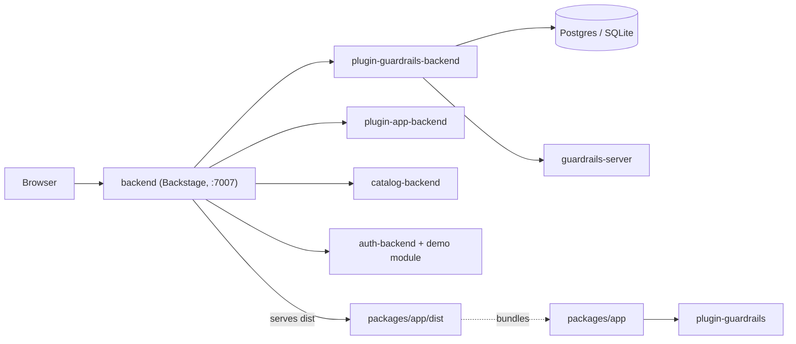
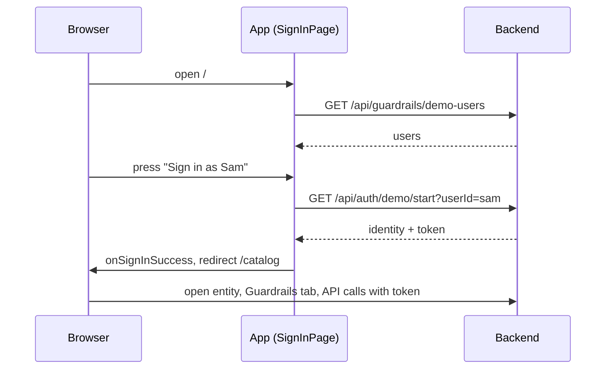

# Architecture

## Architecture Analysis

### System Overview
A Yarn-workspace monorepo with one Backstage backend process that also serves the built frontend, a Backstage plugin pair (frontend `plugin-guardrails`, backend `plugin-guardrails-backend`), and a separate `guardrails-server` that executes tool calls. Postgres backs the plugin under compose/minikube; in-memory SQLite is the plain-local default.

### Architectural Style
Modular monolith around Backstage (backend plugins in one process) plus one small external service, deployed as containers. Frontend is the Backstage new frontend system (extensions and blueprints, no `createApp` legacy routes).

### Component Relationships

Text fallback: the browser talks only to the backend; the backend serves the built app, catalog, auth and guardrails API; the guardrails backend uses a database and the guardrails-server; the app bundle includes plugin-guardrails.

### Frontend composition (UI-relevant)
- `packages/app/src/App.tsx` calls `createApp({ features: appFeatures }).createRoot()` (`@backstage/frontend-defaults`).
- `features.ts` lists three features: `catalogPlugin` (`@backstage/plugin-catalog/alpha`), `signInModule`, `guardrailsPlugin`. The `app` plugin (`@backstage/plugin-app` 0.5.4) is added by `createApp` and provides the shell, nav, themes, default sign-in.
- `signInModule` is a frontend module for plugin `app`: a `SignInPageBlueprint` (custom page), a `PageBlueprint` redirecting `/` to `/catalog`, and an `AppRootElementBlueprint` (`CatalogA11yFix`).
- `guardrailsPlugin` (id `guardrails`) adds an API, an `EntityContentBlueprint` tab (`path: guardrails`) and an `EntityCardBlueprint` (`type: info`); screens load lazily with dynamic import.
- Theme: only plugin-app's built-in `light` and `dark` `ThemeBlueprint`s (MUI v4 `UnifiedThemeProvider`); the app contributes none. No CSS file or `@backstage/ui/css/styles.css` import exists in the app; see code-quality-assessment.md.

### Data Flow
Sign-in page fetches `/api/guardrails/demo-users` and `/api/auth/demo/start?userId=` (URLs from discovery API, plain `fetch`), hands an in-memory identity to Backstage. The tab then calls the guardrails API with the Backstage fetch API (bearer token). Backend validates identity, applies rules, writes change and audit rows, calls guardrails-server.

### Key Design Decisions
- Frontend serving and CSP: `app-backend` serves `packages/app/dist`; CSP in `packages/backend/app-config.yaml` sets `connect-src` to app and backend origins and `script-src` `'self' 'unsafe-eval'`; style-src is not overridden (Backstage default).
- Identity held in memory only (lint forbids localStorage/sessionStorage in the app).
- Dependencies are allow-listed per package (`allowed-packages.txt`, `check:packages`).

### Improvement Opportunities
Load Backstage UI CSS and define one dark theme extension; move plugin colours to theme tokens; add a WebKit test project. See code-quality-assessment.md.

## Interaction Diagrams

### Sign in and open the Guardrails tab

Text fallback: the sign-in page lists users, starts a demo session for the chosen user, then the app redirects to the catalog where the Guardrails tab calls the API with the token.
