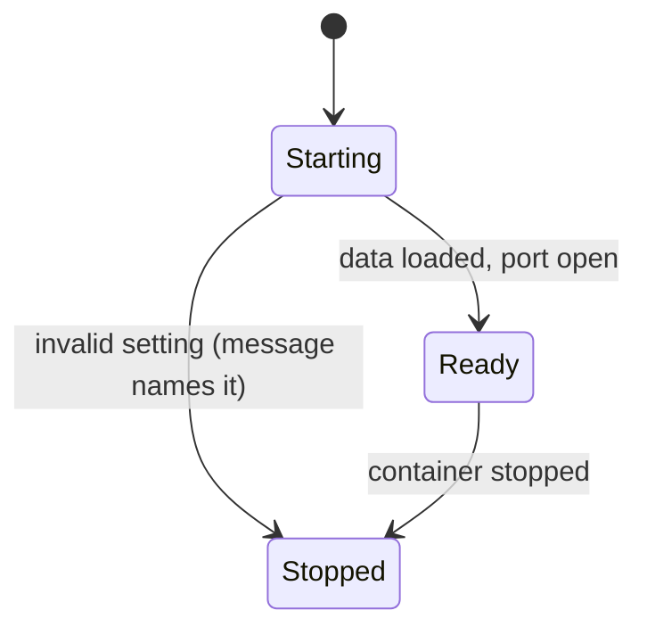
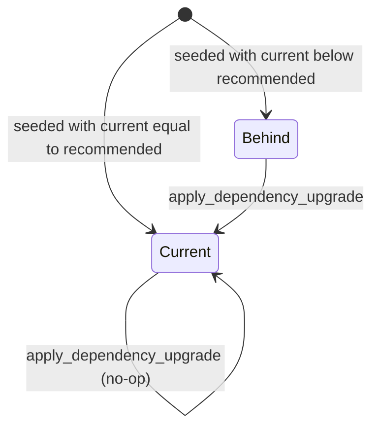
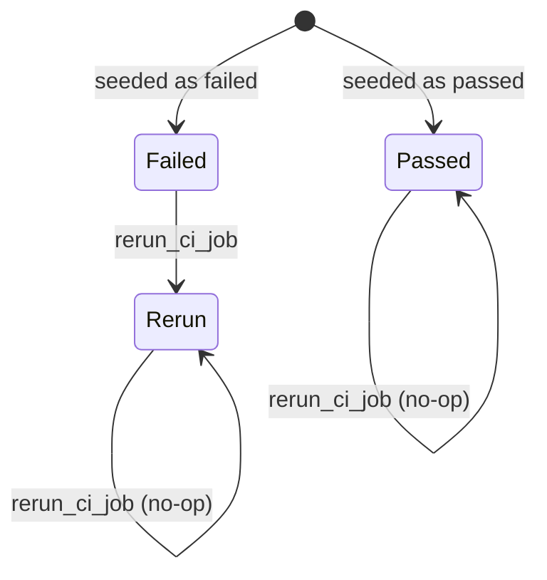
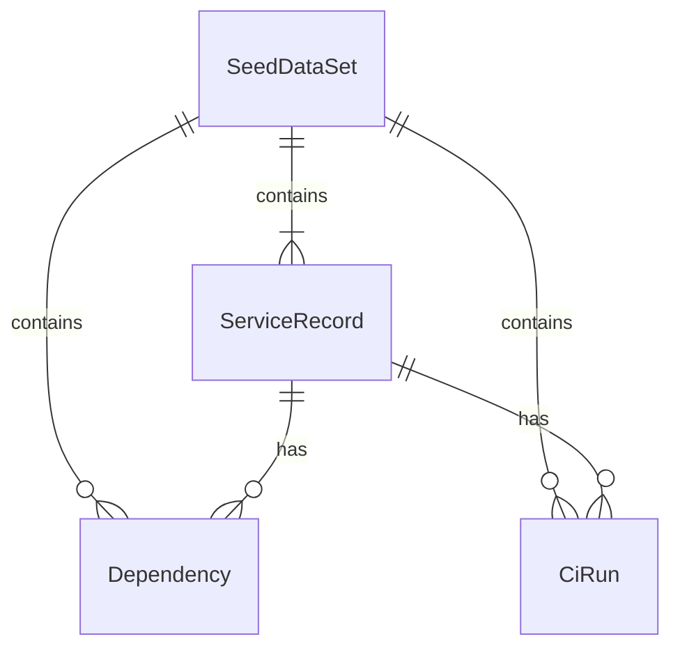

# Functional Spec — u1-data-and-server

Sources: `unit-of-work.md` (u1 scope), `unit-of-work-story-map.md` and `stories.md` (this unit implements US6.1, and the server side of US1.1, US1.2 and US3.3), `requirements.md` (FR6.1, FR6.2, FR7.1, FR7.2, NFR7), `components.md` (GuardrailsServer, SeedDataGenerator), `contract-summary.md` (contract C2 tool interface and contract C4 health and settings) and answers Q1–Q3 in `functional-design-questions.md`. This file is the source of truth for workflows and state machines. `entities.md` holds the data shape and `rules.md` the decision logic (rule IDs BRx.y).

The unit has no screens, so there is no `frontend-components.md`.

## Stories This Unit Implements

| Story | What u1 delivers | Rules |
|---|---|---|
| US6.1 | The server, the generator and repeatable data | BR1.1–BR1.6, BR2.1–BR2.6, BR3.1–BR3.4, BR4.1–BR4.3 |
| US1.1 | The upgrade plan data for a service | BR2.1, BR1.3 |
| US1.2 | The failed CI runs data for a service | BR2.2, BR1.3 |
| US3.3 | A server that can be forced to fail, and then succeeds on a repeat | BR3.1, BR2.3, BR2.4 |

Screens, the approval flow and the retry rules are delivered by u3 and u2.

## Workflows

### W1: Server start

1. Read the settings (BR3.2). If one is invalid, write one line naming it and stop.
2. Build the seed data set from the seed (W6, BR1.1–BR1.6).
3. Start with an empty `RuntimeOverlay` (BR2.5).
4. Open the port. The health check answers ready (BR4.1).

### W2: List the upgrade plan (list_upgrade_plan)

1. If the failure setting is on, return FORCED_FAILURE (BR3.1).
2. If the service input is missing or empty, return INVALID_INPUT (BR3.4).
3. If the service does not exist, return UNKNOWN_SERVICE.
4. Return every dependency of the service ordered by name, with current and recommended version; a dependency whose key is in `upgradedDependencies` shows its recommended version as current (BR2.1).

### W3: List failed CI runs (list_failed_ci_runs)

1. Steps 1–3 as in W2.
2. Return the runs that were seeded as failed and are not in `rerunRuns`, newest first, with run key, run number, status and cause (BR2.2).

### W4: Apply a dependency upgrade (apply_dependency_upgrade)

1. Steps 1–3 as in W2, plus INVALID_INPUT when the dependency key is missing or empty.
2. If the dependency key does not exist or belongs to another service, return UNKNOWN_DEPENDENCY.
3. If the current version already equals the recommended version, return `already-current` and change nothing.
4. Otherwise add the key to `upgradedDependencies` and return `applied` with the new current version (BR2.3). Overlapping calls act one at a time (BR2.6).

### W5: Re-run a CI job (rerun_ci_job)

1. Steps 1–3 as in W2, plus INVALID_INPUT when the run key is missing or empty.
2. If the run key does not exist or belongs to another service, return UNKNOWN_RUN.
3. Add the key to `rerunRuns` if it is not there and return `rerun-started`. A repeat returns the same result and changes nothing more (BR2.4, BR2.6).

### W6: Generate the data set (library call and command-line mode)

1. Take the seed and produce the services, dependencies and CI runs from it, including the required cases (BR1.3) and within the size limits (BR1.2).
2. Write the result in the fixed form: fixed field order, fixed list order, two-space indent, line-feed line endings, one trailing line feed (BR1.1).
3. In command-line mode, print the result so two runs can be compared byte for byte (US6.1, AC6.1.3). At server start the same step runs as a library call and the result stays in memory.

## State Machines

### Server lifecycle

Text fallback: the server starts in Starting. An invalid setting stops it with a message. Otherwise it becomes Ready once the data is loaded and the port is open, and stays Ready until the container stops. The failure setting is fixed for the whole run; changing it means restarting.

### Dependency

Text fallback: a seeded dependency is Behind or Current. An apply moves Behind to Current; an apply on Current changes nothing. Nothing moves back except a restart, which reloads the seed.

### CI run

Text fallback: a seeded run is Failed or Passed. A re-run moves Failed to Rerun, which no longer appears in the failed list; a re-run of a Rerun or Passed run changes nothing. A restart reloads the seed.

## Entity Relationships (derived from entities.md)

## Rules Summary (derived from rules.md)

| Group | Rules | In short |
|---|---|---|
| Data generation | BR1.1–BR1.6 | Same seed gives the same bytes; sizes and fixed cases; invented, realistic, marked synthetic; unique readable keys; recommended never below current |
| The four tools | BR2.1–BR2.6 | Plan lists everything; failed list shows current failures; apply and re-run are safe to repeat; memory only; one write at a time |
| Failure and errors | BR3.1–BR3.4 | Failure setting fails every call; settings checked at start; tool errors have a code and message in a fixed check order; missing input is an error, extra input is ignored |
| Boundaries | BR4.1–BR4.3 | Ready only after load; no approval, user or audit knowledge; data reachable only through the tools |

## Assumptions

- The server is single-user and local; no sign-in is needed on its port. Anyone who can reach the port can call the tools (decided by the sample's local-only scope; revisit before hosting).
- The default seed is a fixed number baked into the image, so a plain start gives the same demo every time (NFR7).
- A re-run of a run that was never failed returns `rerun-started` and changes nothing; the contract has no separate result for it.
- The size limits of FR7.1 are applied to the whole data set rather than to each service, because one service must have no dependencies (BR1.2, BR1.3). The requirement text says "about 10 dependencies and 20 CI runs each"; this reading is a change to confirm at the gate.

## Changes to the Contract (C2) Raised Here

| Change | Why | Kind |
|---|---|---|
| Add the tool error code INVALID_INPUT | A missing or empty input needs its own code (BR3.4) | Additive |
| Fix where the code travels: in the result's structured content, with the same text in the message | Contract review finding R-07 (location of the code) | Clarification |
| A repeated `rerun_ci_job` is safe: the server treats it as idempotent (BR2.4); the contract's `idempotent: false` for this tool is replaced by true | Contract review finding R-03; removes the double re-run risk after a timeout | Change to confirm; u2 needs no extra key |
| Failure setting fails every tool, including the reads | Matches C2 as written; kept (BR3.1) | None |

These are written back to `contract-summary.md` as part of this unit's Bolt (the contract's ownership rule: a change to a contract updates provider, consumer and spec together).

## Open Points Carried Forward

- How u2 tells a server that is down (no answer) from a server that answers with FORCED_FAILURE is a u2 decision (contract review finding R-01); u1 only guarantees that FORCED_FAILURE is an answered error.
- The data set's exact JSON field names are fixed when the code is written; the shape here is the contract with the generator's tests.
