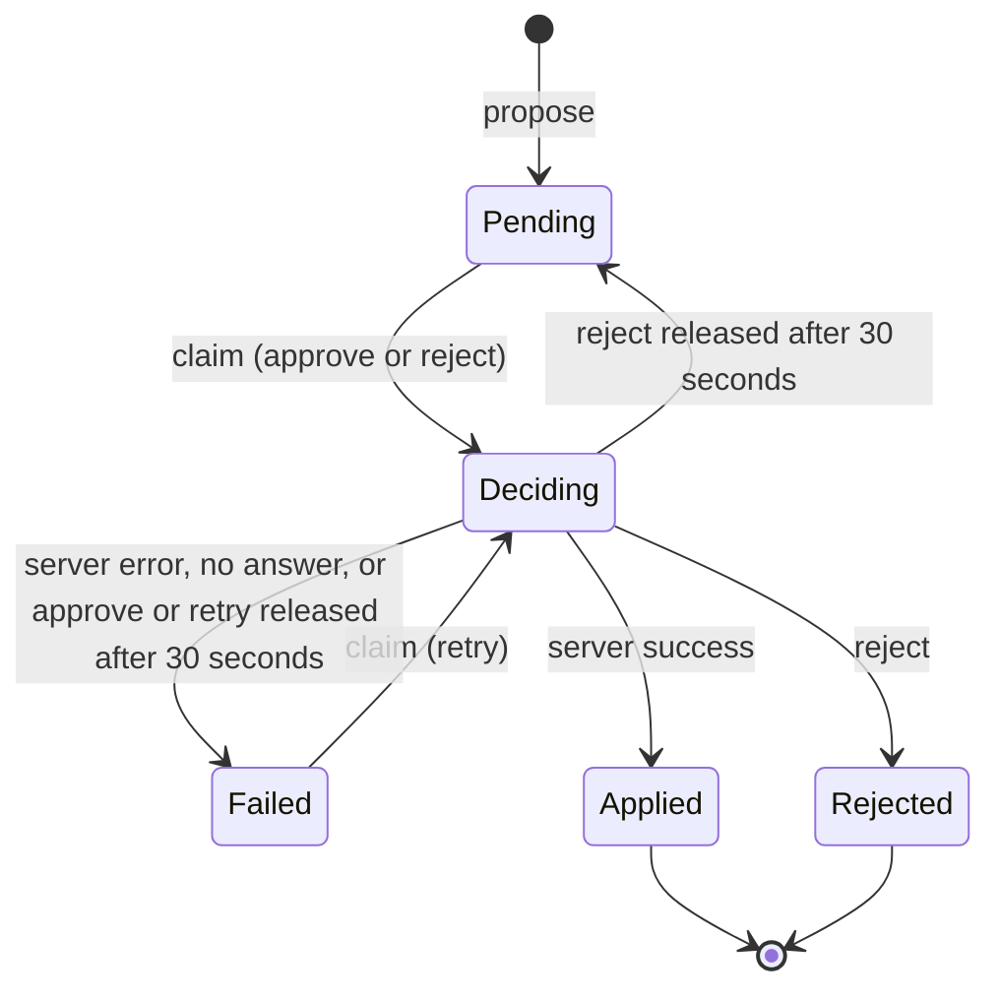
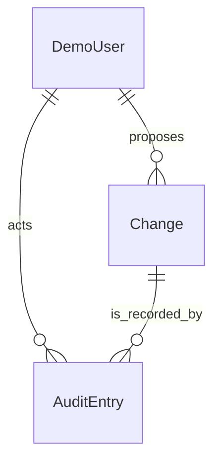

# Functional Spec — u2-plugin-backend

Sources: `unit-of-work.md` and `unit-of-work-story-map.md` (u2 scope and stories), `stories.md` (US1.1, US1.2, US2.1, US2.2, US3.1–US3.3, US4.1, US5.1, US5.2 and their criteria), `requirements.md` (FR1–FR5, FR11, NFR1, NFR5), `components.md` (ChangeWorkflow, AuditLog, DemoIdentity), `contract-summary.md` (contracts C1, C2, C3 and its review findings R-01 to R-07) and answers Q1–Q7 in `functional-design-questions.md`. This file is the source of truth for workflows and state machines. `entities.md` holds the data shape and `rules.md` the decision logic (rule IDs BRx.y).

The unit has no screens, so there is no `frontend-components.md`.

## Stories This Unit Implements

| Story | What u2 delivers | Rules |
|---|---|---|
| US5.1 | Three demo users and roles; actor on every audit entry | BR1.1–BR1.4, BR5.2, BR6.5 |
| US2.1 | Propose an upgrade | BR2.1–BR2.6 |
| US2.2 | Propose a CI re-run | BR2.1–BR2.6 |
| US3.1 | Approve or reject with a reason; the list of changes | BR3.1, BR3.4, BR3.6, BR6.3, BR6.4 |
| US3.2 | No self-approval, no double decision, allowed actions | BR3.2, BR3.3, BR3.5, BR6.2 |
| US3.3 | Retry a failed change | BR3.7, BR3.8, BR4.1–BR4.3 |
| US4.1 | Read and filter the audit log; no edit or delete | BR5.1–BR5.6 |
| US1.1, US1.2 | Relay the plan and failed runs with allowed actions | BR6.1, BR6.2 |
| US5.2 | The backend side of the unreachable server | BR2.5, BR5.5, BR6.1, BR7.1 |

Screens and their accessibility and timing are delivered by u3 and u5.

## Workflows

### W1: Every request

1. Read the sign-in identity. If it names no demo user, refuse with 401 and write nothing (BR1.3).
2. Take the actor and role from it and ignore any actor or role in the request (BR1.1).

### W2: Propose (US2.1, US2.2)

1. Run W1. If the actor is an auditor, refuse with AUDITOR_READ_ONLY and append a refused entry (BR2.4).
2. Ask the server for the plan (upgrade) or the failed runs (re-run) to check the target. If it cannot be read, refuse with SERVER_UNREACHABLE and write nothing (BR2.5).
3. If the service or target is unknown, refuse with NOT_FOUND. If the dependency is already current or the run is not failed, refuse with NOT_ELIGIBLE. Nothing is written (BR2.3).
4. Create the pending change with the summary written now, and append the entry with outcome proposed (BR2.1, BR2.6). A second proposal for the same target creates a second change (BR2.2).

### W3: Approve or reject (US3.1, US3.2)

1. Run W1. If the change does not exist, NOT_FOUND.
2. If the reason is empty or whitespace, refuse with EMPTY_REASON and write nothing (BR3.1).
3. If the actor is an auditor, refuse (BR3.2). If the actor is the proposer, refuse (BR3.3). Both leave the change unchanged and append a refused entry with the reason as submitted.
4. If the server is not reachable by the health probe, refuse with SERVER_UNREACHABLE before any claim and write nothing (BR7.7).
5. Repair any missing audit entry of the change's latest decision (BR7.4), then claim: one atomic conditional update from pending to deciding that also stores the claim token, actor, action, reason and previous status. If it is lost, refuse with ALREADY_DECIDED and append a refused entry (BR3.4, BR3.5).
6. Reject: skip step 7. Approve: call the server (apply or re-run) within 10 seconds (BR3.6).
7. Success (applied, already-current or rerun-started): applied. Any error, unfamiliar code or no answer: failed with its message (BR3.7–BR3.9).
8. Write the final status and decision fields to the change as a conditional update that needs the caller's own claim token and the status still deciding; if the claim was released meanwhile, answer CLAIM_RELEASED (409) and append nothing (BR3.4). Then append the audit entry, which has no effect if it already exists (BR3.4). If step 8 fails after the change is written, the user sees an error and recovery rebuilds the missing entry at the next read or decision (BR7.4).

### W4: Retry (US3.3)

Same as W3, except the claim is from failed to deciding and a change that is not failed is refused with NOT_FAILED (BR4.1). The proposer and the auditor are refused as in W3. A retry that succeeds clears the failure message; one that fails again adds another failed entry (BR4.2).

### W5: Read changes (US3.1)

1. Run W1. Check the server's reachability from its health route, reusing a result for 5 seconds (BR7.1).
2. Release any claim older than 30 seconds with one conditional update and its audit entry in one transaction: an approve or retry goes to failed with the message Interrupted, a reject goes back to pending (BR7.3).
3. Rebuild any missing proposal or decision entry from the change record; appending an existing entry has no effect, and if the repair fails the failure is logged and the read carries on (BR7.4).
4. Return the newest 200 changes of the service, open (pending and failed) by default, each with its allowed actions and the previous status in place of deciding (BR6.3, BR6.4, BR7.5).

### W6: Read plan and failed runs (US1.1, US1.2, US5.2)

Check reachability, call the server's read tool within 3 seconds, and return the items with their allowed actions, an empty list when there are none, or SERVER_UNREACHABLE when the server cannot be used (BR6.1). Propose is shown disabled with ALREADY_CURRENT on a dependency at its recommended version (BR6.2).

### W7: Read the audit log (US4.1)

Return the service's entries newest first, filtered and paged, with an empty page when there are none; no server is needed (BR5.4, BR5.5).

### W8: Read the signed-in user (US5.1)

Return the user id, the name and the role (BR6.5). A separate read returns the list of demo users for the switch (BR1.2).

## State Machine: Change

Text fallback: a proposed change is Pending. An approve or reject claims it into Deciding, and a retry claims a Failed change into Deciding. Deciding ends as Applied (the server succeeded), Rejected (a reject), or Failed (the server failed or did not answer, or an approve or retry claim was released after 30 seconds). A reject claim that is released goes back to Pending because nothing was applied. Applied and Rejected are final; Failed can be retried. Deciding is never shown to callers.

## Entity Relationships (derived from entities.md)

## Rules Summary (derived from rules.md)

| Group | Rules | In short |
|---|---|---|
| Identity | BR1.1–BR1.4 | Sign-in only; three demo users; read-only auditor |
| Proposing | BR2.1–BR2.6 | One change and one entry per proposal; eligibility; server must answer |
| Deciding | BR3.1–BR3.9 | Reason required; refusals recorded; claim, server, record, audit; failures marked |
| Retry | BR4.1–BR4.3 | Failed only; each attempt has its own entry |
| Audit | BR5.1–BR5.6 | Append and read only; service scoped; independent of the server |
| Reads | BR6.1–BR6.5 | Allowed actions with ordered reasons; open changes; plan and CI relay |
| Server and recovery | BR7.1–BR7.6 | Health probe; timeouts; 30 second release; rebuilt entries; hidden deciding |
| Storage | BR8.1 | Durable store; atomic claim |

## Assumptions

- Reject is disabled together with the other write actions while the server is unreachable, as FR11.2 and AC5.2.2 say, even though a reject calls no server, and a direct reject call during an outage is refused with SERVER_UNREACHABLE (BR7.7). The question file's Q3 described a reject that stays available; this spec follows the requirement. This is a point for the gate.
- A decision waits at most 10 seconds for the server and a claim is released after 30, so a caller's browser request ends well before a stuck claim is released.
- The status `deciding` appears only as the previous status plus IN_PROGRESS on reads (BR7.5), so the UI needs no extra status.
- The `me` and demo-user list reads exist so the UI's switch has what it needs; the sign-in mechanism itself (a custom demo provider, contract C3) is built in Code Generation and carries the highest technical risk in this unit.

## Changes to Contracts Raised Here

| Change | Why | Kind |
|---|---|---|
| C1: add the allowed-action reasons ALREADY_CURRENT and IN_PROGRESS, and change the precedence line to SERVER_UNREACHABLE, then AUDITOR_READ_ONLY, then PROPOSER_CANNOT_DECIDE, then IN_PROGRESS, then NOT_PENDING, NOT_FAILED and ALREADY_CURRENT | BR2.3, BR7.5, BR6.2 | Additive; the stand-in for the backend interface used by u3 must tolerate reasons it does not know (shown as a disabled action with generic wording), which is flagged for u3's Functional Design |
| C1: add the error code NOT_ELIGIBLE (409) on proposing, and CLAIM_RELEASED (409) when a decision finishes after its claim was released | BR2.3, BR3.4 | Additive. NOT_FOUND and NOT_ELIGIBLE write nothing; the C1 text that says every 409 writes a refused entry is corrected to say so. A consumer that does not know a new reason or code treats it as a disabled action or a failed call with generic wording, so u3's stand-in needs no change to keep working |
| C1: approve or reject on any non-pending change returns ALREADY_DECIDED; retry on a non-failed change returns NOT_FAILED; the reason NOT_PENDING marks the same state in allowed actions | Contract review finding R-04 (code for approving a failed change) | Clarification |
| C1: all four write actions are listed as not allowed with SERVER_UNREACHABLE when the health probe fails; a forced-failure server is reachable | Contract review finding R-01 | Clarification |
| C1: the changes list holds at most 200 items; the audit page size is at most 100 | Q6, R-07 (filter semantics: from and to inclusive, actor is a userId) | Clarification |
| C3: database settings for the change and audit store (PostgreSQL), persisted across restarts | Q1, contract review finding R-06 | Additive; u4 supplies the values, u5 runs the database service |

These are written into `contract-summary.md` in this unit's Code Generation, together with the matching changes to the C1 interface file.

## Open Points Carried Forward

- The mechanism of the custom demo sign-in and how the UI switch changes the identity (contract C3, Q5 of Contract Design) is settled in this unit's NFR and Code Generation steps and proved first in testing.
- The requirements and stories need updating for the proposed FR12.1, the audited proposal, the service-scoped audit log, open changes and the FR11.2 amendment; this Bolt does it as part of its Definition of Done (delivery planning Q4: B).
