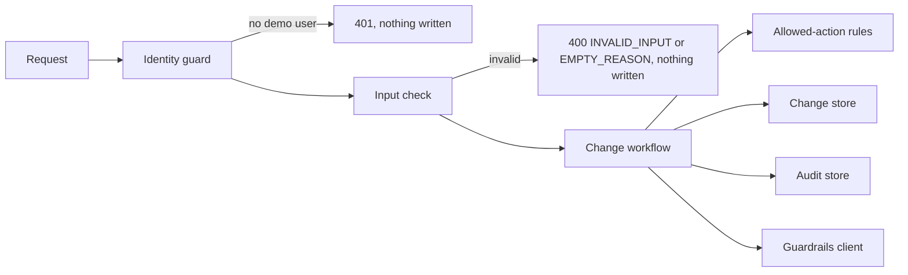

# Security Design — u2-plugin-backend

Sources: `security-requirements.md` and `tech-stack-decisions.md` (NFR1.7, NFR5.1–NFR5.10, NFR2.3, NFR2.6, NFR2.10), `functional-spec.md` and `rules.md` (workflows W1–W8, BR1.1–BR1.4, BR2.4, BR3.1–BR3.5, BR5.1–BR5.3, BR7.7, BR8.1), `contract-summary.md` (contracts C1 and C3) and answer Q1 in `nfr-design-questions.md`. This is a design: it names patterns and where they apply, not code. This unit has no separate performance-requirements, scalability-requirements, reliability-requirements or observability-requirements documents; their targets sit in `tech-stack-decisions.md` (NFR1.1–NFR1.8 and NFR2.10), and the matching designs are in `logical-components.md` (failure domains, the shared connection pool, the log line) and in the rows below (concurrency, recovery, logging).

## Design Summary

Every request passes the same short chain before any business rule runs: identity, then input shape. The business rules of `rules.md` run after that, in the order of BR3.4. Roles and the no-self-approval rule are decided in one place (the allowed-action rules) and used both to build the `allowedActions` of a read and to refuse a write, so the two cannot drift. The audit store is a separate component that offers only append and read.

## Request Chain

Text fallback: the identity guard runs first and refuses with 401 and no write; the input check runs second and refuses with 400 and no write; the change workflow then applies the allowed-action rules, the change store, the guardrails client and the audit store in the order of BR3.4.

## Write Check Order

| Step | Check | Refusal | Writes |
|---|---|---|---|
| 1 | Identity names one of the three demo users (user principal only) | 401 | Nothing |
| 2 | Input shape: known kind, target, status, dates, page 1 or more, page size 1 to 100, reason at most 2,000 characters | 400 INVALID_INPUT | Nothing |
| 3 | The service, run or change exists | 404 NOT_FOUND (409 NOT_ELIGIBLE on a propose that is not eligible) | Nothing |
| 4 | Reason not empty or whitespace (decisions) | 400 EMPTY_REASON | Nothing |
| 5 | Auditor, then proposer | 403 AUDITOR_READ_ONLY or SELF_DECISION | Refused entry with the reason as submitted |
| 6 | Health probe says reachable | 503 SERVER_UNREACHABLE | Nothing |
| 7 | Repair of the latest decision's missing entry, claim, server call, final write, audit entry (BR3.4) | 409 ALREADY_DECIDED, NOT_FAILED, CLAIM_RELEASED | Refused entry, or none for CLAIM_RELEASED |

A reason of more than 2,000 characters is refused at step 2 for every user, including an auditor, so a refused entry can never hold an over-long reason. A page size outside 1 to 100 is refused, not clamped, so the same call always means the same thing.

## Design Solutions by Requirement

| ID | Design solution |
|---|---|
| NFR5.1 | The identity guard builds an actor object (user id, name, role) from the sign-in credentials and passes only that object to the workflow. The request parser has no field for actor or role, so extra values are dropped at the boundary and cannot reach the rules. |
| NFR5.2 | The guard accepts only a user principal whose entity reference is `user:default/<userId>` for one of the three users in the demo user list; service principals, other users and a missing identity get 401 with no write. The one exemption is the read of the demo user list (answer Q1: A), which needs no sign-in, returns only user id, name and role, and is registered only while the demo sign-in is on. |
| NFR5.3 | The demo sign-in provider and the user list route are registered only when `guardrails.demoSignIn.enabled` is true; the default in the plugin is false. The backend writes one warning line at start-up when it is true. The shipped app-config must keep it false and only the compose override sets it true; this is a dependency recorded for u4 and u5. |
| NFR5.4 | One pure function, the allowed-action rules, takes the actor, the change (or target), the server reachability and the claim state and returns each action with its reason in the order of BR6.2. Reads use it to fill `allowedActions`; writes call it before the claim and refuse with the same reason, so the UI view and the refusal always agree. |
| NFR5.5 | The audit store interface has `append` and `read` only, so no code path can update or delete an entry. In the database, a trigger on the audit table raises an error on update and on delete. The guarantee is against application paths; the table owner (the plugin's own login) could remove the trigger, which is accepted for the sample. A test tries to change and remove an entry through the store and the database and sees the entry unchanged and an error raised. |
| NFR5.6 | One input check per route, written as a schema, runs before the workflow: allowed values for kind, status, action and outcome; ISO dates; page and page size ranges; reason length. It returns 400 INVALID_INPUT with a fixed message that names the field but never echoes the value. Unknown fields are removed. The new response and the length limit are added to contract C1 in Code Generation. |
| NFR5.7 | Every statement goes through the query builder with bound values; the only text put into a statement is a fixed table or column name chosen from a list in code. Filters are built by adding conditions, never by joining text. |
| NFR5.8 | The request logger writes time, route pattern (not the raw path), actor id, status, error code and duration. It receives no body, no query values and no settings, so it cannot write a reason or a login. Database and server addresses are read from settings at start-up and are never logged. |
| NFR5.9 | A single error handler turns any unexpected error into a fixed 500 body with no stack and no query text, and logs the error class and the route. Because the claim is released lazily (BR7.3) and the entry is rebuilt (BR7.4), a failure after the claim leaves no stuck or half-recorded change. Tests control the clock to pass the 30 seconds. |
| NFR5.10 | All state is in PostgreSQL through migrations that run at start-up; the in-memory store exists for tests only and the plugin refuses to use it unless a test setting selects it. |
| NFR1.7 | The claim is a single conditional update (`status` is the expected value and the row is returned only to the winner), so exactly one of ten simultaneous callers wins; the others get zero rows and are refused with ALREADY_DECIDED. The final write is a second conditional update bound to the caller's claim token, with the audit append in the same transaction (BR3.4 step 3 and 4). |

## Threat Handling

| Threat | Design response |
|---|---|
| Forged actor or role in a request | Parser has no such field (NFR5.1) |
| A service principal or the guest user calls the routes | Guard accepts demo user principals only (NFR5.2) |
| Demo sign-in left on in a hosted copy | Registered only when set, off by default, start-up warning, u4 and u5 keep the shipped default off (NFR5.3) |
| Role or self-approval checked only in the UI | One shared rule function for reads and writes (NFR5.4) |
| An entry edited or deleted | No store method, database trigger (NFR5.5) |
| Hostile text in filters or reasons | Schema check, bound values, no values in the log (NFR5.6 to NFR5.8) |
| Two callers decide at once | Single conditional claim (NFR1.7) |

## Notes for Later Stages

- Infrastructure Design takes the PostgreSQL service for local test runs (a compose service) and the compose override that turns the demo sign-in on.
- Code Generation adds the contract changes (INVALID_INPUT, the 2,000 character reason limit, NOT_ELIGIBLE, CLAIM_RELEASED, the reasons ALREADY_CURRENT and IN_PROGRESS, `guardrails.demoSignIn.enabled`, and the open user-list route) to `contract-summary.md` and the C1 interface file.
