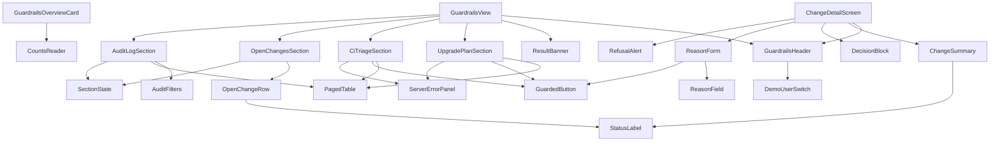

# Frontend Components — u3-plugin-ui

Unit `u3-plugin-ui`, component GuardrailsPluginUI. Behavior, rules (`BRx.y`) and states are in `functional-spec.md`; screens and exact texts are in the refined mockups and their string catalog (plus the additions in `functional-spec.md`). The Backstage building blocks named here come from `design-system-mapping.md`; exact packages and the choice between Backstage's frontend systems are confirmed in NFR Requirements and Code Generation, not here.

## Routes and Extensions

| Where | What | Notes |
|---|---|---|
| Service overview tab | Card extension `GuardrailsOverviewCard` (Screen A) | D1; "Open Guardrails" links to the tab below |
| Service tab "Guardrails" | Content extension with two routes | D1 |
| Tab route `/` | `GuardrailsView` (Screen B) | |
| Tab route `/changes/:changeId` | `ChangeDetailScreen` (Screen C) | Back returns to `/` with a banner state |

The service name used in every call is the catalog entity name.

## Component Hierarchy

Text fallback: the card reads counts; the view holds the header (with the user switch), the banner and four sections (plan, CI, open changes, audit log); the detail screen holds the header, a summary, a decision block, the reason form and the refusal alert. Shared parts: paged table, guarded button, status label, reason field, server error panel and section state.

## Components

| Component | Purpose | Props (inputs) | State it owns | Rules |
|---|---|---|---|---|
| GuardrailsOverviewCard | Screen A: three counts and one link | none (service from the page) | section state of the counts | BR1.4, BR1.2 |
| CountsReader | Loads plan, CI and open lists and derives the three counts | service | loading/loaded/error per list | BR1.4 |
| GuardrailsView | Screen B: lays out the header, banner and four sections; starts all loads together | service | banner message; the "server down" flag that disables writes | BR6.2, BR7.4 |
| GuardrailsHeader | Title with shield mark, breadcrumbs, signed-in user, switch | service, optional change title | none | BR5.1 |
| DemoUserSwitch | Menu button listing demo users with roles | users, current user, onSelect | menu open or closed | BR5.1, BR5.4 |
| ResultBanner | Status region with a close button; takes focus on appearing | message key, onDismiss | none | BR7.2 |
| UpgradePlanSection | Plan table with row actions | service | list state, page | BR1.1, BR2.1 |
| CiTriageSection | Failed runs table with row actions | service | list state, page | BR1.3, BR2.1 |
| OpenChangesSection | Open changes sorted per D6 | service | list state | BR3.1 |
| OpenChangeRow | One row: title, proposer, status, View | change | none | BR3.1 |
| AuditLogSection | Filters, table, paging | service | filters, page, list state | BR4.1 to BR4.4 |
| AuditFilters | From, To, Actor, Action, Outcome, Clear filters | users, values, onChange | date-range error | BR4.2 |
| PagedTable | Table with caption, header cells, 10 rows per page, Previous/Next/"Page N of M" | caption, columns, rows, page, pageCount, onPage | none | BR4.4, BR7.1 |
| ChangeDetailScreen | Screen C | service, changeId | change load state, refusal alert, submit state | BR3.2 to BR3.8 |
| ChangeSummary | Title (the change summary, D10), status label, "Proposed by", "What it will do" (kind label, service, summary) | change | none | BR3.1 |
| DecisionBlock | "Decided by", reason, failure message | change | none | BR3.7 |
| ReasonForm | Reason box, error text, Back, action buttons | change, onSubmit(action, reason) | typed reason, error text | BR3.2, BR3.5 |
| ReasonField | Multi-line box, 500 limit, visible count, threshold announcements | value, onChange, error | none | BR3.2, BR7.3 |
| GuardedButton | Button that stays focusable when unavailable, shows the reason text linked to it, shows "Working..." | label, reason key, working, onActivate | none | BR3.5, BR2.2 |
| StatusLabel | Icon plus word for a status or outcome | status | none | BR7.1 |
| RefusalAlert | Announced, dismissible alert that takes focus | message key, onDismiss | none | BR3.6 |
| ServerErrorPanel | `error.unreachable` with Retry | onRetry | none | BR6.1 |
| SectionState | Loading, empty or `error.loadFailed` wrapper with live announcements and busy marking | state, empty text key, onRetry | none | BR1.2, BR6.3, BR7.2 |

Parts that are not Backstage components (the combined status label, guarded button, banner focus, counter announcements, switch) are the custom parts listed in `design-system-mapping.md`.

## Services Inside the Plugin

| Service | Purpose | Notes |
|---|---|---|
| GuardrailsApi | One method per C1 call (me, demo users, plan, CI runs, changes list, change, propose, approve, reject, retry, audit page); turns answers and error codes into typed results | The only code that makes calls; always sends the credential from DemoSession; never sends actor or role (BR5.3). Tests replace it with a stand-in of the backend. |
| DemoSession | Holds the chosen demo user and token; lists users; switches | Starts on the app's own user; keeps the chosen user for the browser tab so a reload keeps it, and works without that storage (BR5.2). |
| Texts | The string catalog and its additions, and the mapping from reason and error codes to keys | Single place for every user-facing string; a missing key fails a test. |

## Data Flow

| Screen or section | Call (C1) | Used for |
|---|---|---|
| Header | `GET /me`, `GET /demo-users` | Name and role for display; switch list |
| Plan | `GET /services/{service}/plan` | Rows, `allowedActions`, counts |
| CI triage | `GET /services/{service}/ci-runs` | Rows, `allowedActions`, counts |
| Open changes | `GET /services/{service}/changes` (default open) | Rows, count, `allowedActions` |
| Audit log | `GET /services/{service}/audit` with `from`, `to`, `actor`, `action`, `outcome`, `page`, `pageSize=10` | Table and "Page N of M" |
| Propose | `POST /services/{service}/changes` with kind and target | BR2.1 |
| Detail | `GET /changes/{changeId}` | Screen C |
| Decide | `POST /changes/{changeId}/approve`, `/reject`, `/retry` with reason | BR3.3, BR3.4, BR3.7 |
| Switch | The demo sign-in start address for the chosen user | BR5.2 |

## Form Validation

| Field | Rule | Message | Where checked |
|---|---|---|---|
| Reason (approve, reject, retry) | Not blank after trimming; at most 500 characters (box stops further typing) | `error.reasonRequired`, linked to the box | In the UI before sending (BR3.2), and again by the backend |
| From, To | If both set, To is not before From | `error.dateRange`, linked to the date fields; no request | In the UI (BR4.2) |
| Actor, Action, Outcome | Chosen from fixed lists | none needed | The lists |

The UI check is a convenience; the backend enforces every rule (EMPTY_REASON, INVALID_INPUT, roles, states).

## Accessibility Behavior by Component

- GuardedButton: marked unavailable to assistive technology but not removed from the tab order; reason text linked to it; names carry the row ("Propose change for lib-a").
- ResultBanner and RefusalAlert: status or alert region, take focus on appearing, close button named `label.dismiss`.
- SectionState: marks the region busy while loading and announces `loading.section` politely.
- ReasonField: visible label `label.reason`, count visible always, announced at 100, 50, 20 and 0 left.
- DemoUserSwitch: named button; arrows, Enter, Escape as in the interaction spec; selection announced with `status.signedIn`.
- PagedTable: caption and header cells; paging controls named; current page announced.

## Testing Seams (for NFR Requirements and Code Generation)

- GuardrailsApi and DemoSession are the two replaceable seams; every screen is tested against a stand-in of C1 (the contract file `c1-openapi.yaml` is the check that the stand-in is faithful).
- Every state in the accessibility checklist's scan scope is a test variant.
- The 20-load timing and the Chrome/Firefox walkthroughs run against the compose sample (u5), not in unit tests.

## As Built (differences from the design above)

Written after Code Generation so this file matches the code in `packages/plugin-guardrails`.

| Design | As built |
|---|---|
| `CountsReader` | Not a component: `GuardrailsOverviewCard` runs its three loads with the section hook and derives the counts with `cardCounts` (`src/rules/derive.ts`) |
| `OpenChangeRow` | A column set inside `OpenChangesSection`, rendered by `PagedTable` with paging switched off; the View action is a link (`role="link"`) to the relative route `changes/<id>` |
| `GuardrailsHeader` with a switch | As designed; the switch stays mounted while the user is read again after a switch, so focus returns to its button; the title is the service name on Screen B and the change title on Screen C, with a breadcrumb ending in the word "Change" |
| `Texts` | `src/texts/texts.ts` (catalog, reason and error mappings) and `src/texts/formatTime.ts` (`YYYY-MM-DD HH:mm` in the viewer's zone, D12) |
| `GuardrailsApi`, `DemoSession` | `src/api/`; both are built together by `createGuardrailsClient` and handed to the screens through a small React context; the entity tab and card read them from Backstage's API registry |
| Services replaced in tests | The real `GuardrailsApi` and `DemoSession` run against a stand-in network (`msw`) whose answers a contract test checks against `c1-openapi.yaml` |
| One hook per section | `useSection` (also used for the signed-in user and the change); the audit section keeps its table on screen while a page loads, so focus stays on Previous and Next |
| Routes | The tab path shows the view; `changes/:changeId` shows the detail; Back and the breadcrumb are relative links one level up |
| Extensions | Entity content "Guardrails", an entity card and a plugin API, from the `alpha` entry point of `@backstage/plugin-catalog-react` in the pinned version; the screens load when their route opens |
| Shared parts | `ServerErrorPanel`, `SectionState`, `ResultBanner`, `RefusalAlert`, `StatusLabel`, `PagedTable`, `ReasonField` and `GuardedButton` are in `src/components`, with `ChangeSummary`, `DecisionBlock` and `ReasonForm` as designed |
