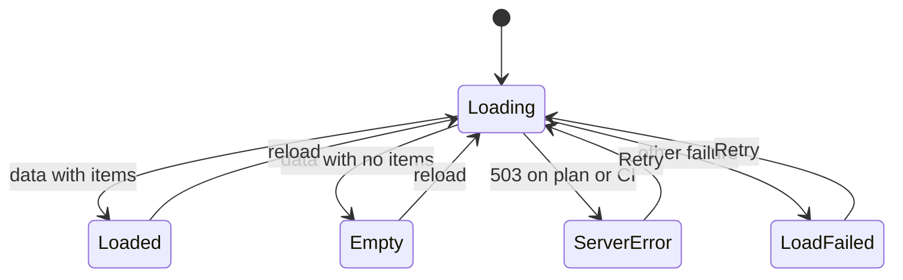
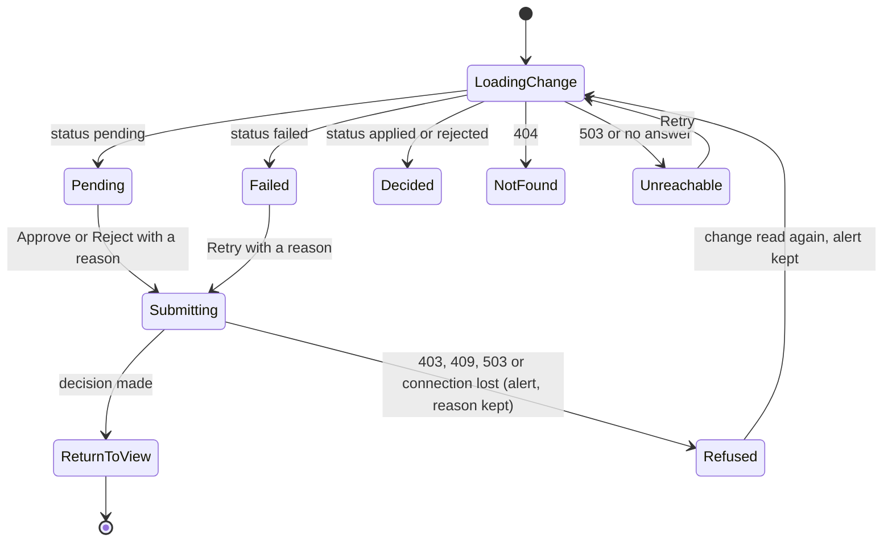
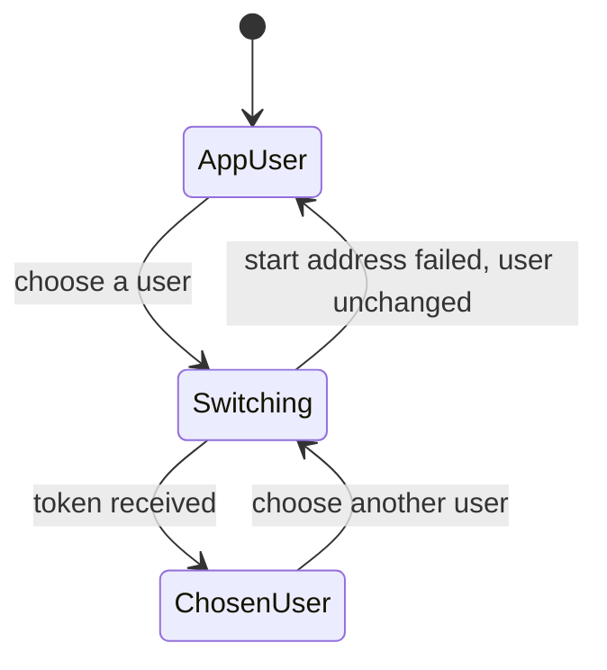

# Functional Spec — u3-plugin-ui

Unit: `u3-plugin-ui`, component GuardrailsPluginUI, owns no entities. This is a user-interface unit, so this file is self-contained: it is the source of truth for the screen workflows and the screen and section states. The UI rules (`BRx.y`) are in `rules.md`, and the table below is a derived summary of them. Component structure, data flow and form validation are in `frontend-components.md`.

## Sources

- `unit-of-work.md` (u3: screens, states, texts and accessibility behavior from the refined mockups; calls the plugin backend and the demo sign-in only; never calls the guardrails server) and `unit-of-work-story-map.md` (u3 implements US1.1, US1.2, US2.1, US2.2, US3.1, US3.2, US3.3, US4.1, US5.1, US5.2, in that order).
- `stories.md`: the 41 acceptance criteria of those ten stories (AC1.1.1 to AC5.2.3), traced in `traceability.json`.
- `requirements.md`: FR1 to FR5, FR11, FR12.1, NFR1, NFR3, NFR4.
- `components.md`: GuardrailsPluginUI "shows what the backend says is allowed and never decides a rule; holds no data of its own".
- `contract-summary.md`: C1 (the backend interface this unit consumes, including the u2 changes: new error codes, new allowed-action reasons, `GET /demo-users`) and C3 (the demo sign-in).
- The refined mockups (`mockups.md`, `interaction-spec.md` with its string catalog, `design-system-mapping.md`, `accessibility-checklist.md`) are the visual and wording authority; this file does not repeat them, it adds the behavior behind them.
- Answer Q1 in `functional-design-questions.md`: the plugin holds the chosen demo user's token.

## Scope

In: overview card (Screen A), Guardrails view (Screen B), change detail (Screen C), the demo-user switch, all states and texts, accessibility behavior, and the mapping from backend answers to what the person sees.
Out: any rule decision (who may do what, which state allows which action, whether a reason is valid beyond "not blank and within the length shown"), any call to the guardrails server, any storage of data. The backend decides; the UI shows its answer.

## Design Decisions Taken

These are details the inputs left open. They were settled here and can be changed at the approval gate.

| # | Decision | Why |
|---|---|---|
| D1 | The Guardrails view is a tab named "Guardrails" on the service's catalog page; the overview card sits on the service overview tab. The change detail is a sub-page of that tab, addressed by change id. The service name for every call is the catalog entity name (u4 makes entity names equal the seeded service names). | Requirements left "where the plugin appears" open; this matches "on its catalog page" (FR1.1) and the card's "Open Guardrails" link. |
| D2 | Reason input stops at 500 characters, as the mockup shows. The backend accepts up to 2,000; the UI limit is the stricter one. A reason is sent exactly as typed; only the "is it blank" check trims. | Keeps the mockup; the audit stores the reason as submitted (FR4.2). |
| D3 | The audit table asks the backend for `pageSize=10` and shows "Page N of M" with M = ceil(total / 10), at least 1. The plan and CI lists come whole from the backend and are paged 10 per page in the browser. | Mockup says 10 rows per page for all three; backend default of 20 is only a default. |
| D4 | The audit From and To fields are calendar dates. From becomes the start of that day and To the end of that day in the viewer's time zone, sent as date-time values (the backend treats both ends as inclusive). | C1 takes date-times; the mockup shows dates. |
| D5 | No automatic refresh. Data reloads when the person acts, switches user, returns from the detail screen, or chooses Retry. | No requirement asks for live updates; avoids announcement chatter. |
| D6 | Open changes are sorted in the browser: failed first, then pending, each by proposed time, newest first. | The mockup order; the backend returns at most 200 open changes. |
| D7 | Texts the catalog lacks are added to the string catalog (table below). Per the catalog rule, nothing outside the catalog is shown. | Needed for reason codes and error codes added in u2 and for the audit/changes sections, which the backend can fail to deliver without the guardrails server being down (the mockup's "Guardrails server unreachable" on the audit section contradicts Q2: A and AC5.2.4, so it is replaced by `error.loadFailed`). |
| D8 | The Target column shows the `target` the backend returns (a dependency key or a run key) as is. | The audit entry carries no other name for it. |
| D9 | Sample sign-in switch: Q1 answer A (see BR5.1 to BR5.4). The app's own first sign-in is wired by u4; this unit does not own it. | Q1. |
| D10 | The change title is the change's `summary` exactly as the backend returns it (for example "Upgrade lib-a from 1.2 to 2.0" or "Re-run CI run #41 (Flaky test)"). It is the title in the open list, the h1 and page title of Screen C ("
 - <service>"), and the name part of `label.viewFor`. The breadcrumb ends with the word `text.change` (no id, because the id is not meant to be read). "What it will do" shows the kind label (`text.kindUpgrade` or `text.kindRerun`), the service and the same summary. The UI composes no sentence of its own from kind and target. | `summary` is written once by the backend when the change is proposed (u2 BR2.6) and is the only wording of the change C1 carries; the mockups' example titles come from it. |
| D11 | Which actions Screen C shows follows the change's status; whether each is enabled follows the backend's allowed actions. A pending change shows Approve and Reject; a failed change shows Retry; an applied or rejected change shows no action and its decision block. An action that is shown is enabled when the backend lists it as allowed, and otherwise is disabled with the backend's reason. The reasons `NOT_PENDING` and `NOT_FAILED` never appear as text: the status already decided whether the action is shown. | The backend ranks `AUDITOR_READ_ONLY`, `PROPOSER_CANNOT_DECIDE` and `IN_PROGRESS` above the state reasons, so for an auditor or a proposer the reason alone cannot say whether to show the action. Showing by status keeps a decided change free of disabled buttons. The status is displayed data, not a decision about who may act. |
| D12 | Dates and times show as `YYYY-MM-DD HH:mm` in the viewer's own time zone, from one function, never as a relative time ("5 minutes ago"). The audit From and To dates become the start and end of that day in the same zone (D4). Tests pin the zone and the clock. | Chosen by the person in the NFR Design (Q1: A); every screen shows times, and tests must give the same text every run. |
| D13 | The audit Action column and filter show "Propose" for a proposal. C1's audit entry carries `action: propose` without the kind of change, so "Propose upgrade" and "Propose re-run" (mockup wording) cannot be told apart there; the change title in the open list does. The mockup wording (`mockups.md`, `interaction-spec.md`) was changed to "Propose". | The UI composes no sentence of its own from data it does not have (D10). |

### String catalog additions

| Key | Text | Used for |
|---|---|---|
| error.loadFailed | Could not load this section. | A section whose call to the plugin backend failed for any reason other than the guardrails server being down (with Retry) |
| error.generic | Something went wrong. Try again. | A write answered with `INVALID_INPUT` or `INTERNAL_ERROR`, or any answer the UI does not know |
| error.unauthenticated | Your demo session ended. Choose a demo user. | `401 UNAUTHENTICATED` |
| refusal.notEligible | This can no longer be proposed. | `409 NOT_ELIGIBLE` on a proposal |
| refusal.claimReleased | This change was interrupted. It has been reloaded. | `409 CLAIM_RELEASED` (the screen reads the change again on its own) |
| error.signedOut | Your session ended. Sign in again. | `401` when there is no switch to choose a demo user with (the demo sign-in is off) |
| text.dash | - | A count on the overview card when a read failed |
| refusal.notFound | This change no longer exists. | Same text as `error.notFound`, listed here for the refusal path |
| disabled.inProgress | This change is being decided. | Allowed-action reason `IN_PROGRESS` |
| disabled.alreadyCurrent | Already at the recommended version. | Allowed-action reason `ALREADY_CURRENT` |
| text.change | Change | Last part of the breadcrumb on Screen C (D10) |
| text.kindUpgrade | Dependency upgrade | Kind label in "What it will do" (D10) |
| text.kindRerun | CI re-run | Kind label in "What it will do" (D10) |
| text.noReason | - | The reason column of an audit entry without a reason |
| text.signedInAs | Signed in as: <name> | The signed-in user in the header |
| text.userWithRole | <name>, <role> | A user in the switch menu |
| loading.inline | Loading... | A count on the overview card while its reads run |
| label.retryLoad | Retry | The Retry action of a section, the card and Screen C |
| label.from, label.to, label.actor, label.action, label.outcome, label.all, label.filters | From, To, Actor, Action, Outcome, All, Audit log filters | The audit filters and the "any value" choice |
| label.service, column.* | Service, and the column names of the four tables | Table headers |
| label.guardrails, card.title, card.upgrades, card.failedRuns, card.open | Guardrails, Guardrails, Upgrades available, Failed CI runs, Open changes | The tab name, the card heading and its three labels |
| title.view, title.detail, title.detailLoading | Guardrails - <service>, <title> - <service>, Change - <service> | Page titles |
| action.propose, action.approve, action.reject, action.retry | Propose, Approve, Reject, Retry | The Action column and filter of the audit log (D13) |
| role.service-owner, role.platform-engineer, role.auditor | Service owner, Platform engineer, Auditor | Role labels in the switch menu |
| label.demoUsers | Demo users | The name of the switch menu |

## Allowed-Action Reasons to Texts

The backend returns, for each action on each row, `allowed` and, when not allowed, one reason. The UI shows that reason only and never computes another. Precedence is the backend's: `SERVER_UNREACHABLE`, `AUDITOR_READ_ONLY`, `PROPOSER_CANNOT_DECIDE`, `IN_PROGRESS`, then the state reasons. This matches the order in `interaction-spec.md`.

| Reason from the backend | What the person sees |
|---|---|
| SERVER_UNREACHABLE | `disabled.unreachable`, action disabled |
| AUDITOR_READ_ONLY | `disabled.auditor`, action disabled |
| PROPOSER_CANNOT_DECIDE | `disabled.proposer`, action disabled |
| IN_PROGRESS | `disabled.inProgress`, action disabled |
| ALREADY_CURRENT (propose) | `disabled.alreadyCurrent`, action disabled |
| NOT_PENDING (approve, reject) or NOT_FAILED (retry) | No text. Whether Approve, Reject and Retry are shown at all follows the change's status (D11), so these two reasons are never displayed |
| An unknown reason | The action is disabled with `error.generic` as its reason text |

## Screen C Actions by Case (D11)

Showing an action by the change's status is page layout: the status is data the backend returns and the screen displays. Whether the action is enabled is the backend's answer alone.

| Case | Shown | Enabled? | Text beside the action |
|---|---|---|---|
| Pending, viewer is another service owner or platform engineer | Approve, Reject | Yes | none |
| Pending, viewer proposed it | Approve, Reject | No | `disabled.proposer` |
| Pending, viewer is the auditor | Approve, Reject | No | `disabled.auditor` |
| Pending and being decided (backend reason `IN_PROGRESS`) | Approve, Reject | No | `disabled.inProgress` |
| Pending, server unreachable | Approve, Reject | No | `disabled.unreachable` |
| Failed, viewer is another user | Retry | Yes | none |
| Failed and being retried (backend reason `IN_PROGRESS`) | Retry | No | `disabled.inProgress` |
| Failed, viewer proposed it, is the auditor, or the server is unreachable | Retry | No | `disabled.proposer`, `disabled.auditor` or `disabled.unreachable` by the precedence above |
| Applied or rejected, any viewer | none (decision block only) | n/a | none |

## Error Answers to Texts

| Backend answer | Where it can come from | What the person sees |
|---|---|---|
| 503 `SERVER_UNREACHABLE` on the plan or CI read | Screen A, B | The section's server error panel with Retry |
| 503 `SERVER_UNREACHABLE` on a write | propose, approve, reject, retry | `error.unreachable` in an announced alert; the typed reason is kept; the sections (Screen B) or the change (Screen C) are read again, so the write actions show `disabled.unreachable` until a load succeeds. The server-down flag lives in the view on Screen B; on Screen C the reloaded change carries `SERVER_UNREACHABLE` in its allowed actions |
| Network failure or no answer on a write (the page gives up at 12 seconds) | any write | `error.submitFailed` in an announced alert; the typed reason is kept; nothing assumed written; the change (Screen C) or sections (Screen B) are read again before the next attempt, because the write may have finished |
| Network failure or non-503 error on a read | any section | `error.loadFailed` with Retry for that section |
| 400 `EMPTY_REASON` | approve, reject, retry | `error.reasonRequired` under the reason box (the UI normally stops this first) |
| 400 `INVALID_INPUT`, 500 `INTERNAL_ERROR`, unknown code | any write | `error.generic` |
| 401 `UNAUTHENTICATED` | any call | With a demo user chosen, one new token is requested (and a read is repeated once); a second 401 shows `error.unauthenticated` and the switch is there to choose a user. Without a switch (the demo sign-in is off) `error.signedOut` shows instead, since there is nothing to choose |
| 403 `AUDITOR_READ_ONLY` | propose, approve, reject, retry | `disabled.auditor`, in an announced alert; the change or sections are read again |
| 403 `SELF_DECISION` | approve, reject, retry | `disabled.proposer`, in an announced alert; the change is read again |
| 404 `NOT_FOUND` | change read or decision | `error.notFound` (Screen C "Not found" state; after a decision, an alert and the same state once the change is read again) |
| 404 `NOT_FOUND` | propose (the dependency or run no longer exists) | `refusal.notEligible` in an announced alert, and the sections reload |
| 409 `ALREADY_DECIDED` | approve, reject | `refusal.alreadyDecided` |
| 409 `NOT_FAILED` | retry | `refusal.notFailed` |
| 409 `NOT_ELIGIBLE` | propose | `refusal.notEligible` |
| 409 `CLAIM_RELEASED` | approve, retry | `refusal.claimReleased`; the change is read again on its own |

## UI Rules (derived summary)

`rules.md` is the source of truth for these rules, with their trigger, logic and violation behavior; this table is a derived reading view of it.

| ID | Rule | Source |
|---|---|---|
| BR1.1 | The plan section lists every item the backend returns with dependency name, current version and recommended version and a "Propose change" action named for its row. | FR1.1, AC1.1.1 |
| BR1.2 | A section with no items shows its empty text (`empty.plan`, `empty.ci`, `empty.open`, `empty.audit`; `empty.auditFiltered` when filters are on; `empty.card` on the card when all three counts are 0), never an empty area. | FR11.1, AC1.1.2, AC1.2.2, AC4.1.4 |
| BR1.3 | The CI section lists every failed run the backend returns with its run number and cause and a "Propose re-run" action named for its row. | FR2.1, AC1.2.1 |
| BR1.4 | The card shows three counts: upgrades available (plan items whose recommended version differs from the current one), failed CI runs (items in the CI list), open changes (items in the open list). It is read only; its one control opens the Guardrails view. While a read is loading the counts show "Loading..."; if any read fails the card shows one error with Retry (`error.unreachable` when the plan or CI read found the server unreachable, otherwise `error.loadFailed`) and a dash in place of the counts. | Screen A, P4 |
| BR2.1 | Choosing "Propose change" or "Propose re-run" sends one proposal naming only the kind and the target; on success the matching banner shows, the open list reloads, and the new change is in it with the signed-in user as proposer. | FR1.2, FR2.2, AC2.1.1, AC2.2.1 |
| BR2.2 | The UI never removes a duplicate: a second deliberate proposal for the same target is sent and both pending changes are listed. While a proposal is being sent its button shows `status.working` and cannot be pressed again, so one click makes one change. | FR1.2, AC2.1.2, AC2.2.2 |
| BR2.3 | The audit log shows a proposal as an entry with action "Propose" (D13), outcome Proposed and "-" as reason. | P2, AC2.1.3, AC2.2.3 |
| BR2.4 | A propose action the backend lists as not allowed is disabled with its reason and sends nothing. If a proposal that was sent comes back refused (`NOT_ELIGIBLE`, `AUDITOR_READ_ONLY`), the person sees the matching text from "Error Answers to Texts" and the plan reloads. | FR1.2, AC2.1.4, AC2.2.3 |
| BR3.1 | The open list shows pending and failed changes only, each with what it will do (the change summary, which is also its title, D10), who proposed it, a status label (icon and word) and a "View" action named for its row. | FR3.1, P4, AC3.1.1 |
| BR3.2 | Approve, Reject and Retry each need a reason. A reason that is empty after trimming is not sent: the screen stays open, `error.reasonRequired` shows under the box linked to it, and nothing is written. The box holds at most 500 characters. The reason is sent exactly as typed. | FR3.2, FR3.6, AC3.1.4, AC3.2.5, AC3.3.4 |
| BR3.3 | Approve sends the reason; when the backend answers with status applied the person returns to the view with `banner.approved`; when it answers failed they return with `banner.applyFailed` and the change shows Failed in the open list. | FR3.4, AC3.1.2, AC3.3.1 |
| BR3.4 | Reject sends the reason; the person returns to the view with `banner.rejected`. | FR3.5, AC3.1.3 |
| BR3.5 | Which of Approve, Reject and Retry are shown follows the change's status (D11); a shown action is enabled only when the backend lists it as allowed for the signed-in user. Otherwise it stays focusable (marked unavailable to assistive technology, not removed from the tab order), shows its reason text linked to it, and does nothing when activated. | FR3.3, FR12.1, AC3.2.1, AC3.2.4 |
| BR3.6 | A decision that comes back refused shows the matching text in an announced alert at the top of the screen and moves focus to it. After a stale `ALREADY_DECIDED` or `NOT_FAILED` the change reloads to its decision block with the alert kept above it. The alert can be dismissed; dismissing it moves focus to the decision block heading. The refusal itself and its audit entry are written by the backend. | FR3.3, FR3.7, AC3.2.2, AC3.2.3, AC3.2.4 |
| BR3.7 | Retry is offered on a failed change only. A successful retry returns to the view with `banner.retryApplied`; a retry that comes back failed returns with `banner.retryFailed`. The failure message of a failed change is shown in its decision block as `text.couldNotApply`. | FR3.6, AC3.3.2, AC3.3.3 |
| BR3.8 | If the call cannot reach the plugin backend while Approve, Reject or Retry is sent, the typed reason stays in the box, `error.submitFailed` shows in an announced alert, the change is read again before the next attempt, and the button is usable again. A 503 shows `error.unreachable` the same way. | Flow 10, FR11.2 |
| BR4.1 | The audit table shows, for each entry the backend returns, date and time, actor name, action, service, target, outcome (icon and word) and reason ("-" when there is none). Entries are in the order the backend returns them, newest first. | FR4.2, AC4.1.1 |
| BR4.2 | The filters are From, To, Actor, Action and Outcome. Applying one reloads the table from page 1 with the matching query. Actor choices are the demo users; Action and Outcome choices are the values in the catalog. "Clear filters" removes all. If To is before From, `error.dateRange` shows linked to the date fields and nothing is requested. | FR4.3, AC4.1.2 |
| BR4.3 | The audit section has no control that edits, deletes or adds an entry. | FR4.1, AC4.1.3 |
| BR4.4 | The audit table is for the current service only and is paged: Previous, Next and "Page N of M", 10 rows per page (D3). Changing a filter returns to page 1. Previous and Next keep focus on the paging controls. | FR4.3, AC4.1.6 |
| BR5.1 | The header switch lists the users the backend gives at `GET /demo-users`. It shows the signed-in user's name and role from `GET /me`. If the user list is not available (the demo sign-in is off) the switch is not shown and only the name is. | FR5.1, AC5.1.1 |
| BR5.2 | Choosing a user asks the sign-in start address for that user, keeps the token it returns inside the plugin, and uses it as the credential on every later call of this plugin. Until a user is chosen, calls use the credential of the app's own sign-in. The plugin never reads or writes another credential. | FR5.1, Q1: A, AC5.1.1 |
| BR5.3 | The identity a call acts as comes only from the credential; no body or header carries an actor, role or user id. Two query values name a person but are data, not acting identity: the audit Actor filter and the sign-in start address's `userId`. The role shown on screen is for display only; every decision about what is allowed comes from the backend's allowed actions. | FR5.2, P5, AC5.1.2, AC5.1.3 |
| BR5.4 | After a switch: the banner is cleared, every section and the open change reload, every action is re-evaluated from the new answers, `status.signedIn` is announced politely, the person stays on the same screen, and focus returns to the switch button. If the start address answers an error, the user stays as before and `error.generic` is announced. | FR5.1, Flow 8 |
| BR6.1 | If the plan or CI read answers `SERVER_UNREACHABLE`, that section shows the server error panel (`error.unreachable` with Retry). Retry reloads that section; when the server is back the data loads. | FR11.2, AC5.2.1, AC5.2.3 |
| BR6.2 | While any section shows the server error panel, or the backend lists a write as `SERVER_UNREACHABLE`, every propose, approve, reject and retry action on the page is disabled with `disabled.unreachable`, including Reject. They enable again after a load succeeds. | FR11.2, AC5.2.2 |
| BR6.3 | The open list and the audit log load on their own and still show data when the guardrails server is down. A failure of either is shown as `error.loadFailed` with Retry for that section only. | FR11.2, AC5.2.4 |
| BR7.1 | Every screen has one h1, h2 headings per section, header and main landmarks, a page title that names the screen and the service, a visible focus indicator, tables with a caption and header cells, status shown by icon plus word, and `lang="en"`. | NFR3, AC1.1.4, AC1.2.3, AC3.1.5, AC4.1.5 |
| BR7.2 | A result banner or alert is a status region, takes focus when it appears, is announced once, and has a close button named `label.dismiss`. Loading is announced politely and marked busy on the loading region. "Working..." is announced when an action starts and its result when it ends. | NFR3, AC1.1.4, AC3.1.5 |
| BR7.3 | Focus moves as the accessibility checklist says: opening the detail screen puts focus on its h1; returning to the view puts it on the banner; closing the switch menu returns it to the switch button. The character counter is visible always and announced at 100, 50, 20 and 0 characters left. | NFR3, AC3.1.5 |
| BR7.4 | Each section starts its own load as soon as the screen opens, in parallel with the others, and shows its loading state until its own data arrives, so no section waits for another. | NFR1, AC1.1.3, AC1.2.3, AC4.1.5 |
| BR7.5 | Layout is designed at 1280 px and wider, stacks below that, and stays usable at 400% zoom without two-way scrolling except inside data tables. Behavior is specified for current stable Chrome and Firefox on desktop. | NFR4, NFR3 |

The numbering `BRx.y` follows the pattern the traceability check recognizes; the groups are 1 View, 2 Propose, 3 Decide, 4 Audit, 5 Identity, 6 Resilience, 7 Accessibility and performance.

## Workflows

Each workflow is a numbered sequence of what the person does and what the screen does. Texts are catalog keys.

### W1: Open the Guardrails view (US1.1, US1.2, US4.1, US5.2)

1. The person opens the service's Guardrails tab. The page title and h1 name the service.
2. The four sections start loading at once (BR7.4), each in its loading state. The header asks for the signed-in user and, when available, the user list.
3. Each section ends as loaded, empty (BR1.2) or error (BR6.1, BR6.3).
4. If any section is in the server error state, every write action is disabled (BR6.2).

### W2: Propose (US2.1, US2.2)

1. The person activates "Propose change for lib-a" (or "Propose re-run for build 41").
2. The button shows `status.working` and cannot be pressed again (BR2.2). One proposal is sent (BR2.1).
3. On success the banner `banner.proposed` shows and takes focus, the open list reloads and shows the new pending change.
4. On a refusal or failure the matching text shows in an alert (BR2.4, "Error Answers to Texts") and the affected list reloads.

### W3: Decide a pending change (US3.1, US3.2)

1. From the open list the person activates "View change: Upgrade lib-a to 2.0". Screen C opens with focus on its h1 and its loading state.
2. The change loads. Its h1 is the change title (D10). A pending change shows "What it will do", the reason box and Back, Reject, Approve, in that tab order.
3. If the backend lists an action as not allowed, it shows disabled with its reason (BR3.5).
4. The person types a reason and activates Approve or Reject. An empty reason stops here (BR3.2).
5. The button shows `status.working`. On success the person returns to Screen B with the matching banner (BR3.3, BR3.4). On a refusal, the alert and reload of BR3.6 apply. On a lost connection, BR3.8 applies.

### W4: Retry a failed change (US3.3)

1. The person opens a failed change. The decision block shows who decided, the reason and `text.couldNotApply`; Retry replaces Approve and Reject.
2. The person types a reason and activates Retry. The steps of W3 4 and 5 apply, with BR3.7 for the outcome.

### W5: Filter and page the audit log (US4.1)

1. The person sets a filter value. The table reloads from page 1 with matching entries or shows `empty.auditFiltered` (BR4.2).
2. An end date before the start date shows `error.dateRange` and requests nothing.
3. Previous and Next move through pages; "Page N of M" is announced and focus stays on the controls (BR4.4).
4. "Clear filters" resets all filters and returns to page 1.

### W6: Switch the demo user (US5.1)

1. The person activates "Switch demo user, signed in as Priya". The menu opens listing Sam, Priya and Alex with roles.
2. Arrow keys move, Enter selects, Escape closes and returns focus to the button.
3. On selection BR5.2 and BR5.4 apply.

### W7: Server is down (US5.2)

1. A section load answers `SERVER_UNREACHABLE`. That section shows the server error panel; write actions disable (BR6.2); the open list and audit log still load (BR6.3).
2. The person activates Retry. The section reloads; when it loads, the writes enable again.

## State Machines

### Section state (plan, CI, open changes, audit log, card)

Text fallback: a section starts Loading and ends Loaded, Empty, ServerError (plan and CI only) or LoadFailed; every state except Loading goes back to Loading on a reload or Retry.

### Change detail screen (Screen C)

Text fallback: Screen C loads the change and shows it as Pending, Failed or Decided (or Not found or Unreachable). Sending a decision moves to Submitting, which ends by returning to Screen B with a banner, or by an alert (a refusal, a 503 or a lost connection): the typed reason is kept and the change is read again, which shows the decision block when someone else decided it, or the form again with the actions the backend now allows.

### Demo-user session

Text fallback: the plugin starts on the app's own signed-in user; choosing a user moves to Switching, which ends with the chosen user's token held by the plugin, or back on the previous user if the start address fails.

## Needs From Other Units

- u2: C1 as in `contract-summary.md`, including `GET /demo-users`, `GET /me`, the allowed-action reasons and the error codes listed above. u3 tests against a stand-in for these and fails if the stand-in disagrees with `c1-openapi.yaml`.
- u4: add the frontend plugin to the host app (the entity tab and overview card of D1), add `authModuleDemoSignIn` to the backend, turn the demo sign-in on only in the compose override, and offer an app sign-in that signs the first user in. This unit does not wire any of it.
- u5: the 20-load timing (AC1.1.3, AC1.2.3, AC4.1.5) is measured against the compose run, not by this unit's tests.
