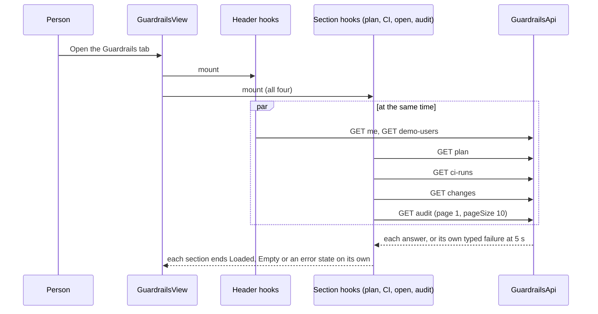

# Performance Design — u3-plugin-ui

Sources: `performance-requirements.md` (NFR1.1–NFR1.7), `tech-stack-decisions.md` (NFR2.2, NFR2.6, NFR2.9, NFR7.1), `functional-spec.md` and `rules.md` (BR1.2, BR2.2, BR6.1, BR6.3, BR7.4, D3, D5, D6), `frontend-components.md` and `contract-summary.md` (C1, timeouts of 3 seconds for reads and 10 seconds for writes at the backend).

This is a read-and-display unit with six calls and no data of its own, so the design is about when calls start, how long the page waits, and how little it renders. There is no cache and no polling. Each design choice names the requirement it meets and the test that shows it.

## Design Decisions

| ID | Decision | Meets | Why this and not another |
|---|---|---|---|
| P1 | **Start every load together from the section, not from the page.** Each section hook (`useSection`) starts its own request in an effect when the section mounts. The page never awaits one section before mounting another, and no section reads another's state. The header's `me` and `demo-users` calls start in the same render pass. | NFR1.2, NFR1.3, BR7.4 | A page-level `Promise.all` would make the page as slow as its slowest section and let one failure hide the rest. Per-section hooks give the "slowest, not the sum" behavior and let each section end in its own state. |
| P2 | **One timeout in one place.** `GuardrailsApi` wraps every call with an abort signal: 5 seconds for reads, 12 seconds for writes. A timeout is turned into the same typed failure as a lost connection (`kind: 'no-answer'`), so the screens handle two cases, not three. The timer is cleared when the call ends or the component unmounts. | NFR1.4 | The limits sit above the backend's own (3 and 10 seconds), so the backend's answer wins whenever it is up. Putting the timer in `GuardrailsApi` keeps the number in one place; screens never start timers. |
| P3 | **Pressed means working, in the same render.** `GuardedButton` takes `working` from the owner. The owner sets it in the click handler before it awaits the call (a state update batched with the click), and ignores a second activation while it is set. The set is kept in a ref as well, so two activations inside one frame still send one request. | NFR1.5, BR2.2 | State alone can lag one render behind a fast double click; the ref closes that gap without a library. |
| P4 | **Reload only what the action changed.** After a proposal only the open-changes section reloads (and the plan or CI section the action was on, because its row may no longer be eligible). After a user switch every section reloads once. After returning from the detail screen the view loads fresh. No other reload is started. | NFR1.1, D5 | Fewer calls means a shorter time to a settled page and fewer announcements. A reload is always a fresh request; nothing is cached. |
| P5 | **Stale answers are dropped.** Each load is tagged with a counter; when a section reloads (Retry, filter change, page change, switch), an answer that belongs to an older counter is discarded. Unmount aborts the call. | NFR1.1, NFR1.4 | Without this, a slow first answer could overwrite a newer one after a quick filter change, and an unmounted screen would still try to set state. |
| P6 | **Page lists in the browser, page the audit on the server.** Plan and CI lists come whole and are sliced 10 per page in memory; the audit asks the backend for `pageSize=10` and the page number (D3). A filter or page change makes one request. The open list is not paged (at most 200 rows, sorted in the browser by D6). | NFR1.6 | The plan and CI lists are small by the seeded data; the audit grows without limit, so only it pays for a request per page. |
| P7 | **Render cost kept small without memoization tricks.** Rows are plain components keyed by id; the sorted open list and the sliced pages are derived with `useMemo` on the data only; no virtualization. With 10 rows per page and at most 200 open rows the render stays under the NFR1.6 guard. If the guard test fails during Code Generation, windowing the open list is the fallback and is recorded then. | NFR1.6 | Virtualization adds focus and accessibility risk (rows leaving the page break keyboard order) for a list that is bounded. |
| P8 | **Load the screens when the route opens.** The entity tab content and the detail route are loaded through `React.lazy`-style dynamic imports from the extension definitions, so the Backstage app does not pay for them at start. The overview card is small and is the only code on the overview tab. | NFR1.7 | Route-level splitting is the standard lazy-loading unit in the new frontend system and needs no extra package. |
| P9 | **A fixed date format, no relative times.** Date-times in the audit and in the decision block show as `YYYY-MM-DD HH:mm` in the viewer's time zone, built by one `formatTime` function. The audit From and To dates are turned into the start and end of that day in the same zone (D4). | NFR7.1 | One function means tests can pin the zone and the clock and get the same text every run; it also avoids the cost and drift of live "minutes ago" text. |

## Load Sequence (Guardrails view)

Text fallback: the header and the four sections all start their calls when they mount, in the same pass; each ends in its own state when its own answer or its own 5-second limit arrives.

## Timeouts and Their Order

| Limit | Value | Set by | What the person sees when it ends the wait |
|---|---|---|---|
| Backend read to the guardrails server | 3 s | u2 | `503 SERVER_UNREACHABLE` arrives, the server error panel shows |
| Page read | 5 s | `GuardrailsApi` (P2) | `error.loadFailed` with Retry for that section |
| Backend write to the guardrails server | 10 s | u2 | the failed change or `SERVER_UNREACHABLE`, as C1 says |
| Page write | 12 s | `GuardrailsApi` (P2) | `error.submitFailed`, reason kept, button usable again |

The page limits sit above the backend limits by design, so a slow guardrails server shows the backend's answer, and only a hung plugin backend reaches the page limit.

## Budgets

| Budget | Figure | Checked by |
|---|---|---|
| Four sections loaded when each read takes 300 ms | at most 700 ms from open | Test with fake timers and a stand-in with 300 ms answers (NFR1.2) |
| Card, three reads of 300 ms | at most 700 ms | Same test on the card (NFR1.3) |
| Page read limit / write limit | 5 s / 12 s | Fake-timer tests with a stand-in that never answers (NFR1.4) |
| Working shown after press | same render, before any answer | Test asserts "Working..." is present synchronously after the click (NFR1.5) |
| First full render with seeded data | at most 1 s after the last answer | Regression guard in the simulated browser (NFR1.6) |
| Plugin code size | at most 300 KB compressed | Build script measures the gzip size and fails above 300 KB; u5 reports it (NFR1.7) |
| Real 20-load 95th percentile | at most 5 s per view | u5 on the compose sample (NFR1.1) |

## Not Designed

- Caching, polling, retries and prefetching: none (D5; C1 states no automatic retries).
- Scalability, reliability and observability: the scalability-requirements, reliability-requirements and observability-requirements documents are not produced for a UI unit (NFR Requirements, `tech-stack-decisions.md`), so there are no matching designs. One viewer on a laptop needs no scaling design; failure behavior is in `logical-components.md` and the section states of `functional-spec.md`; the plugin adds no logging or metrics of its own (security control S2 forbids logging calls with credentials).
- Server-side rendering, service workers and CDN: not applicable to a plugin inside the Backstage app.
