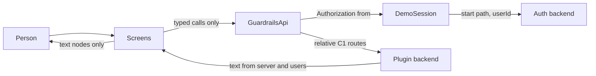
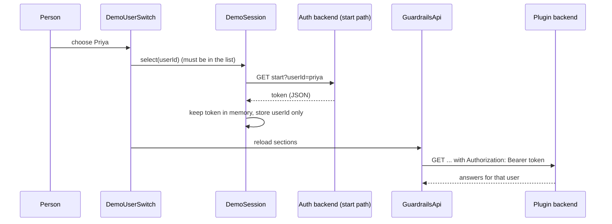

# Security Design — u3-plugin-ui

Sources: `security-requirements.md` (NFR5.1–NFR5.12 and the accepted risks), `tech-stack-decisions.md` (NFR2.4, NFR6.1), `functional-spec.md` and `rules.md` (BR3.2, BR3.5, BR4.3, BR5.1–BR5.4), `frontend-components.md`, `contract-summary.md` (C1 identity rule, C3 demo sign-in) and the u2 security design (which enforces every rule on the server).

The backend enforces every rule. This design keeps the browser from weakening that: it holds the demo credential carefully, sends nothing the backend should decide, and shows backend and user text as text. Controls are small and live in three places so they are easy to test: `GuardrailsApi` (everything that leaves the page), `DemoSession` (the credential) and `Texts` (everything that appears).

## Trust Boundaries and Where Each Control Lives

Text fallback: screens call only `GuardrailsApi`; `GuardrailsApi` takes the credential from `DemoSession` and sends only to the plugin backend; `DemoSession` is the only code that talks to the auth backend; everything coming back is rendered as text.

## Controls

| ID | Control | Meets | How it works | Test |
|---|---|---|---|---|
| S1 | **Token in memory, userId in tab storage** | NFR5.2 | `DemoSession` keeps the token in a private field of one object created per plugin instance. The only value written to `sessionStorage` is the chosen userId under one key. **Start-path shape (contract dependency):** the plugin relies on the start path of u2/u4 answering `GET <auth base>/demo/start?userId=<id>` with JSON of the Backstage sign-in response shape, the token being the string at `backstageIdentity.token` (as built in u2's `src/auth/demoSignIn.ts`); C3 names the route and the identity but not the body, so the Code Generation plan adds a contract test of this shape against u2, and the plugin treats any other answer as a failed switch (`error.generic`). The plugin never reads the token's contents or expiry; it only sends it. **Order at start:** (1) read the stored userId; (2) load `GET /demo-users` (open route, no token needed); (3) only if the stored id is a member of that list, ask the start path for a token; otherwise drop the stored value and use the app user. Calls wait on that one setup promise. The setup round trips come before the section calls on a page load that has a stored user; the NFR1.2/1.3 budgets are measured with the session already set up (a reload with a stored user adds at most the two setup calls, in sequence, ahead of the 5 s read limit). A call that answers 401 while a demo user is chosen triggers one token refresh and, for reads only, one repeat; a second 401 shows `error.unauthenticated`. With no demo user chosen a 401 is shown at once, because a refresh cannot help. Storage failures (private window, blocked) are caught and the session works for the life of the page. | Switch user, read all of `sessionStorage`, `localStorage` and cookies, find the userId and no token; reload, find a token fetched before the first call |
| S2 | **Token confined to one header** | NFR5.3 | `GuardrailsApi` adds `Authorization: Bearer <token>` in one function. Nothing else reads the token: there is no getter that returns it to screens, no log call with it, no address built from it. The error mapper builds messages from catalog keys, never from the request or response. | Full-walkthrough test collects rendered text, console output and request addresses and finds no token; the header appears only on requests to the plugin backend's base address |
| S3 | **Credential-only identity** | NFR5.4 | The call builders have no parameter for an actor, a role or a user id; request bodies are typed with only `kind`, `target` and `reason`. The two allowed exceptions are written once each: the audit `actor` filter (a value from the fixed user list) and the sign-in start path's `userId`. | Test records every request of a full walkthrough and finds `actor`, `role` or `userId` only in those two places |
| S4 | **Text, never markup** | NFR5.5 | All dynamic values are rendered as React text children. No `dangerouslySetInnerHTML`, no `innerHTML`, no `href` built from backend text, no `eval`. ESLint rule `react/no-danger` and `no-restricted-properties` for `innerHTML` and `outerHTML` are errors, enforced in CI (NFR6.1). Links the plugin creates use only fixed route templates with encoded parameters. | Test feeds `` and script-like strings into summary, cause, failure message, reason, names and target, finds them shown literally with no element created; lint failure test file with a forbidden property |
| S5 | **One address builder** | NFR5.6 | `GuardrailsApi` builds every path from fixed segment templates and passes each variable (service, change id) through `encodeURIComponent`; query strings are built with `URLSearchParams`. Filter values come from fixed lists or dates validated by `Date` parsing; a reason never goes in an address. | Test with service and change ids containing `/`, `?`, `#` and spaces reaches the right route and sends them encoded |
| S6 | **Reason handling** | NFR5.7 | `ReasonField` stops at 500 characters (`maxLength` plus a guard on pasted text). `ReasonForm` checks `reason.trim().length > 0` before it calls the API, and sends the reason exactly as typed. | Type 501 characters, find 500 kept; blank reason sends nothing |
| S7 | **Backend decides, UI shows** | NFR5.8 | `GuardedButton` receives `allowed` and `reasonKey` from the backend's allowed actions and has no other input about permission. When not allowed, its click handler returns at once and sends nothing. Which buttons appear follows the change status (D11); that is layout, not an authorization decision. An unknown reason becomes `error.generic` and disabled. | One test per reason (server unreachable, auditor, proposer, in progress, already current) activates the action and finds no request; a test with an allowed action finds it sent |
| S8 | **Switch only when offered** | NFR5.9 | `DemoUserSwitch` renders only when `GET /demo-users` returned a list; the selected id must be a member of that list or the handler refuses to call the start path. When the list is unavailable no call goes to the start path. | Demo off: no switch rendered, no request to the start path; an id outside the list is never sent |
| S9 | **Catalog-only errors** | NFR5.10 | `Texts.forError(failure)` maps the typed failure to a catalog key; only the failure message of a failed change (data, shown in the decision block) and catalog text appear. The API layer discards response bodies, status text and stack traces after reading the code field, and `console` is not called with them. | Force each C1 error code and a thrown error; only catalog text appears and no console output holds a body |
| S10 | **No addresses or secrets in code** | NFR5.11 | The plugin's API class gets base addresses from `discoveryApi.getBaseUrl('guardrails')` and `getBaseUrl('auth')` and sends with `fetchApi.fetch`. Route and start paths are relative constants. The plugin reads no config key. A build check greps the built output for `http://`, `https://` and `localhost` outside the constants file and fails on a hit; port numbers are checked in the source with a lint rule on string literals matching `:\d{2,5}(/|$)`, not in minified output where object literals would give false hits. | The grep check; the plugin starts with an empty config |
| S11 | **Bounded dependencies** | NFR5.12 | Packages are the ones in `tech-stack-decisions.md`; CI compares the lock-file diff to that list (the check reads the package names added and fails on others). | CI check on the pull request |
| S12 | **No write path in the audit section** | NFR5.1 | `AuditLogSection` is composed only of `AuditFilters`, `PagedTable` and paging controls; the `GuardrailsApi` has only `getAuditPage` for the audit. The component accepts no `onEdit` or `onDelete`. | Test lists every control in the audit section and finds filters, Clear filters and paging only; no request except reads |

## Credential Flow

Text fallback: choosing a user asks the start path for a token; the session keeps the token in memory and writes only the user id to tab storage; the next calls send the token only to the plugin backend.

## Failure and Edge Behavior

| Case | Behavior |
|---|---|
| Start path answers an error on a switch | The previous user stays; `error.generic` is announced; no state changes (BR5.4) |
| First visit with no stored user and no demo list | Calls use the app's own credential through `fetchApi`; no switch is shown (BR5.1, BR5.2) |
| Stored userId no longer in the list | The stored value is removed, the app user is used, and the switch shows the app user |
| 401 on a call | One token refresh and one replay of a read; a second 401 shows `error.unauthenticated` and offers the switch. A write is never replayed automatically |
| Tab storage unavailable | The userId is kept in memory for the page's life; reload returns to the app user |
| A write reaches the 12 s page limit | The write may still finish on the backend. `error.submitFailed` shows with the reason kept and the button usable, and the screen reloads the change before the next attempt is enabled, so a repeat meets the real state (`ALREADY_DECIDED` shows its refusal text) instead of making a duplicate |
| In-page script exposure | A script running in the page can read memory; accepted (see below), the token is short-lived and the backend setting is off by default |

## Accepted Risks (carried from the requirements)

| Risk | Control in this design |
|---|---|
| Passwordless demo sign-in (u2 NFR5.3) | The switch exists only when the backend offers the list; the setting is off by default; replace the provider before any hosted use |
| The rest of the app can show a different user than the plugin acts as | The Guardrails header always shows the user the plugin acts as; the audit log shows the same user as actor (FR5.2) |
| The userId in tab storage can be changed by any script | The start path accepts only known demo users |
| A script in the page can read the in-memory token | Out of scope for a demo; the token is never in storage, address or output, and expires |

## Security Headers and Transport

The plugin sets no headers and makes no cross-origin call: all requests go to addresses from the discovery service, which in the compose sample are the same origin as the app. Headers (CSP, framing) belong to the host app and are decided in Infrastructure Design for u4; this unit's no-raw-HTML rule (S4) is what lets a strict content policy work.
