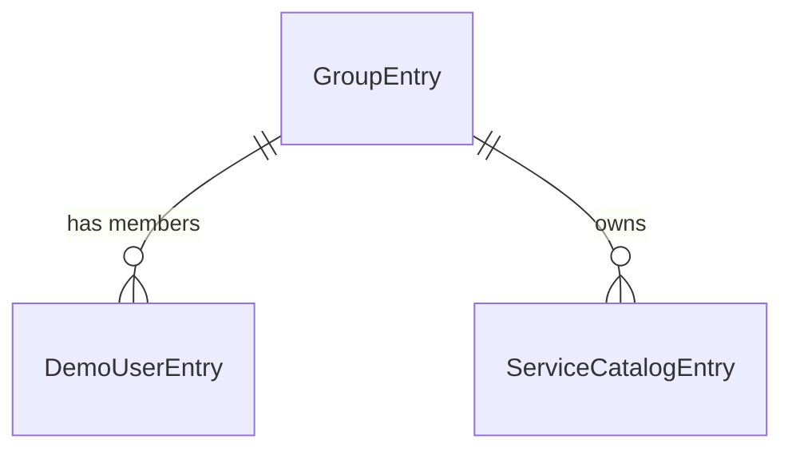

# Entities — u4-backstage-app

Sources: `unit-of-work.md` (u4 owns no entities of its own), `contract-summary.md` (C3: catalog and demo users; C4: health), `components.md`, and answers Q1 and Q2 in `functional-design-questions.md`.

u4 owns no business entities. What it does hold is the data the Backstage app reads at start-up: the catalog entries for the seeded services and the demo users, and the settings. They are listed here because the sign-in page, the catalog test and the README all depend on their exact shape. Entity kinds are Backstage's own (Component, User, Group); the names of the services are not chosen here: they are the `serviceName` values of the seed data (Q1: A).

```yaml
entities:
  - name: ServiceCatalogEntry
    description: One Backstage catalog Component per seeded service. The plugin sends the entity name in every call, so the name must equal the guardrails server's service name.
    attributes:
      - { name: name, type: string, required: true, unique: true, constraints: "equals a serviceName of the seed data set; lower-case words joined by hyphens" }
      - { name: kind, type: string, required: true, allowed: [Component], default: Component }
      - { name: type, type: string, required: true, allowed: [service], default: service }
      - { name: lifecycle, type: string, required: true, allowed: [experimental], default: experimental }
      - { name: owner, type: reference, required: true, references: GroupEntry, note: "group:default/guardrails-demo" }
      - { name: description, type: string, required: false, note: "one fixed sentence saying the service is synthetic" }
    constraints:
      - "The set of names equals the set of serviceName values of the generator's output for the seed in use."
      - "The committed file equals the script's output for the default seed (checked by a test). A run with another seed needs the catalog written again for that seed (BR3.5)."
    relationships:
      - { to: GroupEntry, cardinality: "many to one", direction: "owned by" }

  - name: DemoUserEntry
    description: One Backstage catalog User per demo user, so the app can show a name for the signed-in person. Its name is the demo userId.
    attributes:
      - { name: name, type: string, required: true, unique: true, allowed: [sam, priya, alex] }
      - { name: displayName, type: string, required: true, allowed: [Sam, Priya, Alex] }
    constraints:
      - "Exactly three entries, equal to the demo user list of contract C3 (owned by u2)."
      - "A Backstage User entity has no role. The role label on the sign-in page comes from the backend's open user list, and the backend decides what a role may do."
      - "The sign-in identity is user:default/<name>."

  - name: GroupEntry
    description: The single owner group of every service entry, so each Component has an owner.
    attributes:
      - { name: name, type: string, required: true, unique: true, default: guardrails-demo }
    relationships:
      - { to: DemoUserEntry, cardinality: "one to many", direction: "has members" }

  - name: AppSetting
    description: A setting the app reads, with the environment variable that fills it. No address, port or secret is written in code or in a committed settings file.
    attributes:
      - { name: key, type: string, required: true, unique: true }
      - { name: source, type: string, required: true, note: "environment variable or fixed value" }
      - { name: default, type: string, required: false }
    constraints:
      - "guardrails.server.url has no default: a missing value stops the app at start-up with the guardrails plugin's message naming the setting; GUARDRAILS_SERVER_URL fills it."
      - "app.baseUrl, backend.baseUrl and the backend listen port hold Backstage's local-development values and can be replaced from the environment (BR4.5)."
      - "guardrails.demoSignIn.enabled defaults to false."
```

## Summary

Three catalog kinds and one settings list. Ten catalog entries are declared in total: six service Components, three User entities and one Group. The only entity whose content is not fixed by this design is the service set, which follows the seed. Settings are listed in `functional-spec.md` ("Settings the App Reads").

## Relationship Diagram



Text fallback: the one group owns all six service entries and has the three demo users as members.
