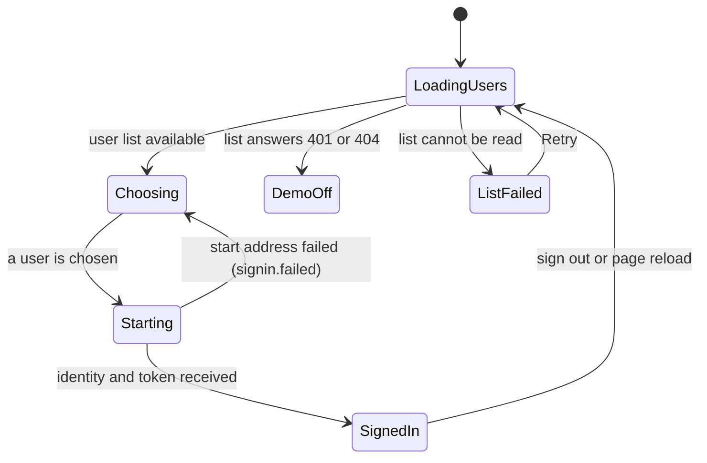
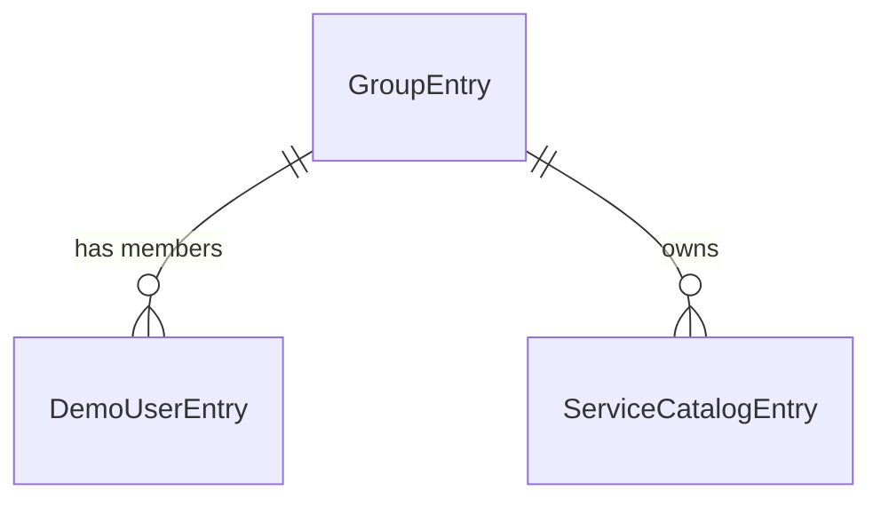

# Functional Spec — u4-backstage-app

Unit: `u4-backstage-app`, the host Backstage app. It owns no entities of its own (the catalog and settings it holds are in `entities.md`) and decides no business rule (`rules.md`). This file is the source of truth for the workflows and the sign-in states; the entity relationship diagram and the rules table below are derived views.

## Sources

- `unit-of-work.md` (U4: loads both plugins and the demo sign-in, catalog of the seeded services, the guardrails server address through settings), `unit-of-work-story-map.md` (U4 carries US5.1 and US6.2).
- `stories.md`: AC5.1.1, AC5.1.2, AC5.1.3 (US5.1) and AC6.2.1, AC6.2.2 (US6.2).
- `requirements.md`: FR5.1, FR5.2, FR7.2, FR8.1; `components.md`; `contract-summary.md`: C3 (registration, settings, demo sign-in, catalog) and C4 (the app's readiness route).
- Answers Q1 (catalog from the generator, checked by a test) and Q2 (sign-in page listing the three demo users) in `functional-design-questions.md`.
- Built by the other units and used here: `plugin-guardrails-backend` with `authModuleDemoSignIn` (u2, contract C1 and C3), `plugin-guardrails` (u3), the generator of the seed data (u1, contract C2).

## Scope

In: the app's backend and frontend entry points and what they load; the sign-in page; the catalog file and the script that writes it; the settings and the shipped configuration; the readiness route; the root `README.md`.
Out: any business rule, any entity of the plugins, the compose files and the CI workflow (u5), minikube files (u6), the plugin screens (u3).

## Design Decisions Taken

These are details the inputs left open. They were settled here and can be changed at the approval gate.

| # | Decision | Why |
|---|---|---|
| D1 | The app is minimal: the catalog (service overview with the Guardrails card and the Guardrails tab), the sign-in, the auth backend and the two guardrails plugins. No scaffolder, TechDocs, search, Kubernetes or other plugins. | The sample is about guardrails; every extra plugin is more to start, test and keep in step. |
| D2 | The catalog holds ten entries: six service Components named by the seed, three User entities for the demo users and one Group that owns the services. | The plugin needs the service names (C3); users and the group give the app names to show and every Component an owner. |
| D3 | A script writes the catalog file from the generator's output for the seed in use; a test compares the committed file with the script's output for the default seed (Q1: A). | The catalog cannot drift from the data (FR7.2); C3 asks that the names equal the seed's `serviceName` values. |
| D4 | The shipped settings read `GUARDRAILS_SERVER_URL` (required, no default), `GUARDRAILS_DEMO_SIGN_IN` (default false) and an optional database setting from the environment. Local development without compose uses an in-memory SQLite database; the compose override supplies PostgreSQL. | C3 asks for no address in code and the demo sign-in off in the shipped settings; the contract's database wording gives u4 the job of supplying the values. |
| D5 | The sign-in page lists the three demo users with their roles and nothing else (Q2: A). It takes the list from the backend's open user list. With the list unavailable (the demo sign-in is off) it shows one text and no way to sign in. | The backend refuses anyone who is not a demo user (AC5.1.3); an open list means the page needs nothing built in. |
| D6 | There is no guest sign-in. | A guest would be refused by the backend with 401 on every Guardrails call. |
| D7 | The root `README.md` is started in this unit (BR5.2). | Requested by the person; u4 is where the whole application first runs. |
| D8 | Whether the auth backend needs an `auth.providers.demo` entry in the shipped settings for the provider to be created, and how the new-frontend-system sign-in page turns the start answer into the app's identity object, are confirmed in Code Generation by running the app, and recorded in the code summary. | They depend on the pinned Backstage versions, not on a choice of behavior. |
| D9 | The sign-in is held in memory for the life of the page: the demo provider's answer is `{profile, providerInfo, backstageIdentity:{token, identity}}`, it has no refresh route, and its logout and frame routes do nothing. A reload shows the sign-in page again; an expired token shows u3's session-ended text on the next call (BR2.6). | Matches the built provider (u2), keeps the token out of storage, and avoids a renewal the provider cannot do. |
| D10 | The app is two packages, `packages/app` and `packages/backend`; the catalog file, its script and its test live with the backend package. The catalog script and its test depend on the u1 generator as a development dependency only (BR3.5). | The unit graph names u2 and u3 as dependencies; this one is added openly for the script and test, and the running app does not need it. |
| D11 | The 85% line floor applies to the app's own code (sign-in page, identity handling, catalog script, settings check), not to purely declarative configuration (BR5.3). | The team rule is about the plugin code; the app has little code of its own, so the floor is stated where it can be measured. |

### Strings of the Sign-In Page

The page is the only screen u4 owns; its texts are defined here (u3's catalog does not apply to it).

| Key | Text | Used for |
|---|---|---|
| signin.title | Choose a demo user | The page heading |
| signin.intro | This sample has three invented users. Pick one to sign in; no password is needed. | The line under the heading |
| signin.role.service-owner | Service owner | Role label |
| signin.role.platform-engineer | Platform engineer | Role label |
| signin.role.auditor | Auditor | Role label |
| signin.choose | Sign in as <name> | The name of each choice (the row action) |
| signin.off | The demo sign-in is off, so nobody can sign in. Ask whoever runs this app to turn it on. | The list answers 401 or 404 (the route is not open: the demo sign-in is off) |
| signin.loadFailed | Could not load the demo users. | The list could not be read for any other reason (with Retry) |
| signin.retry | Retry | The Retry action of the sign-in page |
| signin.failed | Could not sign in. Try again. | The start address answered an error or nothing |
| signin.loading | Loading demo users... | While the list is read |

## Settings the App Reads

| Key | Filled by | Default | Rule |
|---|---|---|---|
| `guardrails.server.url` | `GUARDRAILS_SERVER_URL` | none; a missing value stops the app with the plugin's message naming `guardrails.server.url` | BR4.1 |
| `app.baseUrl`, `backend.baseUrl`, backend listen port | environment variables (names chosen in Code Generation) | Backstage's local-development values (the app's own addresses) | BR4.5 |
| `guardrails.server.readTimeoutMs` | contract default | 3000 | BR4.1 |
| `guardrails.server.writeTimeoutMs` | contract default | 10000 | BR4.1 |
| `guardrails.demoSignIn.enabled` | `GUARDRAILS_DEMO_SIGN_IN` | false | BR4.2 |
| `backend.database` | not set locally (in-memory SQLite); compose supplies PostgreSQL and its login from environment variables | in memory | BR4.3, BR4.4 |
| `catalog.locations` | fixed local file under the app folder | the committed catalog file | BR3.4 |

## Rules Summary (derived)

`rules.md` is the source of truth; this is a reading view.

| ID | Rule | Source |
|---|---|---|
| BR1.1 | The app loads only the catalog, the auth backend, the two guardrails plugins and the demo sign-in module | FR8.1 |
| BR1.2 | The app contains no business rule | U4 boundaries |
| BR2.1 | The demo provider exists only while the setting is on | FR5.1 |
| BR2.2 | The first screen is a sign-in page listing the demo users with roles, or a text that the demo sign-in is off | FR5.1, AC5.1.1 |
| BR2.3 | Choosing a user signs in as that demo user with no password | FR5.1, AC5.1.1 |
| BR2.4 | Whoever is signed in to the app is a demo user; no guest | FR5.2, AC5.1.2, AC5.1.3 |
| BR2.5 | Signing out returns to the sign-in page | FR5.1 |
| BR2.6 | The sign-in is held in memory for the life of the page and is not renewed | FR5.1, AC5.1.1 |
| BR3.1 | One catalog Component per seeded service, named as the seed names it | FR8.1, FR7.2, AC6.2.2 |
| BR3.2 | The catalog file is written by a script and checked against the default seed | FR7.2, FR8.1 |
| BR3.3 | Three demo users and one owner group in the catalog | FR5.1 |
| BR3.4 | The catalog is read-only from the app | FR8.1 |
| BR3.5 | The committed catalog matches the default seed only; another seed needs the catalog written again | FR7.2, C4 |
| BR4.1 | The server address comes from the environment, no default | FR8.1 |
| BR4.2 | The demo switch comes from the environment, off unless set | FR5.1 |
| BR4.3 | In-memory database locally; others from the environment | FR8.1, NFR5 |
| BR4.4 | No secret in a committed file | security rules |
| BR4.5 | The app's own base addresses are local-development values, replaceable from the environment | FR8.1 |
| BR5.1 | The readiness route answers when the backend is up | C4, AC6.2.1 |
| BR5.2 | The root README documents the whole project and stays in step | the person's request |
| BR5.3 | The app's own code is tested test-first and held to the 85% line floor | team practices |

## Workflows

Each workflow is a numbered sequence of what happens. Texts are the keys of the sign-in strings above or of u3's catalog.

### W1: Start the app (US6.2)

1. The backend reads its settings (BR4.1 to BR4.5). IF `GUARDRAILS_SERVER_URL` is missing THEN the guardrails plugin stops the app with a message naming `guardrails.server.url`.
2. It loads the catalog, the auth backend, plugin-guardrails-backend and its demo sign-in module (BR1.1); the module registers the demo provider and the open user list only when the demo switch is on (BR2.1). The guardrails plugin runs its migrations on the database and starts.
3. The catalog reads the committed file and holds the ten entries (BR3.1, BR3.3).
4. The readiness route answers 200 (BR5.1). The frontend loads the catalog pages and `guardrailsPlugin`.

### W2: Open the app and sign in (US5.1)

1. The person opens the app. With nobody signed in, the sign-in page shows `signin.loading`, then the list (BR2.2).
2. IF the list is available THEN three choices appear, each with the name and a role label from the list. IF the list answers 401 or 404 THEN `signin.off` shows and nothing can be chosen. IF it fails for another reason THEN `signin.loadFailed` shows with Retry.
3. The person chooses one. The page asks the sign-in start address for that userId and receives the identity and token (BR2.3).
4. The app keeps the identity and token in memory and shows the catalog page (BR2.6). IF the start address failed THEN `signin.failed` shows and the page stays.
5. A reload, or a token that has expired, brings the person back to this page or to u3's session-ended text on the next call; the app does not renew the sign-in.

### W3: Open a seeded service (US6.2)

1. The person opens the catalog and chooses a service (for example `catalog-portal`).
2. The overview shows the Guardrails card (u3 Screen A); the tab "Guardrails" shows the view (u3 Screen B). Both call the plugin backend with the entity name and the signed-in demo user's credential.
3. The upgrade plan of the service loads in the browser (AC6.2.2).

### W4: Switch user and sign out

1. The Guardrails header's switch (u3) replaces the credential for the plugin's calls only; the app's own sign-in is unchanged.
2. Signing out ends the app session and shows the sign-in page (BR2.5).

### W5: Rebuild the catalog for a seed

1. Someone runs the catalog script with a seed (default 20261106). It prints the catalog file for that seed's services (BR3.2).
2. For the default seed the output must equal the committed file; the test fails otherwise.

## State Machines

### Sign-in

Text fallback: the page starts by loading the user list and ends as Choosing (three users), DemoOff (the list is not open, one text) or ListFailed (a text and Retry). Choosing a user moves to Starting, which ends as SignedIn or back at Choosing with an error text. Signing out or reloading the page returns to the start; the sign-in is held in memory and never renewed (BR2.6).

## Entity Relationship (derived from `entities.md`)

## Needs From Other Units

- u1: the generator's output (service names) and a way to call it from a script for a given seed; its default seed is 20261106. This is a development and test dependency of u4 (D10), added to the unit graph by this design.
- u2: `plugin-guardrails-backend` exporting the plugin and `authModuleDemoSignIn`, and the open user list at `GET /api/guardrails/demo-users`.
- u3: `plugin-guardrails` exporting `guardrailsPlugin` for the new frontend system.
- u5: the compose files that set `GUARDRAILS_SERVER_URL`, `GUARDRAILS_DEMO_SIGN_IN=true`, the PostgreSQL login, and wait for the readiness route; use the same seed for the guardrails server and the catalog (BR3.5: leave GUARDRAILS_SEED at its default, or write the catalog for the other seed); extend the README with the compose run and the browser checks.
