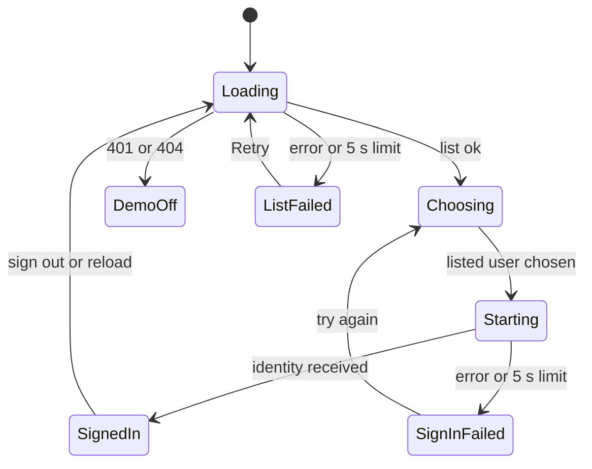

# Reliability Design — u4-backstage-app

Sources: `reliability-requirements.md` (NFR7.1 to NFR7.6), `tech-stack-decisions.md` (NFR2.3, NFR2.4, NFR2.11), `functional-spec.md` (W1, W2, W5, BR3.1, BR3.2, BR4.1, BR5.1, the sign-in state machine), `performance-requirements.md` (limits), `observability-requirements.md` (readiness route) and `contract-summary.md` (C4 readiness route, C3 settings). No availability target applies; the design makes the start repeatable, loud on failure and independent of the guardrails server.

## Patterns

| ID | Pattern | Meets | How it works |
|---|---|---|---|
| R1 | **Deterministic catalog script** | NFR7.1, NFR7.6 | The catalog script calls the u1 generator with a seed (default 20261106), sorts entries by name and writes YAML with a fixed key order and no timestamp. A test runs it twice and compares bytes, then compares the output with the committed file (NFR2.4). Runs in CI. |
| R2 | **Fail fast on a bad start** | NFR7.2 | The entry point is `main().catch(error => { log the message; process.exit(1) })`. A missing `GUARDRAILS_SERVER_URL` makes the plugin throw with the key's name; the start-up test asserts the start rejects with that message. Code Generation runs the real entry point once with the variable missing and records the exit code in the code summary; if it is not non-zero the catch above is what makes it so. u5's compose run shows the failure. |
| R3 | **Independent of the guardrails server** | NFR7.3 | The app makes no call to the guardrails server at start-up and registers no start-time dependency on it. The start-up test uses a stand-in server that is not running and finds the readiness route 200, the open routes working and the server-dependent routes answering 503 (u2). |
| R4 | **Readiness route that tells the truth** | NFR7.4 | The route is Backstage's own readiness route, which answers 200 only after the backend's plugins (including the guardrails plugin's migrations) have started. The app adds no route that answers earlier. The start-up test requests it after start and finds 200. |
| R5 | **Total sign-in state function** | NFR7.5 | `signInState(state, event)` is a pure reducer over the states loading, choosing, demoOff, listFailed, starting and signInFailed (plus signedIn). A table test feeds every state with every event and finds a defined next state; a render test finds that each state shows choices, one text or the working text, never an empty page. |
| R6 | **Same input, same output** | NFR7.6 | The page and catalog read only the user list and the committed file; there is no random value, clock text or locale-dependent formatting in the sign-in page. |
| R7 | **One feature list** | NFR2.3 | `backendFeatures` is exported from one module; the entry point and the start-up test both build from it, so a feature missing in the entry point is missing in the test. |

## State Handling

Text fallback: the same machine as `functional-spec.md`, with the failed start shown as its own state that returns to choosing, so the failure text has a state to live in.

## Recovery

| Case | Behavior |
|---|---|
| Failed sign-in | The page stays; the person tries again |
| User list unreadable | Retry |
| Guardrails server down | App, catalog and sign-in work; plugin pages show u3's unreachable states |
| Demo sign-in off | App starts and shows `signin.off` |
| Reload or expired token | Sign-in page or u3's session-ended text; no silent renewal |
| Data to back up | None of the app's own; the catalog is committed and plugin data is in the compose volume |
