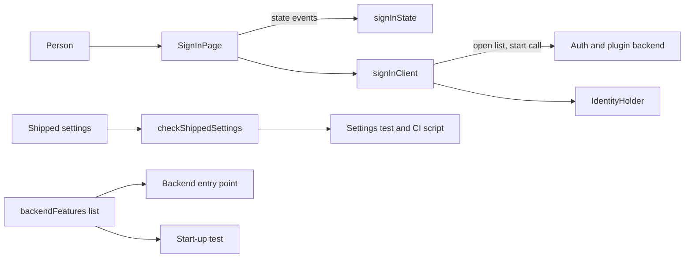
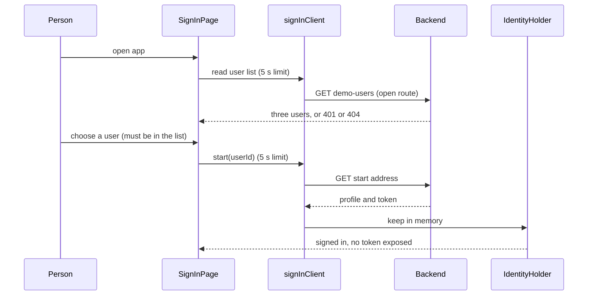

# Security Design — u4-backstage-app

Sources: `security-requirements.md` (NFR5.1 to NFR5.8 and the accepted risks), `tech-stack-decisions.md` (NFR2.3, NFR2.5, NFR5.8, NFR6.1), `functional-spec.md` (D4, D5, D6, D9, BR1.1, BR2.1 to BR2.6, BR4.1 to BR4.5), `reliability-requirements.md`, `contract-summary.md` (C3 sign-in and settings), the u2 security design (server-side enforcement) and the u3 security design (the plugin's token handling, which left security headers to this unit). Answer Q1 in `nfr-design-questions.md` (A) decided the headers.

The backend enforces every rule. The app only signs in the three demo users, never widens who can sign in, and keeps secrets and addresses out of committed files and code.

## Trust Boundaries and Where Each Control Lives

Text fallback: the page sends events to a pure state function and calls the backend only through `signInClient`; the identity holder is the only code that keeps the token; one settings-check function is called by the settings test and a CI script; one exported feature list builds both the entry point and the start-up test.

## Controls

| ID | Control | Meets | How it works | Test |
|---|---|---|---|---|
| S1 | **Demo provider only, no other sign-in** | NFR5.1 | `backendFeatures` is the one exported list: catalog backend, auth backend, `plugin-guardrails-backend`, `authModuleDemoSignIn`, app backend. No other auth module is in it. The shipped settings have `demo` as the only key under `auth.providers`. The page offers no guest path (D6). | Settings test finds `demo` alone; the start-up test sends credentials for a service principal, an unknown user and no one and finds 401 each; the real provider answers a token for sam, priya and alex and 401 for an unknown id |
| S2 | **Switch from the environment, off by default** | NFR5.2 | `app-config.yaml` holds `guardrails.demoSignIn.enabled: ${GUARDRAILS_DEMO_SIGN_IN}` with the default false written as a setting-check rule, not a literal in code. With the switch off the plugin registers neither the open list nor the provider; the page maps 401 and 404 to `signin.off`. D8 (does the auth plugin need `auth.providers.demo`) stays open to Code Generation; the controls are stated for the provider module until then. | Start-up test with the switch off: signed-out list 401, signed-in 404; with it on: 200 with three users |
| S3 | **Token confined to the identity holder** | NFR5.3 | `IdentityHolder` keeps `{profile, backstageIdentity}` in a closure created once per app instance and hands it to the framework only through the identity API's own methods (`getCredentials`, `getProfileInfo`). There is no getter that returns the token to the page, no storage call, no log call and no address built from it. The page and the state function never see it. | Sign-in test reads `localStorage`, `sessionStorage` and cookies and finds no token; the console recorder and the rendered text hold none; the token appears only as the header of calls to the plugin backend |
| S4 | **No secret or address in a committed file or in code** | NFR5.4 | The guardrails server address appears only as `${GUARDRAILS_SERVER_URL}`; the database login only as environment substitutions. `checkShippedSettings` (one function) reads every committed settings file and fails on a literal password value, on a host name other than the app's own local-development addresses, and on a missing substitution. A source lint rule on string literals matching `https?://` and `:\d{2,5}` in `packages/app/src` and `packages/backend/src` (test files excepted) fails on a hit. | Settings test and CI script both call `checkShippedSettings`; a deliberate bad fixture fails it |
| S5 | **Text, never markup** | NFR5.5 | Names and roles from the list are React text children. ESLint `react/no-danger` and `no-restricted-properties` for `innerHTML` and `outerHTML` are errors in `packages/app`, enforced in CI (NFR6.1). | Test feeds `` and script-like strings as names and roles and finds them literally with no element created; a lint fixture with a forbidden property fails |
| S6 | **CORS for the app's own address only** | NFR5.6 | `backend.cors.origin` holds the app's base address only (from the same environment variable as `app.baseUrl`), with no wildcard and credentials as the framework requires. | Settings test; start-up test sends another `Origin` and finds no `Access-Control-Allow-Origin` for it. If the test backend does not apply the setting, Code Generation records that and u5's compose run makes the check |
| S7 | **Choices come only from the list** | NFR5.7 | The page renders one button per list entry. The state function's `choose` event takes a `userId` and ignores one that is not in the current list; there is no text field. | Test sends an id outside the list to the state function and finds no request; the page has no free-text field |
| S8 | **Bounded dependencies** | NFR5.8 | `allowed-packages.txt` beside each package lists the allowed runtime and development packages with versions. A CI script compares the declared dependencies and fails on any other; a package added on purpose edits the file in the same pull request. | The script's own test with a fixture that adds a package |
| S9 | **Security headers: Backstage defaults plus one explicit content policy** (Q1: A) | NFR5.5, NFR5.6 | Backstage's default headers stay. The shipped settings add `backend.csp` allowing scripts, styles and connections from `'self'` and the backend's base address only, with no `unsafe-eval` and no wildcard host. Because S5 forbids raw-HTML insertion and the app writes no inline script, the policy has no reason to loosen. `checkShippedSettings` verifies the setting is present and holds no wildcard. u5's Chrome and Firefox run confirms the pages still load under it; if a Backstage page needs a looser directive, the change is made in settings with a note, never silently. **Update after Code Generation:** a real browser run showed Backstage's entity page failing with an `EvalError` under `script-src 'self'`, so the shipped policy allows `'unsafe-eval'` for `script-src` only (the person approved this at the unit checkpoint); every other directive still refuses it and wildcards stay refused. | Settings test; start-up test reads the policy header from a backend answer when the test backend applies it, else the check is listed as u5's |

## Credential Flow

Text fallback: the page reads the open list, the person chooses a listed user, the client asks the start address, and the identity holder keeps the answer in memory without handing the token to the page.

## Failure and Edge Behavior

| Case | Behavior |
|---|---|
| List 401 or 404 | `signin.off`, nothing to choose (BR2.2) |
| Start call error or limit | `signin.failed`, the page stays usable |
| Reload | Back to the sign-in page; nothing was stored (D9) |
| Expired token | u3's session-ended text on the next call; no renewal |
| Missing `GUARDRAILS_SERVER_URL` | The guardrails plugin stops the start with a message naming the key and no value |

## Accepted Risks (carried from the requirements)

| Risk | Control in this design |
|---|---|
| Passwordless demo sign-in | Off by default (S2); README states the risk |
| A script in the page can read the in-memory token | Token never in storage, address or output (S3); content policy and no raw HTML make injection harder (S5, S9) |
| The user list is readable while the switch is on | Three invented users; present only while the switch is on (S2) |
