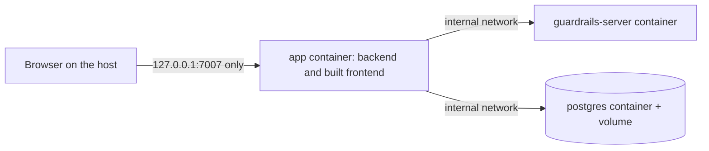

# Security Design — u5-compose-and-ci

Sources: `nfr-requirements/security-requirements.md` (NFR5.1 to NFR5.12), `nfr-requirements/tech-stack-decisions.md` (NFR1.1 to NFR7.2), `contract-summary.md` (C3 sign-in, the guardrails server address and readiness route), the u4 infrastructure specification (variable names, the two settings files, the readiness route), u4's `check-exit.mjs`, the u1 server image (`packages/guardrails-server/Dockerfile`), the existing workflow `.github/workflows/ci.yml`, and `nfr-design-questions.md` (no open questions; the settled design choices were confirmed). u5 has no `functional-spec.md` or `rules.md` (it adds no behavior), so no behavior rule is designed here.

This is a design: patterns, files and what each file must do. Complete files are written in Code Generation. Where a design depends on how a real container behaves (read-only file systems), it says what to try first and what the written fallback is; a real run in Code Generation settles it.

## Architecture of the Run



Text fallback: the browser reaches only the app, on 127.0.0.1 port 7007. The app talks to the guardrails server and to PostgreSQL over a network that is marked internal, so neither can be reached from the host or reach the internet. The app is the only container on the second, outward-facing (`edge`) network.

| Container | Image | Joins | Publishes | Health check |
|---|---|---|---|---|
| `app` | built by u5 from u4's output (`packages/backend/Dockerfile`) | `edge`, `internal` | `127.0.0.1:7007:7007` (NFR5.1) | Node probe of `/.backstage/health/v1/readiness` |
| `guardrails-server` | u1's image, unchanged | `internal` | nothing | u1's own probe |
| `postgres` | `postgres` at an exact tag | `internal` | nothing | `pg_isready` |

## Compose File Design (`compose.yaml`)

Pattern: least privilege applied to each service the same way, and a hard order of start. Illustrative fragment (not the whole file):

```yaml
services:
  app:
    build: { context: ., dockerfile: packages/backend/Dockerfile }
    user: '1000:1000' # the image's non-root user
    read_only: true
    cap_drop: [ALL]
    security_opt: ['no-new-privileges:true']
    tmpfs:
      - /tmp
      - /app/node_modules/app/dist/static # filled at start, see below
    ports: ['127.0.0.1:7007:7007']
    depends_on:
      guardrails-server: { condition: service_healthy }
      postgres: { condition: service_healthy }
    restart: 'no'
```

Rules the file follows (each is also a unit test, NFR2.3):

- Exactly one `ports` entry in the whole file, bound to `127.0.0.1` (NFR5.1). `internal: true` on the `internal` network.
- Every service: non-root `user`, `cap_drop: [ALL]`, `no-new-privileges`, a health check, `restart: "no"` (NFR5.3, NFR2.7). `read_only: true` for the server (hard) and for the app and PostgreSQL with the writable paths named below.
- Values come from `${NAME}` substitutions read from `.env.compose`, passed by `--env-file`; the file holds no password, no token and no address of the host machine. The guardrails seed is the literal `20261106` (NFR7.1). `GUARDRAILS_SERVER_URL=http://guardrails-server:7007` is set on the app, `GUARDRAILS_DEMO_SIGN_IN=true` (NFR5.5), and `APP_BASE_URL` equals `BACKEND_BASE_URL` equals `http://localhost:7007` (u4 hand-off: the two base URLs must be equal).
- The app starts with `--config app-config.yaml --config app-config.postgres.yaml` (u4's two-file form), so the PostgreSQL settings are used for real. The five `POSTGRES_*` values are the same variables for the app and the database (NFR2.12).
- The server keeps its image's default port, 7007 inside its own container (each container has its own network space, so this does not clash with the app's 7007); the address the app is given is `http://guardrails-server:7007`. The `localhost:7100` in `.env.example` is for `yarn start:local` only and is not used here.

### Writable paths (answer to R-01, NFR5.3)

| Container | Writable | Why |
|---|---|---|
| `guardrails-server` | nothing | u1's image writes nothing; `read_only: true` is a hard test |
| `app` | `/tmp` (tmpfs) and the frontend static directory (tmpfs) | the app-backend plugin rewrites the frontend's JavaScript at start to inject the runtime settings (`injectConfigIntoStatic`) |
| `postgres` | the data volume, `/tmp` (tmpfs), `/var/run/postgresql` (tmpfs) | data, temp files and the socket |

Static directory pattern: a tmpfs mount is empty, so the image keeps the built frontend twice, a pristine copy at `/app/app-static-src` (read-only, root-owned) and the place the app-backend plugin reads, which is the tmpfs. The image's start command (in the Dockerfile, so the image is self-contained and u6 reuses it) copies the pristine copy into the tmpfs and then starts the backend. The copy is a plain recursive copy that does not try to preserve the owner (`cp -R`; BusyBox `cp -a` would try to and could stop the chain when run as the non-root user). The copy is the only step before the start, so a failed copy stops the container with a non-zero code (NFR2.7). A named volume is not used for the static directory because it would keep an old frontend across a rebuild.

Fallback, written down and tested: if a real run shows the plugin also needs to write elsewhere, or PostgreSQL will not start under the stated rights, the service gets a written exception that names exactly what is relaxed (`read_only`, the user, or a short `cap_add` list), the reason in a comment in the compose file and in the unit's code summary; the compose-file test asserts the service's writable set and capability list equal the written exception, so it can never widen silently (NFR5.3).

### PostgreSQL rights (answer to the review)

PostgreSQL is the Alpine variant at an exact tag (`16.x.y-alpine3.xx`, chosen on the day, shared with the two plugin jobs, NFR5.4). In that image the `postgres` user has the fixed numeric id 70 and the image's data directory is owned by it, so a new named volume gets the right owner when it is first created. The service is started directly as that user: `user: '70:70'`, with `cap_drop: [ALL]` and `no-new-privileges`. Started as that user the image's entrypoint does not switch users, so it needs no capability. The non-root test accepts a numeric id other than 0 or the name `postgres`. The first real run settles it; if `initdb` or the volume ownership fails, the written exception above restores the image's own start as root with a short `cap_add` list (`CHOWN`, `SETUID`, `SETGID`, `DAC_OVERRIDE`, `FOWNER`) and keeps `cap_drop: [ALL]` before it, so the list is the whole difference.

### Settings files, catalog and start command (answer to the review)

The image's working directory is `/app`, the directory the backend is started from, because Backstage reads `--config` files and the catalog file target relative to the working directory. The Dockerfile puts these in `/app`: `app-config.yaml`, `app-config.postgres.yaml` and the `catalog/` folder (copied from `packages/backend/`), so `./catalog/guardrails-catalog.yaml` and both `--config` names resolve. The image's command is:

```sh
cp -R /app/app-static-src/. /app/node_modules/app/dist/static/ \
  && exec node packages/backend \
       --config app-config.yaml --config app-config.postgres.yaml
```

A unit test (NFR2.3) reads the Dockerfile and `app-config.yaml` and asserts that every `--config` file in the command and the catalog `target` path resolve to files the Dockerfile copies into the working directory, so a missing file fails in `e2e-unit` and not as an empty catalog in the end-to-end run.

## App Image Design (`packages/backend/Dockerfile`)

Pattern: multi-stage, like the server image, built from the repository root, base `node:24.11.0-alpine3.22` (the `ARG NODE_IMAGE` default is the single place of the tag, NFR5.4).

- Build stage: `yarn install --frozen-lockfile`, build the frontend (`yarn workspace app build`, which writes `packages/app/dist`) and the backend bundle (`backstage-cli package build` in `packages/backend`, which writes `dist/skeleton.tar.gz` and `dist/bundle.tar.gz`).
- Runtime stage: unpack the skeleton and install production dependencies only, unpack the bundle, copy the built frontend to `/app/node_modules/app/` (its `package.json` and `dist`), where the app-backend plugin looks for the package named `app` (this keeps u4's `package.json` files unchanged), copy the committed catalog and the two settings files, add the pristine static copy, set `USER node` and `EXPOSE 7007`.
- Size and content (NFR1.4): no source, no test code, no development dependencies, no `.git`. A root `.dockerignore` already exists (it excludes `node_modules`, `dist`, `.git`, `aidlc` and others); u5 extends it with `.env*` (and `coverage`, `dist-types` if missing) so `.env.compose` cannot enter a build context, and a unit test asserts the entries (NFR5.2). A build step prints the image size, and the compose job fails above 550 MB (raised from 500 MB; person-approved 2026-11-09).
- Native modules: the install uses `--ignore-scripts`, as the server image does, so the Alpine image needs no compiler. `better-sqlite3` is then not built, which is correct for this run because the compose run uses PostgreSQL only and the database client is loaded lazily from the settings. Whether the frontend build and the CLI also work under `--ignore-scripts` (they use prebuilt optional packages) is one of the things the first real image build must settle; if they do not, only the build stage gets a toolchain, never the runtime stage.
- No secret is a build argument or in a layer; the image has no `HEALTHCHECK` secret and no `latest` tag (NFR5.4).

## Start Script Design (`yarn compose:up`, `compose:down`, `compose:reset`)

Pattern: a thin `.mjs` entry calling tested TypeScript in `packages/e2e/src` (NFR2.1, NFR2.10).

1. `ensureEnvFile` creates `.env.compose` if it is missing: a random 32-character password from the system's secure random source for `POSTGRES_PASSWORD`, plus the fixed non-secret names (`POSTGRES_HOST=postgres`, `POSTGRES_PORT=5432`, `POSTGRES_DB=guardrails`, `POSTGRES_USER=guardrails`). It never prints the password, never overwrites an existing file (NFR5.2) and writes it with mode 0600. `.gitignore` lists `.env.compose`. If the file is missing but the PostgreSQL volume of the sample already exists (the stored password would no longer match a new one), it stops with a plain message that names `yarn compose:reset` instead of creating a file that cannot work.
2. `refuseOtherSeed` stops with a plain message when `GUARDRAILS_SEED` is set to anything but `20261106` in the environment or the file (NFR7.1).
3. `checkDocker` stops with a plain message when the `docker` command or Compose v2 is missing.
4. One helper (`composeArgs`) builds the argument list for every `docker compose` call of the script, the specs and the job: `--project-name guardrails-sample --env-file .env.compose`. `ps`, `logs`, `run`, `down` all use it, so none of them can read a developer's own `.env` (which holds `localhost` addresses for `yarn start:local`); a unit test asserts every call is built by the helper. It runs `docker compose <args> up --build --wait --wait-timeout 180` (NFR1.2, NFR2.2) and prints the address, and on failure prints `docker compose ps` and each service's log (NFR2.6).
5. `compose:down` runs `down` (keeps the volume); `compose:reset` runs `down --volumes` and says that the data is removed (NFR2.8). The end-to-end run always starts with a reset (NFR7.2).

## Browser and Header Checks Design (`packages/e2e`)

Pattern: Playwright with three projects against the one running stack, sharing helper modules for sign-in, markers and reports.

- Projects: `chrome` (Google Chrome stable channel) and `firefox` (the tool's pinned build) run the flow, accessibility and keyboard specs (NFR3.1, NFR3.2, NFR3.3, NFR4.1); `timing` runs in Chrome only (NFR1.1). Window 1440 by 900. A fresh browser context for every timed load (empty cache).
- Specs: `flows` (view plan, propose upgrade, view failed runs, propose re-run, approve and reject with a required reason, retry a failed change, filter and page the audit log), `a11y` (axe with the rule sets `wcag2a`, `wcag2aa`, `wcag21a`, `wcag21aa`, real contrast, on every screen, "incomplete" results written to the report), `keyboard` (the whole propose, approve, audit task with key events only, and a focus check), `tree` (accessibility-tree snapshots with a name for every control), `headers-token` (NFR5.6, NFR5.7), `audit-append-only` (NFR5.11), `repeatability` (NFR7.1, NFR7.2), and `timing`.
- Header and token specs use plain HTTP requests (no browser). For NFR5.6 they send `Origin: http://localhost:7007` and `Origin: https://example.org` and read `Access-Control-Allow-Origin` and the page's `Content-Security-Policy`. For NFR5.7 they sign in as each of the three demo users through `GET /api/auth/demo/start?userId=…`, call the plan of a seeded service with the token (expect 200 with the seeded dependencies), and with no token, a malformed one and one with a changed character (expect 401 each). For NFR5.11 they send `PUT`, `PATCH` and `DELETE` with a valid token to the audit route and an entry address (expect 404 or 405) and compare the entry count before and after.
- Timing (NFR1.1): one helper holds the data-ready marker of each of the six views (from `tech-stack-decisions.md`); a pure function computes the nearest-rank 95th percentile (the 19th smallest of 20) and is unit tested, including the edge cases of equal values and a wrong sample count. `yarn e2e:timing` exits non-zero above 5000 ms for any view and writes all times to a JSON file the job uploads. Before the 20 loads the spec creates three proposals through the API so the lists have rows.
- Output hygiene (NFR5.10): Playwright's trace, video and HAR capture are off in every project (`trace: 'off'`); only screenshots on failure and the text report are kept, so request headers and storage are never recorded. After the run, a `scanOutputs` module searches `docker compose logs` and every file of the report folder for (a) the database password, (b) every token the specs obtained, and (c) any token-shaped text, that is a JSON-web-token pattern (three base64url parts starting `eyJ`) or a `Bearer ` header value, which catches tokens the browser flows got through the sign-in page, and fails on a hit. The module opens `.zip` files and scans their entries too, so turning trace capture on later cannot hide a token. Its unit tests plant a password and a token in a plain file and in a zip entry and expect a hit for each, and a clean folder expects none. The specs keep tokens in memory only.
- Missing-address check (NFR5.12, NFR7.2): with the stack up, `docker compose run --rm --no-deps -T -e GUARDRAILS_SERVER_URL= app` starts a second app container on the compose network (the database is reachable, so the result does not depend on whether the key check or the database connection comes first). The container is started without `--rm` and with a fixed name, so it can be inspected after it ends (the helper removes it afterwards, also on failure). The check waits at most 60 seconds for it to exit, then requires a non-zero `State.ExitCode`, output containing `guardrails.server.url` (what the backend prints and what u4's `check-exit.mjs` asserts), and that `State.Health.Status` never reached `healthy` ("never healthy" means: it exited before its health check passed). The call is built by the `composeArgs` helper, so it reads `.env.compose`. If an empty value is not treated as missing by the settings reader, Code Generation uses a small override file that omits the variable instead; the check does not change. It adds to u4's `check:exit`: that runs the source entry point on the host, this one runs the built image.

## Pipeline Design (`.github/workflows/ci.yml`)

Pattern: the existing jobs stay; u5 adds four jobs and makes three small edits to existing ones.

Two points where this design supersedes wording in the requirements, with the reason: the job that tests the compose file and the workflow without Docker is `e2e-unit` (the requirements' NFR2.16 says `compose-files`; both would run the same package's unit tests, so there is one job), and the missing-address check uses `docker compose run --no-deps` on the running stack (NFR5.12 says `docker run` of the image; outside the compose network the database host would not resolve, see the alternatives table). The requirement's pass conditions are unchanged.

- `e2e-unit`: installs, runs `packages/e2e` unit tests with coverage (85% line threshold in the package's own settings, NFR2.1), includes the compose-file tests (NFR2.3) and the workflow tests (NFR2.4, NFR5.9). No Docker, 15-minute limit.
- `app-image`: builds the app image (not pushed), checks non-root user, exactly one exposed port and the 550 MB (raised from 500 MB; person-approved 2026-11-09) limit, as the existing `image` job does for the server (NFR5.3, NFR1.4).
- `compose-e2e`: 25-minute limit. Steps in order: install; `yarn compose:reset`-then-`compose:up`; `playwright install --with-deps chrome firefox`; flows, accessibility, keyboard and tree specs; header, token and audit specs; repeatability; timing; missing-address check; output scan; on any failure `docker compose ps` and logs; always `compose:down` and upload the report and timing numbers (7-day retention). Each step prints its time (NFR1.3).
- `ci-ok`: `needs` lists every other job, `if: always()`, and a first step that fails when any needed job's result is not `success`. The repository's required status is this job alone (NFR2.5, FR10.1).
- Edits to existing jobs: `timeout-minutes: 15` on each; `postgres:16` becomes the same exact tag as compose; the throw-away `postgres` login stays and is the named exemption of the secret test (NFR5.2).
- `permissions: contents: read` stays at the top; no `pull_request_target`; no `secrets.`; no registry login, push or deploy (NFR5.9, NFR2.17).
- Dependency control: the new package's allow-list file, checked with the same script pattern as u4 (NFR5.8).

## Formatting and Lint (NFR6.1)

`packages/e2e` gets Backstage's lint configuration (`backstage-cli package lint`) added as a step in the existing `lint` and `typecheck` jobs. Prettier already covers every file type of the repository, including `compose.yaml`, the workflow and the Markdown.

## Design Decisions and Alternatives

| Decision | Alternative | Why not |
|---|---|---|
| `edge` and `internal` networks, the second marked internal | One default network with only the app published | One network would let the database and server reach the internet and each other freely; the second network costs one line. |
| Pristine static copy and a tmpfs filled at start | Leave the static directory writable in the image; a named volume | A writable image directory weakens the read-only claim; a volume would serve an old frontend after a rebuild. |
| `.env.compose` separate from `.env` | One shared `.env` | `.env` holds `localhost` addresses for `yarn start:local`; the same file in compose would give the container the wrong server address. |
| `docker compose run --no-deps` for the missing-address check | `docker run` of the image outside the network | Outside the network the database host does not resolve and the failure could come from the database, not the missing key. |
| One `ci-ok` summary job | Required status per job | Every new job would need a repository setting change (NFR2.5). |
| Header, token and audit checks as plain HTTP requests | Run them inside the browser | They do not need a browser, run faster and fail with clearer output. |

## Traceability

`traceability.json` lists the 15 IDs the tool derived from the security requirements (the ones that document names); the table below covers every ID of both requirements documents, NFR1.1 to NFR7.2.

| ID | Designed by |
|---|---|
| NFR1.1 | Timing project and the percentile helper; markers in one helper file; `yarn e2e:timing` blocks |
| NFR1.2 | `up --wait --wait-timeout 180` in the start script |
| NFR1.3 | Time limits per job; per-step timing printed; budget in `tech-stack-decisions.md` |
| NFR1.4 | Multi-stage app image, `.dockerignore`, size check in `app-image` and `compose-e2e` |
| NFR2.1 | `packages/e2e/src` unit tests, 85% threshold, `e2e-unit` job |
| NFR2.2 | Start script: `compose:up` with `ensureEnvFile`, build, wait, address |
| NFR2.3 | Compose-file tests in `e2e-unit` (ports, rights, health checks, order, equal base URLs, volume) |
| NFR2.4 | Workflow tests in `e2e-unit`; `ci-ok` covers every job |
| NFR2.5 | `ci-ok` as the single required status; README names the repository setting |
| NFR2.6 | Failure output of the start script and the job (ps and logs); uploaded report |
| NFR2.7 | `depends_on` with health conditions, `restart: "no"`, readiness-route probe |
| NFR2.8 | `compose:down` and `compose:reset`; the run starts from a reset |
| NFR2.9 to NFR2.15 | The technology choices of `tech-stack-decisions.md` (Compose v2, Node start script, one app image, PostgreSQL, Playwright, TypeScript helpers), realised by the compose file, the app image, the start script and `packages/e2e` above |
| NFR2.16 | The four new jobs `e2e-unit`, `app-image`, `compose-e2e`, `ci-ok` (`e2e-unit` takes the place of `compose-files`) and the three edits to existing jobs, in Pipeline Design |
| NFR2.17 | No registry login, push or deploy step; checked by the workflow tests |
| NFR3.1 | `a11y` spec, axe rule sets, real contrast, both browsers |
| NFR3.2 | `keyboard` spec, key events only, focus check |
| NFR3.3 | `tree` spec, accessibility-tree snapshots |
| NFR3.4 | README checklist; open item in the code summary |
| NFR4.1 | `flows` spec in the `chrome` and `firefox` projects |
| NFR4.2 | Browser versions printed in the report; Firefox moves with the tool's pinned version |
| NFR5.1 | One loopback `ports` entry; `internal` network; compose-file test |
| NFR5.2 | `.env.compose` generated, ignored, mode 0600; secret test with the two-entry exemption; `.dockerignore` |
| NFR5.3 | Rights on every service; writable-path table; fallback with a written exception |
| NFR5.4 | Exact tags, `ARG` default read by the test, one PostgreSQL tag, `actions/*` only |
| NFR5.5 | `GUARDRAILS_DEMO_SIGN_IN=true` in compose only; README text; sign-in choices checked in the flows |
| NFR5.6 | `headers-token` spec: origin and content-policy checks |
| NFR5.7 | `headers-token` spec: real token, three users, three refusals |
| NFR5.8 | Allow-list file and script for `packages/e2e` |
| NFR5.9 | Workflow tests: read-only token, no `pull_request_target`, no push or login, limits |
| NFR5.10 | `scanOutputs` after the run |
| NFR5.11 | `audit-append-only` spec: token-carrying write attempts and counts |
| NFR5.12 | `docker compose run --no-deps` with the variable emptied; exit code, message, health |
| NFR6.1 | Lint and typecheck steps for the new package; Prettier covers all files |
| NFR7.1 | `repeatability` spec and the seed refusal in the start script |
| NFR7.2 | Reset before the run; empty changes and audit lists checked; the missing-address run |
