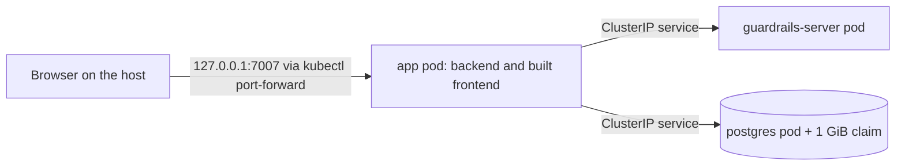

# Security Design — u6-minikube-run

Sources: `nfr-requirements/security-requirements.md` (NFR5.13 to NFR5.22) and `nfr-requirements/tech-stack-decisions.md` (NFR1.5 to NFR7.4) of this unit; `contract-summary.md` (C3 settings and sign-in, C4 health routes and the server address); the finished `compose.yaml`, `packages/backend/Dockerfile`, `.github/workflows/ci.yml` and `packages/e2e` (`specs/support/stack.ts`, `specs/timing.spec.ts`); u5's `nfr-design/security-design.md` (the compose design this one mirrors); and `nfr-design-questions.md` (no open questions; the settled design choices were confirmed). u6 has no `functional-spec.md` or `rules.md` (it adds no behavior and owns no entity), and for a packaging unit the performance, scalability, reliability and observability requirement documents are not produced (their few items are rows in `tech-stack-decisions.md`), so no behavior rule and no separate design document for those categories exist here.

This is a design: patterns, files and what each file must do. Complete files are written in Code Generation. Where a design depends on how a real pod behaves, it says what to try first and what the written fallback is; a real run settles it.

## Architecture of the Run



Text fallback: the browser reaches only the app, through a port-forward that listens on 127.0.0.1 port 7007 only. The app reaches the guardrails server and PostgreSQL through cluster-internal services; neither is exposed outside the cluster. Everything lives in the namespace `guardrails-sample`.

| Workload | Kind | Image | Service | Readiness and liveness |
|---|---|---|---|---|
| `app` | Deployment, 1 replica | `guardrails-app:local` built from `packages/backend/Dockerfile` | ClusterIP `app:7007` | httpGet `/.backstage/health/v1/readiness` |
| `guardrails-server` | Deployment, 1 replica | `guardrails-server:local` built from `packages/guardrails-server/Dockerfile` | ClusterIP `guardrails-server:7007` | exec `node packages/guardrails-server/dist/probe/healthcheck.js` |
| `postgres` | StatefulSet, 1 replica | the compose tag `postgres:16.15-alpine3.24` (kept equal by test) | ClusterIP `postgres:5432` | exec `pg_isready` |

## Manifest Design (`k8s/`)

Pattern: one Kustomize base, one file per concern, namespaced objects only, so a hosted overlay can be added later without touching it (Q1: A). The namespace object is created by the start script, not by the kustomization, so removing the sample cannot be blocked by a missing or shared namespace file.

```
k8s/
  kustomization.yaml   # namespace: guardrails-sample; resources below; no secretGenerator
  configmap.yaml       # settings, same names as compose
  serviceaccounts.yaml # one per workload, no role bindings
  postgres.yaml        # StatefulSet + Service
  guardrails-server.yaml
  app.yaml
```

Settings (`configmap.yaml`): `GUARDRAILS_SERVER_URL=http://guardrails-server:7007`, `GUARDRAILS_DEMO_SIGN_IN=true` (NFR5.19), `APP_BASE_URL` and `BACKEND_BASE_URL` both `http://localhost:7007`, `BACKEND_PORT=7007`, `POSTGRES_HOST=postgres`, `POSTGRES_PORT=5432`, `POSTGRES_DB`, `POSTGRES_USER` (the same non-secret values as compose), and `GUARDRAILS_SEED=20261106` as a literal on the server. `POSTGRES_PASSWORD` comes only from the Secret `guardrails-db` through `secretKeyRef` on the app and PostgreSQL containers.

### Pod rights (NFR5.15)

Every pod and container carries this block (illustrative, one workload shown; the user ids differ):

```yaml
spec:
  automountServiceAccountToken: false
  securityContext:
    runAsNonRoot: true
    runAsUser: 1000 # 70 for postgres
    runAsGroup: 1000
    fsGroup: 1000 # volume ownership, see below
    seccompProfile: { type: RuntimeDefault }
  containers:
    - securityContext:
        allowPrivilegeEscalation: false
        readOnlyRootFilesystem: true
        capabilities: { drop: [ALL] }
```

| Workload | Writable mounts (the whole set; a test asserts it) | Ownership |
|---|---|---|
| `guardrails-server` | none | not applicable |
| `app` | `emptyDir` at `/tmp`; `emptyDir` at `/app/node_modules/app/dist/static` | `fsGroup: 1000` makes both group-writable by the app user |
| `postgres` | the claim at `/var/lib/postgresql/data` (with `PGDATA=/var/lib/postgresql/data/pgdata`, because a new volume root is not empty and `initdb` refuses it); `emptyDir` at `/tmp`; `emptyDir` at `/var/run/postgresql` | `fsGroup: 70` |

The static directory follows the compose pattern: the image's own start command copies the pristine frontend into it, then starts the backend (u5 design, "Settings files, catalog and start command"). No image change is needed; the `emptyDir` stands where the tmpfs stood. As in compose, `cp -R` without owner preservation is kept so a non-root copy cannot stop the chain.

Fallback, written down and tested: if a real start shows a container cannot run under a setting, that workload gets a written exception naming exactly what is relaxed, with the reason beside the manifest and in the code summary, and the manifest test asserts the workload's mounts and capability list equal the written exception, so it can never widen silently (NFR5.15). PostgreSQL is the likeliest case, as in compose; the exception there restores the image's own start with a short `capabilities.add` list after `drop: [ALL]`.

### Probe timings (NFR2.20)

The probes carry the same budgets as compose's health checks, because Kubernetes defaults are tighter (an exec probe times out after 1 second, and a liveness probe restarts a container after 3 failures at 10-second intervals, about 30 seconds). A startup probe holds liveness and readiness off until the container has started, so a slow first start with migrations is not mistaken for a hang.

| Workload | Startup probe | Readiness probe | Liveness probe |
|---|---|---|---|
| `guardrails-server` (exec `healthcheck.js`, which allows its own request 2000 ms) | `periodSeconds: 5`, `timeoutSeconds: 3`, `failureThreshold: 12` (60 s, compose's 12 retries) | `periodSeconds: 5`, `timeoutSeconds: 3`, `failureThreshold: 3` | `periodSeconds: 10`, `timeoutSeconds: 3`, `failureThreshold: 3` |
| `app` (httpGet of the readiness route) | `periodSeconds: 5`, `timeoutSeconds: 5`, `failureThreshold: 30` (150 s plus the initial delay, compose's 30 retries and 20 s start period) | `periodSeconds: 5`, `timeoutSeconds: 5`, `failureThreshold: 3` | httpGet of `/.backstage/health/v1/liveness`, `periodSeconds: 10`, `timeoutSeconds: 5`, `failureThreshold: 6` |
| `postgres` (exec `pg_isready`) | `periodSeconds: 5`, `timeoutSeconds: 5`, `failureThreshold: 20` (compose's 20 retries) | `periodSeconds: 5`, `timeoutSeconds: 5`, `failureThreshold: 3` | `periodSeconds: 10`, `timeoutSeconds: 5`, `failureThreshold: 6` |

The app's liveness probe deliberately does not use the readiness route: readiness is not-200 until migrations finish and while the guardrails server is unreachable, and a liveness check on it would restart a healthy app whenever a dependency blinks. Code Generation confirms the liveness route exists in the Backstage backend and, if it does not, uses a TCP probe on port 7007 instead and records that. The manifest test (NFR2.20) asserts that every probe has an explicit `timeoutSeconds` of at least the value in the table and that each startup budget (`periodSeconds` times `failureThreshold`) is at least compose's.

### Start order (NFR2.20, NFR2.7)

The app pod has two init containers, run in order, both with the same rights block and no writable mount:

1. `wait-postgres`: the PostgreSQL image's `pg_isready -h postgres -p 5432` in a loop with a 2-second sleep, giving up after 120 seconds.
2. `wait-server`: the app image's Node, running a short fetch of `http://guardrails-server:7007/healthz` in a loop, each request bounded by `AbortSignal.timeout(2000)` so a hung connection cannot stall the loop, giving up after 120 seconds.

A failed init container stops the pod from starting, so `kubectl rollout status` fails inside the 5-minute bound and the start script prints the diagnosis (NFR1.6, NFR2.22). Probes alone were rejected: the app would start, fail to reach PostgreSQL and restart, which is noisy and slower. After the init containers, the app's readiness probe is still the readiness route of u4, so "ready" means the plugin's migrations finished. Each Deployment sets `progressDeadlineSeconds: 300`.

### Server-down flow (NFR2.24)

The guardrails server pod sets `terminationGracePeriodSeconds: 5`. The flow stops and restarts the server through `kubectl` calls built by one module in `packages/e2e/src` (see "Stack Control" below), in a fixed sequence that cannot race:

1. **Find:** read the name of the running server pod (`get pod -l app=guardrails-server -o name`), refusing if there is none.
2. **End:** `scale deployment/guardrails-server --replicas=0`, then `wait --for=delete pod/<that name> --timeout=30s`. The call returns only when the pod object is gone, so the spec never proceeds while the old pod could still answer, and the later restore cannot match the terminating pod.
3. **Start:** `scale deployment/guardrails-server --replicas=1`, then `rollout status deployment/guardrails-server --timeout=60s`. Rollout status waits for the new pod to be ready and cannot match zero pods.

Because the end step waits for deletion, the server is down from the plugin's side as soon as step 2 returns. Code Generation measures that the pod stops answering well inside the plugin's 5-second probe-reuse window (the time between the scale call and the first refused connection); if it does not, only the minikube path of the spec is adjusted and the measured numbers are recorded in the code summary.

## Secret Design (NFR5.14)

`ensureSecret` in `packages/e2e/src`:

1. Reads whether `secret/guardrails-db` exists in `guardrails-sample`. If it does, nothing is written (a second `up` leaves it unchanged, and so do the data and the login).
2. Otherwise generates a random 32-character value from the system's secure random source and creates the Secret with `kubectl create secret generic guardrails-db --from-file=POSTGRES_PASSWORD=/dev/stdin`, writing the value to the child's standard input. The value is in no argument list, no environment dump, no file and no log (a unit test inspects the arguments of the call and the output of the function).
3. If the claim exists but the Secret does not (a login that cannot match the stored one), it stops with a plain message that names `yarn minikube:down`, as `compose:reset` does for compose.

## Start Script Design (`yarn minikube:up`, `minikube:down`)

Pattern: a thin `.mjs` entry calling tested TypeScript in `packages/e2e/src` (NFR2.18, NFR2.31). Every external call goes through one runner function so the unit tests can fake it.

1. `checkTools`: `docker`, `minikube` and `kubectl` present, with a plain message that names the missing one and where to get it.
2. `ensureCluster`: if the `minikube` profile is not running, `minikube start --driver=docker --cpus=2 --memory=4096`. Then `assertLocalContext` (below).
3. `buildImages`: `minikube image build -t guardrails-app:local -f packages/backend/Dockerfile .` and the same for the server, from the repository root, so the cluster's own image store has them and nothing is pulled (`imagePullPolicy: Never`). The app image size is printed and checked against 550 MB.
4. `ensureNamespace` (create if missing), `ensureSecret`, then `kubectl apply -k k8s/`.
5. `waitReady`: `kubectl rollout status` for the three workloads with a 300-second timeout; on failure, `kubectl get pods,svc,pvc`, `describe` and each pod's logs are printed and the exit code is non-zero (NFR2.22).
6. `startForward`: `kubectl port-forward --address 127.0.0.1 -n guardrails-sample svc/app 7007:7007`, started detached; its process id is written to `.minikube-forward.pid` (untracked, listed in `.gitignore`). A stale file is replaced only when its process is not alive or is not the forward: before it stops or trusts a process id, the script reads that process's command line (`ps -p <pid> -o command=`; on Windows the equivalent process query) and requires it to contain `kubectl`, `port-forward` and `guardrails-sample`, and otherwise ignores the file and kills nothing; a taken local port stops the start with a plain message (NFR5.13). The script then polls the readiness route through the forward until it answers and prints the address.
7. `minikube:down` stops the forward by the process id in the file (after checking the process is a `kubectl port-forward`), deletes the file, deletes the namespace (the claim and the Secret go with it) and says that the data is gone and the cluster is left running (NFR2.23, NFR5.22).

A second `up` re-runs the same steps: the image builds are layer-cached, apply is repeatable, the Secret and the claim stay, and the forward is restarted.

### Target-cluster guard (NFR5.17)

`assertLocalContext` runs twice in `up`. First, before `minikube start`, when the `minikube` profile is already running: a shell left on another context is refused here, before anything is started or changed (this is the case the refusal exists for). Second, after `minikube start` (which itself points the kubeconfig at the `minikube` context) and before any call that changes the cluster. It also runs at the start of `down`. It requires `kubectl config current-context` to be exactly `minikube` and `minikube status` to report the same profile as running; anything else stops with a plain message that names the current context and changes nothing. The check does not rely on the server address alone. Every later `kubectl` call of the script, the specs' stack control and the pipeline job also passes `--context minikube`, so a context switched in another terminal between the check and a later call cannot redirect a change to another cluster; a unit test asserts that every `kubectl` argument list built by the runner function carries it.

## Stack Control for the Server-Down Flow (`packages/e2e`)

Pattern: today `specs/support/stack.ts` calls `docker compose` and `docker kill` directly. u6 moves the command construction into a module under `src/` with two backends and leaves `stack.ts` as a thin chooser.

- `E2E_STACK` (default `compose`; `minikube` in the live job) selects the backend; any other value is refused with a plain message. Under `compose` the three calls (find the server, end it, start it and wait until healthy) are exactly today's.
- Under `minikube` the three calls are the find, end and start steps of "Server-down flow" above (`get pod -l app=guardrails-server -o name`; `scale ... --replicas=0` then `wait --for=delete pod/<name>`; `scale ... --replicas=1` then `rollout status`), every one with `--context minikube -n guardrails-sample`.
- The module is unit tested with a faked runner for both backends, the unknown-value refusal and a failed call named in the error, and counts toward the 85% floor (NFR2.18). The spec's assertions are not changed.

## Timing Switch (NFR1.5)

`E2E_TIMING_BLOCKING` is read by one small module (`true` unless the value is exactly `false`; any other value is treated as `true`, so a typo can never switch a blocking check off). `specs/timing.spec.ts` still measures, prints and writes every p95 to the report; only the final `expect(p95).toBeLessThanOrEqual(LIMIT_MS)` is skipped when the switch is `false`. Unit tests cover both values, an empty value and a typo.

## Manifest Check Design (NFR2.20, in `e2e-unit`)

Pattern: pure functions in `packages/e2e/src` that take parsed YAML and return a list of violations, with a unit test per rule using a good and a bad document (tests first). The loader follows the `resources:` list of `k8s/kustomization.yaml` and parses each file with the `yaml` package already in the workspace; no `kubectl` is needed. Rules:

- exposure: no `NodePort` or `LoadBalancer` Service, no `Ingress`, no `hostPort`, `hostNetwork` or `hostPID`; the server and PostgreSQL are `ClusterIP` (NFR5.13);
- secrets: the password only as `secretKeyRef`; no `kind: Secret`, no `secretGenerator` (NFR5.14);
- rights: the block above on every container, `automountServiceAccountToken: false` and `fsGroup` on every pod that mounts a claim or an `emptyDir`; the writable-mount set of each workload equals the table above or its written exception (NFR5.15);
- scope: no cluster-scoped kind; one service account per workload with no binding; the kustomization sets the namespace (NFR5.16);
- versions: PostgreSQL's tag equals the tag in `compose.yaml` and in both plugin jobs; the two built images are `:local` with `imagePullPolicy: Never`; no `latest` (NFR5.18);
- settings: the names equal compose's; `APP_BASE_URL` equals `BACKEND_BASE_URL`; the seed is `20261106`; `GUARDRAILS_DEMO_SIGN_IN` appears only in the ConfigMap (NFR5.19, NFR7.3);
- probes and order: every workload has readiness and liveness probes of the kinds in the table, the app has both init containers, every Deployment has `progressDeadlineSeconds`, resource requests and limits are set and no larger than compose's `mem_limit` (NFR2.20).

## Pipeline Design (`.github/workflows/ci.yml`)

Pattern: the existing jobs stay; u6 adds one job and one `needs` entry.

- `minikube-e2e`: `needs: app-image`, `ubuntu-latest`, `timeout-minutes: 35`, top-level `permissions: contents: read` unchanged (NFR5.21). Steps in order: checkout and install; download `minikube` and `kubectl` at the exact versions written in the workflow, verify each with `sha256sum -c` against the digest written beside it, and install them (no third-party action); `minikube start --driver=docker --cpus=2 --memory=4096`; `yarn minikube:down` then `yarn minikube:up`; the non-loopback refusal check (below); `playwright install --with-deps chrome firefox`; the flows, accessibility, keyboard, tree, header, token, audit and repeatability specs with `E2E_STACK=minikube`; the timing spec with `E2E_TIMING_BLOCKING=false`; the output scan over `kubectl logs` and the report for the password and every token (NFR5.14); on failure the diagnosis of NFR2.22; always `yarn minikube:down`, the check that port 7007 is closed (NFR5.22) and the upload of the report and timing numbers (7-day retention). Each step prints its time (NFR1.7).
- Live exposure check (NFR5.13): while the sample is running, the job reads the runner's first non-loopback IPv4 address and requires that a connection to it on port 7007 is refused (a short Node script in `packages/e2e/src`, unit tested with a fake socket for refused, accepted and no-address-found), and that the same call to `127.0.0.1:7007` succeeds. After `down` it requires that `127.0.0.1:7007` is refused too (NFR5.22).
- Image checks (NFR5.15, as the compose job does): in the `minikube-e2e` job, after the images are built into the cluster, the job reads each image's configuration through `minikube image` (or `docker image inspect` inside the node) and requires a non-root `User` and exactly one exposed port for both `guardrails-app:local` and `guardrails-server:local`, repeating the `app-image` job's checks on the images the cluster actually runs.
- `ci-ok`: `minikube-e2e` is added to `needs`; its rule (fails unless every needed job succeeded) is unchanged (NFR2.21, FR10.1).
- Workflow tests in `e2e-unit` assert: no `pull_request_target`, no `secrets.`, no registry login, push or deploy, a `timeout-minutes` on the job, only `actions/*` in `uses:`, a digest check for each downloaded tool, and the job in `ci-ok`'s `needs`.

## Formatting and Lint (NFR6.2)

The new modules are inside `packages/e2e`, which already has Backstage's lint configuration in the `lint` and `typecheck` jobs. Prettier already covers YAML, the workflow and Markdown, so `k8s/` is checked with no new step.

## Accepted Risks of the Design

| Risk | Why accepted | Control |
|---|---|---|
| Pods can open outbound connections, unlike compose's `internal` network, which blocks them. | Default minikube has no network plugin that enforces egress policy, so a policy object would look like protection and give none (recorded as the no-network-policy risk in `security-requirements.md`). | The sample holds invented data, no secret leaves the pods through a route the design provides, and a hosted overlay adds policies. The README states the difference from compose. |

## Design Decisions and Alternatives

| Decision | Alternative | Why not |
|---|---|---|
| Init containers wait for PostgreSQL and the server | Probes and restarts only | The app would crash and restart while the database starts; slower and noisy. |
| `emptyDir` plus `fsGroup` for the static directory | A writable image directory; a persistent volume | A writable image directory weakens the read-only claim; a volume would keep an old frontend across a rebuild. |
| Password through standard input to `kubectl create secret` | `--from-literal` | A literal puts the password in the argument list, visible in the process list. |
| Namespace created by the script | A `Namespace` object in the kustomization | Keeps the base free of cluster-scoped kinds (NFR5.16). |
| Scale to zero for the server-down flow | `kubectl delete pod` | The Deployment would recreate the pod at once, so the flow could not hold the server down. |
| `E2E_STACK` switch in the e2e package | A copy of the flow for minikube | Two copies would drift; one chooser keeps the assertions in one place. |
| `minikube image build` | `eval $(minikube docker-env)` and `docker build`; `minikube image load` | The env trick depends on the shell and breaks on Windows; `load` needs a prior local build. |
| Context guard that requires the name `minikube` | Trusting the current context | A shell left on a hosted cluster would receive the manifests and a namespace delete. |

## Traceability

`traceability.json` lists the 22 IDs the tool derived from the security requirements. The u5 IDs that NFR5.13 to NFR5.19 and NFR5.21 refer to (NFR5.1 to NFR5.7, NFR5.9, NFR5.11, NFR5.12) are not designed again here: each is designed by its u6 counterpart, or reused unchanged from u5's design where u5's check runs as it is.

| ID | Designed by |
|---|---|
| NFR1.5 | Timing Switch: `E2E_TIMING_BLOCKING`, report-only step in the live job |
| NFR2.24 | Stack Control (`E2E_STACK`), the unchanged specs run through the port-forward, the live job's spec steps |
| NFR5.1 | Reused through NFR5.13 |
| NFR5.2 | Reused through NFR5.14 |
| NFR5.3 | Reused through NFR5.15 |
| NFR5.4 | Reused through NFR5.18 |
| NFR5.5 | Reused through NFR5.19 |
| NFR5.6 | Reused unchanged: the header spec of u5, run in the live job (NFR5.20) |
| NFR5.7 | Reused unchanged: the token spec of u5, run in the live job (NFR5.20) |
| NFR5.9 | Reused through NFR5.21 |
| NFR5.11 | Reused unchanged: the audit append-only spec of u5, run in the live job (NFR5.20) |
| NFR5.12 | Not repeated: the built-image missing-address check of u5 covers the same image; the live job adds no second check |
| NFR5.13 | Manifest exposure rules, ClusterIP services, port-forward bound to 127.0.0.1, live non-loopback refusal check (Pipeline Design, "Live exposure check") |
| NFR5.14 | Secret Design, secretKeyRef only, manifest secret rules, output scan of pod logs |
| NFR5.15 | Pod rights block, writable-mount table with `fsGroup`, written-exception fallback, non-root and one-port checks on the built images (Pipeline Design, "Image checks") |
| NFR5.16 | One namespace, no cluster-scoped kind, one service account per workload |
| NFR5.17 | Target-cluster guard before every change and in `down` |
| NFR5.18 | Pinned tags, `:local` images with `imagePullPolicy: Never`, digests for the downloaded tools |
| NFR5.19 | `GUARDRAILS_DEMO_SIGN_IN` only in the ConfigMap; README text; sign-in choices checked in the flows |
| NFR5.20 | The unchanged specs run against the port-forward in the live job |
| NFR5.21 | Pipeline Design: read-only token, no push or login, pinned tools, time limit, workflow tests |
| NFR5.22 | `down`: forward stopped by checked process id, namespace removed, closed-port check |

The remaining IDs of the two requirements documents (NFR1.6 to NFR1.8, NFR2.18 to NFR2.23, NFR2.25 to NFR2.34, NFR3.5, NFR4.3, NFR6.2, NFR7.3, NFR7.4) are realised by the start script, manifest and pipeline designs above and by `tech-stack-decisions.md`: NFR1.6 and NFR2.22 by `waitReady`, NFR1.7 by the job limit and per-step times, NFR1.8 by the image build step and size check, NFR2.18 by the unit-tested modules in `packages/e2e/src`, NFR2.19 by the start script, NFR2.20 by the manifest checks, NFR2.21 by the pipeline job, NFR2.23 by `up` and `down`, NFR2.25 to NFR2.34 by the manifest design, image builds, port-forward and tool pins, NFR3.5 and NFR4.3 by running the existing scans and browsers unchanged, NFR6.2 by the existing lint and Prettier steps, NFR7.3 and NFR7.4 by the unchanged repeatability checks and the removed namespace before each run.
