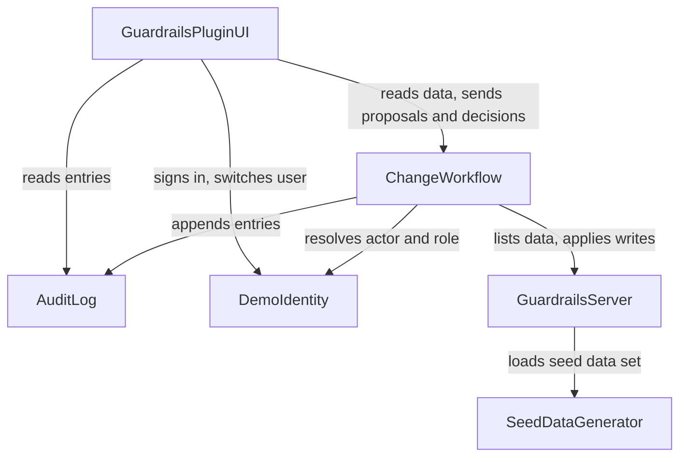

# Component Catalogue

Sources: `requirements.md` (FR/NFR), `stories.md` (US), `team-practices.md`, and answers Q1–Q5 in `domain-design-questions.md`. Decisions are in `decisions.md`. Entities are captured at ownership and shape level only; their full schema belongs to Functional Design.

```yaml
components:
  - name: GuardrailsPluginUI
    summary: The Backstage frontend plugin that shows the Guardrails card and views for a service.
    behaviour: >
      Shows the overview card, the Guardrails view (upgrade plan, CI triage, open changes, audit log)
      and the change detail screen. Offers the demo-user switch. Disables actions according to the
      allowed actions and reasons the backend returns, but never decides them; it uses the role from
      DemoIdentity for display only. Holds no data of its own.
    responsibilities:
      - Render the screens and states defined in the refined mockups
      - Collect the reason text and send propose, approve, reject and retry requests
      - Show results, errors, banners and empty states
    depends_on:
      - component: ChangeWorkflow
        interaction: reads the upgrade plan, CI failures and open changes together with the allowed actions and reasons for each, and sends proposals and decisions
        style: sync
      - component: AuditLog
        interaction: reads audit entries for the audit table
        style: sync
      - component: DemoIdentity
        interaction: signs in as a demo user and switches users
        style: sync
    dependents: []
    external_dependencies:
      - name: Backstage frontend system
        kind: other
        purpose: hosts the plugin pages and components
    entities: []

  - name: ChangeWorkflow
    summary: The Backstage backend plugin that runs proposals and decisions and enforces who may act.
    behaviour: >
      Owns the change lifecycle: propose, approve, reject, retry. Reads the acting user and role from
      the sign-in identity, never from the request. Refuses self-approval, auditor writes, second
      decisions, retry of a non-failed change and empty reasons, and records refused attempts (an
      empty reason writes nothing). Applies an approved change only through the guardrails server and
      records every outcome in the audit log. Also relays the upgrade plan and CI failures to the UI.
      For every change and every plan or CI row it returns the actions allowed to the signed-in user
      and, when an action is not allowed, the reason; the UI shows these and takes the user's role from
      DemoIdentity for display only (one source of truth for the rules).
      Order of every decision (approve, reject, retry): (1) one atomic claim moves the change from
      pending (or failed, for retry) to an internal "deciding" state, and only the caller that wins the
      claim goes on; the loser is refused and audited as in FR3.7. (2) For approve and retry, call the
      guardrails server. (3) Write the final status and the decision details to the change record.
      (4) Append the audit entry. A reject skips step 2. If step 2 fails, the change becomes failed and
      step 4 records outcome failed. If step 3 or 4 fails, the user sees an error and the change record
      is the recovery source: any change whose status is decided but which has no audit entry gets that
      entry appended the next time changes are read, built from the change record. Applying an upgrade
      that is already at the recommended version succeeds as a no-op, so a repeated apply is harmless.
      A claim not completed within 30 seconds is released to failed with the message "Interrupted".
    responsibilities:
      - Own pending, applied, rejected and failed changes
      - Enforce FR3.3, FR3.7, FR3.6, FR3.2 and proposed FR12.1 in the backend
      - Call the guardrails server to list data and to apply writes
      - Append an audit entry for every propose, decision, retry and refusal
    depends_on:
      - component: GuardrailsServer
        interaction: lists the upgrade plan and failed CI runs, applies an upgrade, re-runs a CI job
        style: sync
      - component: AuditLog
        interaction: appends an entry for every action and refusal
        style: sync
      - component: DemoIdentity
        interaction: resolves the acting user and role from the sign-in identity
        style: sync
    dependents:
      - component: GuardrailsPluginUI
        interaction: reads data and sends proposals and decisions
    external_dependencies:
      - name: Backstage backend system
        kind: other
        purpose: hosts the plugin routes and applies sign-in identity to requests
      - name: Change store
        kind: database
        purpose: keeps changes between requests
    entities:
      - name: Change
        identifier: changeId
        attributes: [kind, service, target, proposedBy, status, decidedBy, decisionReason, failureMessage, proposedAt, decidedAt]
        references:
          - entity: DemoUser
            owned_by: DemoIdentity
            relationship: each Change is proposed by one DemoUser and may be decided by another
          - entity: ServiceRecord
            owned_by: GuardrailsServer
            relationship: each Change concerns one service, referred to by its service name
          - entity: Dependency
            owned_by: GuardrailsServer
            relationship: an upgrade Change concerns one dependency, referred to by its dependency key
          - entity: CiRun
            owned_by: GuardrailsServer
            relationship: a re-run Change concerns one CI run, referred to by its run key

  - name: AuditLog
    summary: The append-only record of every action and refusal.
    behaviour: >
      Exposes only two operations: append an entry and read entries (newest first, filterable by time,
      actor, action and outcome, scoped to a service, paged). Has no operation to change or delete an
      entry, so append-only (FR4.1, NFR5) holds by construction.
    responsibilities:
      - Own audit entries
      - Accept appended entries and never alter them
      - Serve filtered, paged reads
    depends_on: []
    dependents:
      - component: GuardrailsPluginUI
        interaction: reads entries for the audit table
      - component: ChangeWorkflow
        interaction: appends an entry for every action and refusal
    external_dependencies:
      - name: Audit store
        kind: database
        purpose: keeps entries durably and in order
    entities:
      - name: AuditEntry
        identifier: entryId
        attributes: [time, actor, action, service, target, outcome, reason]
        references:
          - entity: DemoUser
            owned_by: DemoIdentity
            relationship: each AuditEntry names the DemoUser who acted
          - entity: Change
            owned_by: ChangeWorkflow
            relationship: each AuditEntry may concern one Change

  - name: DemoIdentity
    summary: The sample's sign-in provider, which owns the demo users and their roles.
    behaviour: >
      Offers three demo users (Sam, Priya, Alex) each with a fixed role (service owner, platform
      engineer, auditor). Signs a user in and switches users by issuing a different identity. The
      identity it issues is the only source of actor and role for the backend.
    responsibilities:
      - Own demo users and their roles
      - Issue the sign-in identity the backend reads
      - Support switching the signed-in demo user
    depends_on: []
    dependents:
      - component: GuardrailsPluginUI
        interaction: signs in and switches users
      - component: ChangeWorkflow
        interaction: resolves the acting user and role
    external_dependencies:
      - name: Backstage sign-in and auth backend
        kind: other
        purpose: carries the identity on every request
    entities:
      - name: DemoUser
        identifier: userId
        attributes: [name, role]

  - name: GuardrailsServer
    summary: The synthetic guardrails MCP server that stands in for the unavailable real one.
    behaviour: >
      Runs in its own container and offers four operations: list the upgrade plan for a service,
      list failed CI runs with causes, apply a dependency upgrade, re-run a CI job. Loads its data from
      the seed data set at start. Holds no approval state: an apply or re-run is performed when asked.
      Failure for testing is a start-up setting of the server (failure mode on or off), not a fifth
      tool: the plugin never calls it, and tests switch it by restarting the container. Applied
      upgrades live in the server's memory and are lost on restart, when the data is loaded again from
      the seed. Applying an upgrade that is already at the recommended version succeeds as a no-op.
    responsibilities:
      - Own the synthetic services, dependencies and CI runs
      - Serve the four operations
      - Allow a forced failure for testing
    depends_on:
      - component: SeedDataGenerator
        interaction: loads the seed data set it produces at start
        style: async
    dependents:
      - component: ChangeWorkflow
        interaction: lists data and applies writes
    external_dependencies:
      - name: MCP server runtime
        kind: other
        purpose: exposes the four operations as tools
    entities:
      - name: ServiceRecord
        identifier: serviceName
        attributes: [serviceName]
      - name: Dependency
        identifier: dependencyKey
        attributes: [serviceName, name, currentVersion, recommendedVersion]
      - name: CiRun
        identifier: runKey
        attributes: [serviceName, runNumber, status, cause]

  - name: SeedDataGenerator
    summary: The repeatable generator of the synthetic data set.
    behaviour: >
      Produces about 5 services with roughly 10 dependencies and 20 CI runs each, within 20%. Two runs
      with the same seed give identical output, byte for byte (FR7.1, FR7.2).
    responsibilities:
      - Generate the seed data set from a seed value
      - Guarantee repeatability
    depends_on: []
    dependents:
      - component: GuardrailsServer
        interaction: loads the seed data set at start
    external_dependencies: []
    entities:
      - name: SeedDataSet
        identifier: seed
        # Carries every service, dependency and CI run the server will list. Its exact shape is a
        # shared data-shape contract owned by SeedDataGenerator and filled in by Functional Design;
        # GuardrailsServer reads it and adds no data of its own.
        attributes: [seed, services, dependencies, ciRuns]
```

## Component Diagram



Text fallback: GuardrailsPluginUI calls ChangeWorkflow, AuditLog and DemoIdentity. ChangeWorkflow calls GuardrailsServer, AuditLog and DemoIdentity. GuardrailsServer loads data from SeedDataGenerator. AuditLog, DemoIdentity and SeedDataGenerator call nothing. There are no cycles.

## Component Summary

| Component | Purpose | Depends On | Dependents | Entities Owned |
|---|---|---|---|---|
| GuardrailsPluginUI | Screens and states | ChangeWorkflow, AuditLog, DemoIdentity | none | none |
| ChangeWorkflow | Change lifecycle and rule enforcement | GuardrailsServer, AuditLog, DemoIdentity | GuardrailsPluginUI | Change |
| AuditLog | Append-only record | none | GuardrailsPluginUI, ChangeWorkflow | AuditEntry |
| DemoIdentity | Demo users, roles and sign-in | none | GuardrailsPluginUI, ChangeWorkflow | DemoUser |
| GuardrailsServer | Synthetic guardrails tools | SeedDataGenerator | ChangeWorkflow | ServiceRecord, Dependency, CiRun |
| SeedDataGenerator | Repeatable synthetic data | none | GuardrailsServer | SeedDataSet |

## Entity Ownership

| Entity | Owning Component | Identifier | Attributes | References |
|---|---|---|---|---|
| Change | ChangeWorkflow | changeId | kind, service, target, proposedBy, status, decidedBy, decisionReason, failureMessage, proposedAt, decidedAt | DemoUser (proposer and decider), ServiceRecord, Dependency, CiRun |
| AuditEntry | AuditLog | entryId | time, actor, action, service, target, outcome, reason | DemoUser (actor), Change (optional) |
| DemoUser | DemoIdentity | userId | name, role | none |
| ServiceRecord | GuardrailsServer | serviceName | serviceName | none |
| Dependency | GuardrailsServer | dependencyKey | serviceName, name, currentVersion, recommendedVersion | none |
| CiRun | GuardrailsServer | runKey | serviceName, runNumber, status, cause | none |
| SeedDataSet | SeedDataGenerator | seed | seed, services, dependencies, ciRuns | none |

## External Dependencies

| Component | Dependency | Kind | Purpose |
|---|---|---|---|
| GuardrailsPluginUI | Backstage frontend system | other | Hosts pages and components |
| ChangeWorkflow | Backstage backend system | other | Hosts routes and applies the sign-in identity |
| ChangeWorkflow | Change store | database | Keeps changes between requests |
| AuditLog | Audit store | database | Keeps entries durably and in order |
| DemoIdentity | Backstage sign-in and auth backend | other | Carries the identity on every request |
| GuardrailsServer | MCP server runtime | other | Exposes the four operations as tools |

## Rationale

| Component | Why it is a separate building block |
|---|---|
| GuardrailsPluginUI | Distinct concern (presentation) and the fastest-changing part; holds no data and no rules |
| ChangeWorkflow | Distinct concern (rules and lifecycle) and distinct data (changes); every rule in FR3 lives here |
| AuditLog | Distinct concern and distinct data; its two-operation interface is what makes the log append-only by construction (ADR-001) |
| DemoIdentity | Distinct concern (who is acting) and distinct data (users and roles); the backend trusts it, not the request (ADR-003) |
| GuardrailsServer | Distinct lifecycle: it stands in for a server that exists elsewhere and ships as its own container |
| SeedDataGenerator | Distinct concern (repeatable data) and a different lifecycle: runs before the server and not at request time (ADR-004) |

**Alternatives rejected** are recorded per decision in `decisions.md`: one backend component (ADR-001), the guardrails server owning changes and audit (ADR-002), demo users inside the backend (ADR-003), and the server generating its own data (ADR-004).
