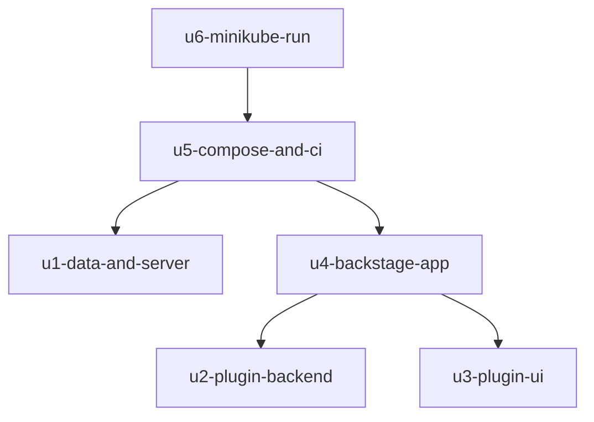

# Unit Dependencies

Sources: `unit-of-work.md`, `components.md` (component dependencies) and answer Q2 (independent units may be built at the same time). This is the dependency graph only; it names no build order and no critical path. Delivery Planning chooses the order.

## Dependency Graph



Text fallback: u4-backstage-app depends on u2-plugin-backend and u3-plugin-ui. u5-compose-and-ci depends on u1-data-and-server and u4-backstage-app. u6-minikube-run depends on u5-compose-and-ci. u1-data-and-server, u2-plugin-backend and u3-plugin-ui depend on nothing. There are no cycles.

## Reading the Edges

A unit depends on another when its code or tests need that unit's code to build or pass.

- u2 and u3 do not depend on u1 or on each other: each is tested against a stand-in for the interface it calls (the server's tool interface for u2, the backend interface for u3). The real contracts between them are fixed in Contract Design, and the stand-ins follow those contracts.
- u4 needs the compiled plugins to load them, so it depends on u2 and u3.
- u5 runs the application and the server together, so it depends on u4 (the app) and u1 (the server).
- u6 reuses what the compose run proves, so it depends on u5.

## Integration Points

| From | To | What crosses | Defined in |
|---|---|---|---|
| u3-plugin-ui | u2-plugin-backend | Reads of plan, CI, open changes and audit entries; proposals and decisions; allowed actions with reasons | Contract Design (backend interface) |
| u2-plugin-backend | u1-data-and-server | The four tool operations | Contract Design (server tool interface) |
| u1-data-and-server | u1-data-and-server | The seed data set, loaded from the generator at start | Functional Design (shared data-shape contract) |
| u4-backstage-app | u2, u3 | Plugin registration, sign-in with demo users and roles, configuration of the server address | Contract Design |

## Parallel Development Opportunities

- u1-data-and-server, u2-plugin-backend and u3-plugin-ui have no edge between them and can be built at the same time, each in its own copy of the project.
- After those, u4-backstage-app needs u2 and u3 finished; u5-compose-and-ci needs u1 and u4; u6-minikube-run needs u5.

Several valid orderings exist. This document does not pick one.

## Edge Block

```yaml
units:
  - name: u1-data-and-server
    kind: service
    depends_on: []
  - name: u2-plugin-backend
    kind: library
    depends_on: []
  - name: u3-plugin-ui
    kind: ui
    depends_on: []
  - name: u4-backstage-app
    kind: service
    depends_on: [u2-plugin-backend, u3-plugin-ui]
  - name: u5-compose-and-ci
    kind: packaging
    depends_on: [u1-data-and-server, u4-backstage-app]
  - name: u6-minikube-run
    kind: packaging
    depends_on: [u5-compose-and-ci]
```
